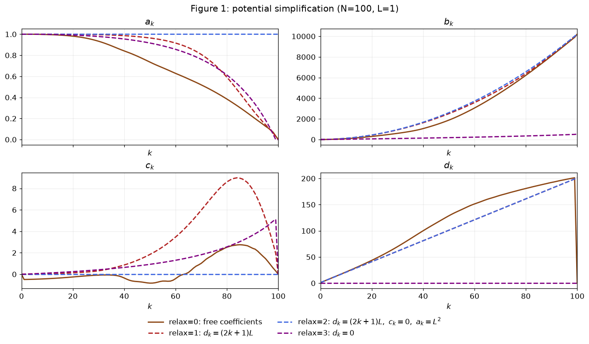
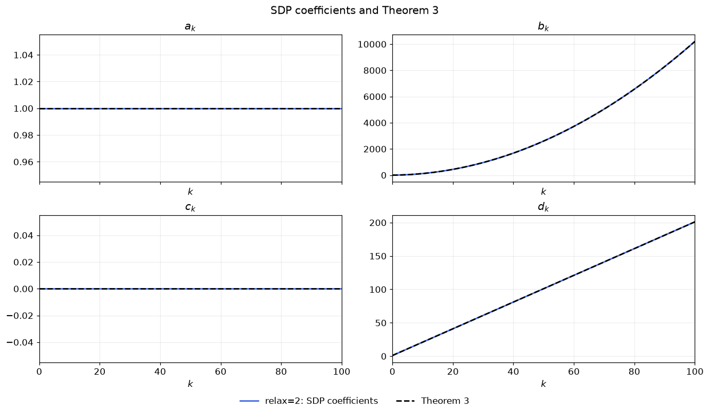

# Example I · Gradient descent: Figure 1에서 Theorem 3까지
## 1단계 · 알고리즘과 가정

$f\in\mathcal F_L$는 $L$-smooth convex function이고, $x_\star\in\arg\min f$, $f_\star=f(x_\star)$, $g_k=f'(x_k)$로 둔다. Gradient descent의 한 단계는

$$x_{k+1}=x_k-L^{-1}g_k$$

이다.

## 2단계 · Parameterized potential 설정

알고리즘과 함수 클래스가 정해졌으므로, 이제 매 단계 증가하지 않는 Lyapunov potential을 찾아 최종 gradient norm 제곱의 상한을 구한다. 다음 형태의 Lyapunov potential을 탐색하며 계수 수열을 decision variable로 둔다.

$$\phi_k^f=a_k\|x_k-x_\star\|^2+b_k\|g_k\|^2
+2c_k\langle g_k,x_k-x_\star\rangle+d_k(f(x_k)-f_\star).$$

기본 실험의 초기·최종 potential $\phi_0^f,\phi_N^f$와 Lyapunov 조건을 다음과 같이 두면

$$\phi_{k+1}^f\le\phi_k^f,\quad
\phi_0^f=L^2\|x_0-x_\star\|^2,\quad\phi_N^f=b_N\|g_N\|^2
\quad\Longrightarrow\quad
\|g_N\|^2\le\frac{L^2\|x_0-x_\star\|^2}{b_N}.$$

따라서 $b_N$이 클수록 $\|g_N\|^2$의 상한이 작아진다. 따라서 SDP는 Lyapunov 조건을 만족하는 계수 중에서 $b_N$을 최대화한다.

### 공통 실험 설정
$$L=1,\quad\texttt{m}=0,\quad\delta_k=L^{-1}.$$

## 3단계 · LMI/SDP로 계수 수치 탐색

초기·최종 계수 조건은 `relax` 값에 따라 다음과 같다.

| `relax` | $a_0$ | $a_N$ | $b_0$ | $b_N$     | $c_0$ | $c_N$ | $d_0$ | $d_N$     |
| ------- | ----- | ----- | ----- | --------- | ----- | ----- | ----- | --------- |
| 0       | $L^2$ | $0$   | $0$   | $\texttt{tau}$ | $0$   | $0$   | $0$   | $0$       |
| 1       | $L^2$ | $0$   | $0$   | $\texttt{tau}$ | $0$   | $0$   | $L$   | $(2N+1)L$ |
| 2       | $L^2$ | $L^2$ | $0$   | $\texttt{tau}$ | $0$   | $0$   | $L$   | $(2N+1)L$ |
| 3       | $L^2$ | $0$   | $0$   | $\texttt{tau}$ | $0$   | $0$   | $0$   | $0$       |

### Potential을 Gram 행렬과 함수값의 선형식으로 쓰기

최적점에서는 $g_\star=0$이고, 좌표와 함수값의 기준을 옮겨 $x_\star=0$, $f_\star=0$으로 둔다. Appendix D.4의 표기에 따라 벡터와 함수값을 다음과 같이 모은다.

$$P=[x_k\quad g_k\quad g_{k+1}],\qquad G=P^\top P\succeq0,\qquad
F=[f(x_k)\quad f(x_{k+1})]\in\mathbb R^{1\times2}.$$

#### Shorthand notations for picking up elements in the Gram matrix $G$ and in $F$
We choose $\mathbf{x}_k,\mathbf{x}_{k+1},\mathbf{x}_\star,\mathbf{g}_k,\mathbf{g}_{k+1},\mathbf{g}_\star\in\mathbb{R}^3$ and $\mathbf{f}_k,\mathbf{f}_{k+1},\mathbf{f}_\star\in\mathbb{R}^2$ such that

$$
\begin{aligned}
x_k &= P\mathbf{x}_k, & x_{k+1} &= P\mathbf{x}_{k+1}, & x_\star &= P\mathbf{x}_\star, \\
g_k &= P\mathbf{g}_k, & g_{k+1} &= P\mathbf{g}_{k+1}, & g_\star &= P\mathbf{g}_\star, \\
f_k &= F\mathbf{f}_k, & f_{k+1} &= F\mathbf{f}_{k+1}, & f_\star &= F\mathbf{f}_\star.
\end{aligned}
$$

Appendix D.4, p.36은 potential의 이차항 계수행렬을 다음과 같이 쓴다.

$$\begin{aligned}
V_k&=[\mathbf x_k-\mathbf x_\star\quad\mathbf g_k]
\begin{pmatrix}a_k&c_k\\c_k&b_k\end{pmatrix}
[\mathbf x_k-\mathbf x_\star\quad\mathbf g_k]^\top,\\
V_{k+1}&=[\mathbf x_{k+1}-\mathbf x_\star\quad\mathbf g_{k+1}]
\begin{pmatrix}a_{k+1}&c_{k+1}\\c_{k+1}&b_{k+1}\end{pmatrix}
[\mathbf x_{k+1}-\mathbf x_\star\quad\mathbf g_{k+1}]^\top.
\end{aligned}$$

그러면 potential의 이차항은 $\operatorname{Tr}(GV_k)$가 되고, 한 단계 차이는

$$\phi_{k+1}^f-\phi_k^f=\operatorname{Tr}\bigl(G(V_{k+1}-V_k)\bigr)
+F\bigl[d_{k+1}(\mathbf f_{k+1}-\mathbf f_\star)-d_k(\mathbf f_k-\mathbf f_\star)\bigr]$$

로 표현된다.

GD 업데이트를 대입하면

$$\begin{aligned}
\|x_{k+1}-x_\star\|^2&=G_{11}-\frac2L G_{12}+\frac1{L^2}G_{22},\\
\|g_{k+1}\|^2&=G_{33},\\
\langle g_{k+1},x_{k+1}-x_\star\rangle&=G_{13}-\frac1L G_{23}.
\end{aligned}$$

따라서

$$V_{k+1}-V_k=\begin{pmatrix}
a_{k+1}-a_k&-a_{k+1}/L-c_k&c_{k+1}\\
-a_{k+1}/L-c_k&a_{k+1}/L^2-b_k&-c_{k+1}/L\\
c_{k+1}&-c_{k+1}/L&b_{k+1}
\end{pmatrix}$$

이다.

### Smooth convex interpolation inequality
$\forall p,q\in \{\star,k,k+1\},$
$$f(x_p)-f(x_q)-\langle g_q,x_p-x_q\rangle -\frac1{2L}\|g_p-g_q\|^2\ge0.$$

Appendix D.4는 이를 다음 행렬로 표현한다.

$$M_{p,q}=[\mathbf x_p\quad\mathbf x_q\quad\mathbf g_p\quad\mathbf g_q]
M[\mathbf x_p\quad\mathbf x_q\quad\mathbf g_p\quad\mathbf g_q]^\top,$$

$$F(\mathbf f_p-\mathbf f_q)+\operatorname{Tr}(GM_{p,q})\ge0.$$

논문의 식 (19), p.35에서

$$M=\frac12\begin{pmatrix}
0&0&0&-1\\0&0&0&1\\
0&0&-1/L&1/L\\-1&1&1/L&-1/L
\end{pmatrix}$$

### Lagrangian
$$\begin{aligned}
&\phi_{k+1}^f-\phi_k^f+
\sum_{p\ne q}\lambda_{p,q}\bigl[F(\mathbf f_p-\mathbf f_q)+\operatorname{Tr}(GM_{p,q})\bigr]\\
&\quad=\operatorname{Tr}\left[G\left(V_{k+1}-V_k+
\sum_{p\ne q}\lambda_{p,q}M_{p,q}\right)\right]\\
&\qquad+F\left[d_{k+1}(\mathbf f_{k+1}-\mathbf f_\star)
-d_k(\mathbf f_k-\mathbf f_\star)+
\sum_{p\ne q}\lambda_{p,q}(\mathbf f_p-\mathbf f_q)\right],
\qquad\lambda_{p,q}\ge0.
\end{aligned}$$

### LMI
함수값의 계수가 0이 아니면 $F$를 바꾸어 가중합을 얼마든지 크게 만들 수 있으므로 다음 선형 등식이 필요하다.

$$d_{k+1}(\mathbf f_{k+1}-\mathbf f_\star)-d_k(\mathbf f_k-\mathbf f_\star)
+\sum_{p\ne q}\lambda_{p,q}(\mathbf f_p-\mathbf f_q)=0.$$

$F=[f(x_k)\quad f(x_{k+1})]$의 두 성분에 대한 계수를 각각 쓰면

$$\begin{aligned}
-d_k-\lambda_{\star,k}+\lambda_{k,\star}
+\lambda_{k,k+1}-\lambda_{k+1,k}&=0,\\
d_{k+1}-\lambda_{\star,k+1}-\lambda_{k,k+1}
+\lambda_{k+1,\star}+\lambda_{k+1,k}&=0.
\end{aligned}$$

그러면 행렬항만 남는다. 모든 $G\succeq0$에 대해 그 trace가 0 이하가 되도록 하는 조건이 다음 **LMI**다.

$$V_{k+1}-V_k+\sum_{p\ne q}\lambda_{p,q}M_{p,q}\preceq0.$$

### SDP
$$\boxed{\begin{aligned}
\max\quad &b_N\\
\text{s.t.}\quad &b_N\ge0,\\
&V_{k+1}-V_k+\sum_{p\ne q}\lambda_{p,q}M_{p,q}\preceq0,\\
&d_{k+1}(\mathbf f_{k+1}-\mathbf f_\star)-d_k(\mathbf f_k-\mathbf f_\star)
+\sum_{p\ne q}\lambda_{p,q}(\mathbf f_p-\mathbf f_q)=0,\\
&\lambda_{p,q}\ge0,\qquad k=0,\ldots,N-1.
\end{aligned}}$$

## 4단계 · 계수 패턴 관찰과 단순화
### $b_N^{\mathrm{opt}}$의 $N$-의존성

초기·최종 potential의 계수 조건을 유지하며 총 반복 횟수 $N$을 바꾸어, $b_N$이 얼마나 커지는지 살펴본다.

$$b_N^{\rm opt}=\max b_N\quad\text{s.t.}\quad
(\phi_k^f,\phi_{k+1}^f)\in\mathcal V_k,\quad
\phi_0^f=L^2\|x_0-x_\star\|^2,\quad\phi_N^f=b_N\|g_N\|^2.$$

여기서 $\mathcal V_k$는 Lyapunov 조건 $\phi_{k+1}^f\le\phi_k^f$를 만족하는 potential 쌍의 집합이다.

3단계의 SDP를 `relax=0`, $N\in \{1,2,3,4,5,100\}$에서 MOSEK로 풀어,
논문 p.6에 제시된 결과와 현재 실험값과 나란히 놓는다. 추가로 $N=10,20,50$도 계산한다.
| $N$ | SDP $b_N$ | $(N+1)^2$ | 논문의 근삿값 | 상대 차이 | Solver 상태 |
| --- | --- | --- | --- | --- | --- |
| 1 | 3.99999995 | 4 | 4 | -1.225e-08 | optimal |
| 2 | 8.99999999 | 9 | 9 | -7.239e-10 | optimal |
| 3 | 15.99999989 | 16 | 16 | -6.842e-09 | optimal |
| 4 | 24.99999894 | 25 | 25 | -4.226e-08 | optimal |
| 5 | 35.99999907 | 36 | 36 | -2.577e-08 | optimal |
| 10 | 120.99999952 | 121 | — | -3.949e-09 | optimal |
| 20 | 440.99999998 | 441 | — | -4.435e-11 | optimal |
| 50 | 2600.99375584 | 2601 | — | -2.401e-06 | optimal |
| 100 | 10200.94948076 | 10201 | 10201 | -4.952e-06 | optimal |

비교한 반복 횟수에서 $b_N/(N+1)^2$는 1에 가깝다. 특히 $N=100$에서는 $b_N\approx10200.9495$로, 논문의 근삿값 $10201$을 재현한다.

$$b_N^{\rm opt}\approx(N+1)^2,\qquad
\|g_N\|^2\lesssim\frac{L^2\|x_0-x_\star\|^2}{(N+1)^2}.$$

여기까지는 비교한 유한한 $N$에서 얻은 수치적 관찰이다. 이제 모든 단계에서 potential 부등식을 만족하는 계수식을 찾기 위해, $N=100$ 실험의 중간 계수들을 살펴본다.

### Figure 1: 중간 계수들을 제한하며 potential 단순화하기

같은 $N=100$에서 아래 네 설정을 비교한다.

| `relax` | 중간 계수들에 대한 제한 | 색 / 선 | $d_0$ | $a_N$ | $d_N$ |
| --- | --- | --- | --- | --- | --- |
| 0 | 없음 | 갈색 실선 | $0$ | $0$ | $0$ |
| 1 | $d_k=(2k+1)L$ | 빨간 점선 | $L$ | $0$ | $(2N+1)L$ |
| 2 | $d_k=(2k+1)L,\ c_k=0,\ a_k=L^2$ | 파란 점선 | $L$ | $L^2$ | $(2N+1)L$ |
| 3 | $d_k=0$ | 보라 점선 | $0$ | $0$ | $0$ |

모든 설정에서 $a_0=L^2$, $b_0=c_0=c_N=0$이다.

각 설정의 potential은 다음과 같다.

**`relax=0`**

$$\phi_k^f=
a_k\|x_k-x_\star\|^2+b_k\|g_k\|^2
+2c_k\langle g_k,x_k-x_\star\rangle
+d_k(f(x_k)-f_\star).$$

**`relax=1`**

$$\phi_k^f=
a_k\|x_k-x_\star\|^2+b_k\|g_k\|^2
+2c_k\langle g_k,x_k-x_\star\rangle
+(2k+1)L(f(x_k)-f_\star).$$

**`relax=2`**

$$\phi_k^f=
L^2\|x_k-x_\star\|^2+b_k\|g_k\|^2
+(2k+1)L(f(x_k)-f_\star).$$

**`relax=3`**

$$\phi_k^f=
a_k\|x_k-x_\star\|^2+b_k\|g_k\|^2
+2c_k\langle g_k,x_k-x_\star\rangle.$$

| 설정 | $b_N$ | $b_N/(N+1)^2$ | Solver 상태 |
| --- | --- | --- | --- |
| relax=0 | 10200.94948076 | 0.999995 | optimal |
| relax=1 | 10200.73009528 | 0.999974 | optimal |
| relax=2 | 10199.89142469 | 0.999891 | optimal |
| relax=3 | 517.10797950 | 0.050692 | optimal |

#### Figure 1에서 선택할 potential
##### `relax=1,2`의 결과
$c_k$를 제거하고 $a_k$를 상수 $L^2$로 거정했는데도 $b_{100}$이 약 10200이다.
즉, 복잡한 네 항을 모두 자유롭게 조절하지 않아도 다음 세 항이면 충분할 가능성이 확인된 것이다.

$$\phi_k^f=
L^2\|x_k-x_\star\|^2+b_k\|g_k\|^2
+d_k(f(x_k)-f_\star).$$

##### `relax=3`의 결과
반면 함수값 항을 아예 제거하면 $b_{100}$이 약 517로 떨어진다.
이는 $d_k(f(x_k)-f_\star)$ 항이 단순히 추가된 장식이 아니라, 충분히 빠르게 증가하는 $b_k$를 얻는 데 중요한 역할을 한다는 단서다.

이 결과를 바탕으로 다음 형태를 선택한다.

$$\boxed{\phi_k^f=L^2\|x_k-x_\star\|^2+b_k\|g_k\|^2+d_k(f(x_k)-f_\star).}$$

5단계에서는 $b_k,d_k$의 recurrence를 구하고, interpolation 부등식의 multiplier를 명시적으로 구성해 $\phi_{k+1}^f\le\phi_k^f$를 증명한다.

## 5단계 · 해석적 potential inequality와 convergence rate

따라서 네 계수는

$$\boxed{a_k=L^2,\qquad b_k=k(k+2),\qquad c_k=0,\qquad d_k=(2k+1)L.}$$

이다.

### 증명한 계수 수열과 수치해 비교하기

3·4단계에서 구한 수치 계수와 방금 증명한 계수식의 값을 비교한다. 파란 실선은 `relax=2`에서 구한 SDP 계수이고, 검정 점선은 Theorem 3의 명시적 수열이다. 두 수열을 같은 축에 그려 각 계수가 얼마나 가까운지 확인한다.

| 계수 | SDP의 $k=N$ 값 | Theorem 3의 $k=N$ 값 | 모든 상태의 최대 절대 차이 |
| --- | --- | --- | --- |
| $a_k$ | 1 | 1 | 0 |
| $b_k$ | 10199.891 | 10200 | 0.108575 |
| $c_k$ | 0 | 0 | 0 |
| $d_k$ | 201 | 201 | 0 |

같은 형태의 potential에서 수치적으로 구한 계수와 해석적으로 구한 계수는 서로 매우 가깝다. 수치해의 $b_N\approx10199.8914$와 명시적 수열의 $N(N+2)=10200$ 사이의 차이는 약 $0.1086$이며, $10200$에 대한 상대 차이는 약 $1.06\times10^{-5}$이다.

MOSEK이 반환한 값은 유한 정밀도로 계산한 근삿값이다. 위에서 해석적으로 증명한 $b_N^{\rm opt}\ge10200$은 명시적 수열이 모든 제약을 만족한다는 사실에서 나온다. 수치해가 이 하한보다 조금 낮게 출력된 것은 근사 계산에 따른 수치 오차로 해석한다.

이제 명시적으로 구한 계수 수열로 정의한 $\phi_k^f$가 Lyapunov potential이라는 성질을 이용하여 함수값과 gradient norm 제곱의 convergence rate를 얻는다.

### Telescoping으로 함수값과 gradient norm 제곱의 convergence rate 얻기

$d_0=L$, $b_0=0$으로 시작한 Theorem 3의 수열은 다음 Lyapunov potential을 준다.

$$\phi_k^f=(2k+1)L(f(x_k)-f_\star)
+k(k+2)\|g_k\|^2+L^2\|x_k-x_\star\|^2.$$

위 $\phi_k^f$는 Lyapunov potential이므로 $\phi_{j+1}^f\le\phi_j^f$가 모든 $j\ge0$에서 성립한다. 따라서

$$\phi_k^f\le\phi_0^f
=L(f(x_0)-f_\star)+L^2\|x_0-x_\star\|^2.$$

$f_\star$가 $f$의 최솟값이므로 $f(x_k)-f_\star\ge0$이고, 두 norm의 제곱도 비음수다. $L>0$, $k\ge0$에서 각 계수 $(2k+1)L$, $k(k+2)$, $L^2$도 비음수이므로, $\phi_k^f$를 구성하는 세 항은 모두 비음수다.

비음수인 세 항의 합이 $\phi_0^f$ 이하이므로, 각 항도 각각 $\phi_0^f$ 이하이다. 함수값 항과 gradient norm 제곱 항에 대해 따로 쓰면

$$\begin{aligned}
(2k+1)L(f(x_k)-f_\star)&\le\phi_k^f\le\phi_0^f,\\
k(k+2)\|g_k\|^2&\le\phi_k^f\le\phi_0^f.
\end{aligned}$$

첫 번째 식을 $(2k+1)L$로 나누면 함수값 오차의 상한을 얻는다. 두 번째 식은 $k\ge1$에서 $k(k+2)$로 나누어 gradient norm 제곱의 상한을 얻는다.

$$\boxed{\begin{aligned}
f(x_k)-f_\star&\le\frac{L(f(x_0)-f_\star)+L^2\|x_0-x_\star\|^2}{(2k+1)L}=O(k^{-1}),&&k\ge0,\\
\|g_k\|^2&\le\frac{L(f(x_0)-f_\star)+L^2\|x_0-x_\star\|^2}{k(k+2)}=O(k^{-2}),&&k\ge1.
\end{aligned}}$$
