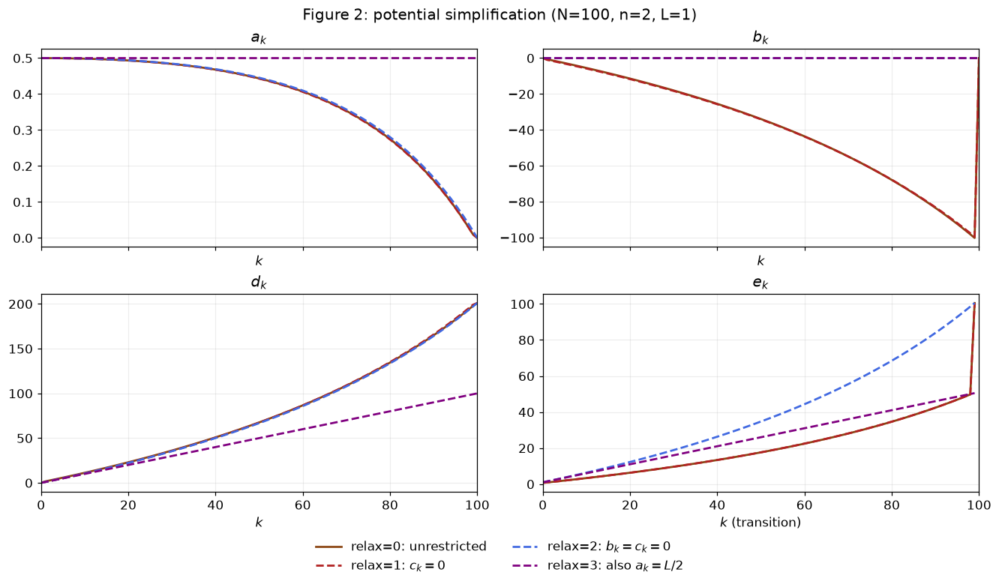
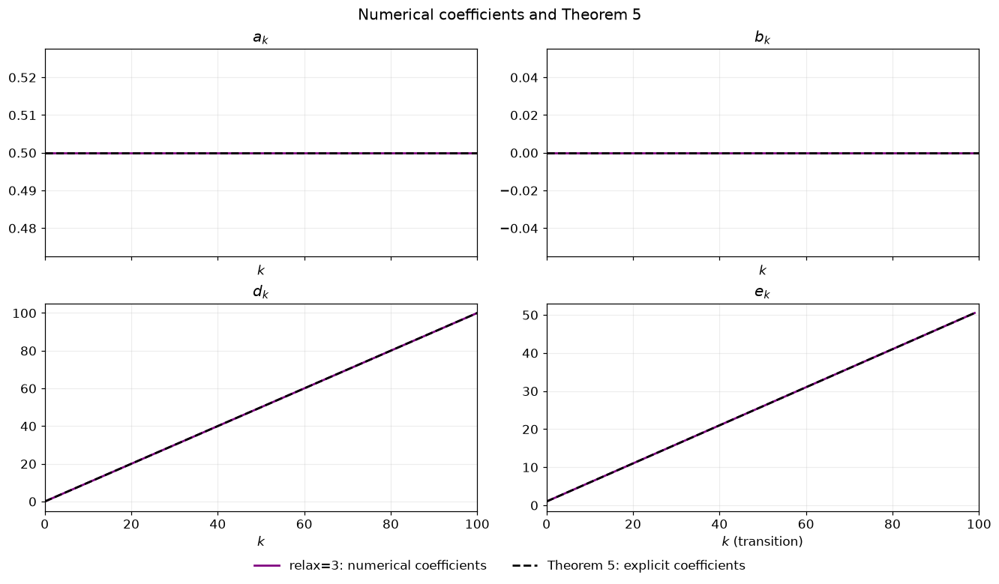

# Example II · Stochastic gradient descent: Figure 2에서 Theorem 5까지

## 1단계 · 알고리즘과 가정

$f\in\mathcal F_L$을 $L$-smooth convex 함수라 하고, $x_\star\in\arg\min f$, $f_\star=f(x_\star)$로 둔다.

SGD에서는 정확한 gradient $f'(x_k)$ 대신 stochastic gradient oracle에서 얻은 $G(x_k;i_k)$를 사용한다. 여기서 $i_k$는 1부터 $n$까지의 정수 중 균등하게 선택하며, oracle은 다음 두 조건을 만족한다고 가정한다.

$$
\begin{aligned}
\mathbb E_{i_k}[G(x_k;i_k)]&=f'(x_k),\\
\mathbb E_{i_k}\|G(x_k;i_k)-f'(x_k)\|^2&\le\sigma^2.
\end{aligned}
$$

첫 번째는 unbiased 조건이고, 두 번째는 variance가 $\sigma^2$ 이하라는 조건이다. $\mathbb E_{i_k}$는 이전 단계까지의 정보를 고정한 상태에서 현재 선택한 $i_k$에 대해 취하는 조건부 기댓값이다.

Step-size를 $\delta_k=1/L$로 고정하면 SGD의 갱신식은 다음과 같다.

$$
\boxed{x_{k+1}^{(i_k)}=x_k-\frac1L G(x_k;i_k)}
$$

## 2단계 · Parameterized potential 설정

다음 형태의 Lyapunov potential을 선택하고 계수 수열을 decision variable로 둔다.

$$
\begin{aligned}
\phi_k^f={}&\underbrace{a_k\|x_k-x_\star\|^2}_{\text{distance term}}
+\underbrace{b_k\|f'(x_k)\|^2}_{\text{squared gradient norm term}}\\
&+\underbrace{2c_k\langle f'(x_k),x_k-x_\star\rangle}_{\text{cross term}}
+\underbrace{d_k(f(x_k)-f_\star)}_{\text{function gap term}}.
\end{aligned}
$$

논문 Appendix E.7의 대칭 계수행렬은 다음과 같다.

$$Q_k=\begin{pmatrix}a_k&c_k\\c_k&b_k\end{pmatrix}\in\mathbb S^2,$$

여기서 $\mathbb S^2$는 $2\times2$ 실대칭 행렬의 집합이다.

potential의 계수 $a_k,b_k,c_k,d_k$는 $0\le k\le N$에서 정의한다. 오차 계수 $e_k$는 갱신 $k\to k+1$에 대응하므로 $0\le k<N$에서 정의한다. 초기 오차 계수는 $e_0$, 마지막 오차 계수는 $e_{N-1}$이다.

기본 실험의 초기 potential $\phi_0^f$와 마지막 potential $\phi_N^f$, 그리고 oracle의 variance에 따른 오차항을 포함한 **Lyapunov 조건**을 다음과 같이 두면

$$\begin{gathered}
\mathbb E_{i_k}[\phi_{k+1}^f]\le\phi_k^f+e_k\sigma^2,\qquad e_k\ge0,\\
\phi_0^f=\frac L2\|x_0-x_\star\|^2,\qquad
\phi_N^f=d_N(f(x_N)-f_\star)\\
\Longrightarrow\quad
\mathbb E[f(x_N)-f_\star]\le
\frac{L\|x_0-x_\star\|^2}{2d_N}
+\frac{\sum_{k=0}^{N-1}e_k}{d_N}\sigma^2.
\end{gathered}$$

따라서 $d_N$이 클수록 초기 distance term의 계수가 작아진다. 첫 번째 SDP는 $d_N$을 최대화한다. 두 번째 SDP는 그 값을 거의 유지하면서 $\sum_{k=0}^{N-1}e_k$를 최소화한다.

### 공통 실험 설정

$$L=1,\quad\mu=0,\quad\delta_k=L^{-1}.$$

강한 볼록성 계수 $\mu$는 구현의 `m`에 대응한다.

## 3단계 · LMI와 SDP 구성

`relax`별 초기·중간·마지막 계수 조건은 다음과 같다. 중간 계수의 범위는 $0<k<N$이다. `free`는 값을 미리 고정하지 않고 SDP가 결정하는 계수다. 코드의 `tau`는 $d_N$이다.

| `relax` | $a_0$ | $a_k$ | $a_N$ | $b_0$ | $b_k$ | $b_N$ | $c_0$ | $c_k$ | $c_N$ | $d_0$ | $d_k$ | $d_N$ |
| --- | --- | --- | --- | --- | --- | --- | --- | --- | --- | --- | --- | --- |
| 0 | $L/2$ | `free` | $0$ | $0$ | `free` | $0$ | $0$ | `free` | $0$ | $0$ | `free` | $\texttt{tau}$ |
| 1 | $L/2$ | `free` | $0$ | $0$ | `free` | $0$ | $0$ | $0$ | $0$ | $0$ | `free` | $\texttt{tau}$ |
| 2 | $L/2$ | `free` | $0$ | $0$ | $0$ | $0$ | $0$ | $0$ | $0$ | $0$ | `free` | $\texttt{tau}$ |
| 3 | $L/2$ | $L/2$ | $L/2$ | $0$ | $0$ | $0$ | $0$ | $0$ | $0$ | $0$ | `free` | $\texttt{tau}$ |

### Potential을 Gram 행렬과 함수값의 선형식으로 쓰기

일반성을 잃지 않고(WLOG) $x_\star=0$, $f_\star=0$으로 가정한다. 최적점에서는 $f'(x_\star)=0$이다. Appendix E.7에 따라

$$P=[x_k\quad G(x_k;1)\ \cdots\ G(x_k;n)\quad
f'(x_{k+1}^{(1)})\ \cdots\ f'(x_{k+1}^{(n)})],\qquad
G=P^\top P\succeq0,$$

$$F=[f(x_k)\quad f(x_{k+1}^{(1)})\ \cdots\ f(x_{k+1}^{(n)})]
\in\mathbb R^{1\times(n+1)}$$

로 둔다. 단독으로 쓰는 $G$는 Gram 행렬이고, $G(x_k;i)$는 stochastic gradient다.

> **Shorthand notations for picking up elements in the Gram matrix $G$ and in $F$**
>
> 실제로 선택된 인덱스는 $i_k$이고, 아래에서는 가능한 oracle 결과를 $i=1,\ldots,n$으로 열거한다. 위첨자 $(i)$는 $i$번째 oracle 결과 $G(x_k;i)$를 사용했을 때 얻는 다음 점을 나타낸다. 따라서 $x_{k+1}^{(i)}$는 벡터의 $i$번째 성분이 아니라, $n$개의 가능한 oracle 결과 중 $i$에 대응하는 점이다.
>
> Appendix E.7의 계수벡터 $\mathbf x_i,\mathbf g_i,\mathbf f_i$도 각각 이 점의 위치, gradient, 함수값에 대응하도록 정의한다.
>
> $$
> \begin{aligned}
> x_k&=P\mathbf x_0,& f'(x_k)&=P\mathbf g_0,&f(x_k)&=F\mathbf f_0,\\
> x_{k+1}^{(i)}&=P\mathbf x_i,&f'(x_{k+1}^{(i)})&=P\mathbf g_i,&f(x_{k+1}^{(i)})&=F\mathbf f_i,\\
> x_\star&=P\mathbf x_\star,&f'(x_\star)&=P\mathbf g_\star,&f_\star&=F\mathbf f_\star,\\
> G(x_k;i)&=P\mathbf G_i
> \end{aligned}
> $$
>
> 여기서 $i=1,\ldots,n$이다.
>
> Unbiasedness와 SGD 업데이트는
>
> $$
> \mathbf g_0=\frac1n\sum_{i=1}^n\mathbf G_i,\qquad
> \mathbf x_i=\mathbf x_0-\delta_k\mathbf G_i
> $$
>
> 에 반영되어 있다. $e_j$를 해당 공간의 $j$번째 표준기저벡터라 하면
>
> $$
> \mathbf x_0=e_1,\quad \mathbf G_i=e_{1+i},\quad \mathbf g_i=e_{1+n+i}\in\mathbb R^{1+2n},\qquad
> \mathbf f_0=e_1,\quad \mathbf f_i=e_{1+i}\in\mathbb R^{1+n},
> $$
>
> $$
> \mathbf x_\star=\mathbf g_\star=0,\qquad \mathbf f_\star=0
> $$
>
> 으로 둔다.

Appendix E.7은 potential의 이차항 계수행렬을 다음과 같이 쓴다.

$$\begin{aligned}
V_k&=[\mathbf x_0-\mathbf x_\star\quad\mathbf g_0]
Q_k
[\mathbf x_0-\mathbf x_\star\quad\mathbf g_0]^\top,\\
V_{k+1}^{(i)}&=[\mathbf x_i-\mathbf x_\star\quad\mathbf g_i]
Q_{k+1}
[\mathbf x_i-\mathbf x_\star\quad\mathbf g_i]^\top.
\end{aligned}$$

그러면 potential의 이차항은 $\operatorname{Tr}(GV_k)$가 되고, 한 단계 차이의 expectation은

$$\begin{aligned}
\mathbb E_{i_k}[\phi_{k+1}^f]-\phi_k^f
&=\operatorname{Tr}\!\left[G\left(\frac1n\sum_{i=1}^nV_{k+1}^{(i)}-V_k\right)\right]\\
&\quad+F\left[\frac{d_{k+1}}n\sum_{i=1}^n(\mathbf f_i-\mathbf f_\star)-d_k(\mathbf f_0-\mathbf f_\star)\right]
\end{aligned}$$

로 표현된다.

### Smooth convex interpolation inequality

Appendix E.7의 점 인덱스 집합은 $\mathcal{I}=\{\star,0,1,\ldots,n\}$이다. $0$은 $x_k$, $i$는 $x_{k+1}^{(i)}$에 해당한다. 이 절의 $x_p,g_p,f_p$는 각각 점 라벨 $p$에 대응하는 위치, gradient, 함수값을 뜻한다. $p,q\in\mathcal{I}$, $p\ne q$에 대해

$$f_p-f_q-\langle g_q,x_p-x_q\rangle
-\frac1{2L}\|g_p-g_q\|^2\ge0$$

을 사용한다. 논문의 식 (19)에서

$$M=\frac12\begin{pmatrix}
0&0&0&-1\\
0&0&0&1\\
0&0&-1/L&1/L\\
-1&1&1/L&-1/L
\end{pmatrix}$$

을 사용하면

$$M_{p,q}=[\mathbf x_p\quad\mathbf x_q\quad\mathbf g_p\quad\mathbf g_q]
M[\mathbf x_p\quad\mathbf x_q\quad\mathbf g_p\quad\mathbf g_q]^\top,$$

$$F(\mathbf f_p-\mathbf f_q)+\operatorname{Tr}(GM_{p,q})\ge0$$

으로 쓸 수 있다.

#### Variance 조건

Variance를 나타내는 행렬은

$$A_{\mathrm{var}}=\frac1n\sum_{i=1}^n
(\mathbf G_i-\mathbf g_0)(\mathbf G_i-\mathbf g_0)^\top$$

이고,

$$\operatorname{Tr}(GA_{\mathrm{var}})
=\mathbb E_i\|G(x_k;i)-f'(x_k)\|^2\le\sigma^2$$

이다. $n=2$에서는

$$A_{\mathrm{var}}=\frac14\begin{pmatrix}
0&0&0&0&0\\
0&1&-1&0&0\\
0&-1&1&0&0\\
0&0&0&0&0\\
0&0&0&0&0
\end{pmatrix}.$$

### Lagrangian

Lyapunov 조건의 모든 항을 왼쪽으로 모아 $\mathbb E_{i_k}[\phi_{k+1}^f]-\phi_k^f-e_k\sigma^2\le0$으로 쓴다. 여기에 interpolation 부등식과 variance 조건의 비음수 가중합을 더하면

$$\begin{aligned}
&\mathbb E_{i_k}[\phi_{k+1}^f]-\phi_k^f-e_k\sigma^2\\
&\quad+\sum_{p\ne q}\lambda_{p,q}
\left[F(\mathbf f_p-\mathbf f_q)+\operatorname{Tr}(GM_{p,q})\right]
+e_k\left[\sigma^2-\operatorname{Tr}(GA_{\mathrm{var}})\right]\\
&=\operatorname{Tr}\!\left[G\left(\frac1n\sum_{i=1}^nV_{k+1}^{(i)}-V_k
-e_kA_{\mathrm{var}}+\sum_{p\ne q}\lambda_{p,q}M_{p,q}\right)\right]\\
&\quad+F\left[\frac{d_{k+1}}n\sum_{i=1}^n(\mathbf f_i-\mathbf f_\star)-d_k(\mathbf f_0-\mathbf f_\star)
+\sum_{p\ne q}\lambda_{p,q}(\mathbf f_p-\mathbf f_q)\right],\\
&\lambda_{p,q}\ge0,\quad e_k\ge0.
\end{aligned}$$

$e_k\sigma^2$가 소거되어, GD의 LMI 좌변에 $-e_kA_{\mathrm{var}}$가 추가된다.

### LMI

함수값의 계수가 0이 아니면 $F$를 바꾸어 가중합을 얼마든지 크게 만들 수 있으므로 다음 선형 등식이 필요하다.

$$\frac{d_{k+1}}n\sum_{i=1}^n(\mathbf f_i-\mathbf f_\star)
-d_k(\mathbf f_0-\mathbf f_\star)
+\sum_{p\ne q}\lambda_{p,q}(\mathbf f_p-\mathbf f_q)=0.$$

$n=2$에서 $F$의 세 성분에 대한 계수를 각각 쓰면

$$\begin{aligned}
-d_k+\lambda_{0,\star}+\lambda_{0,1}+\lambda_{0,2}
-\lambda_{\star,0}-\lambda_{1,0}-\lambda_{2,0}&=0,\\
\frac{d_{k+1}}2+\lambda_{1,\star}+\lambda_{1,0}+\lambda_{1,2}
-\lambda_{\star,1}-\lambda_{0,1}-\lambda_{2,1}&=0,\\
\frac{d_{k+1}}2+\lambda_{2,\star}+\lambda_{2,0}+\lambda_{2,1}
-\lambda_{\star,2}-\lambda_{0,2}-\lambda_{1,2}&=0.
\end{aligned}$$

그러면 행렬항만 남는다. 모든 $G\succeq0$에 대해 그 trace가 0 이하가 되도록 하는 조건이 다음 **LMI**다.

$$\frac1n\sum_{i=1}^nV_{k+1}^{(i)}-V_k-e_kA_{\mathrm{var}}
+\sum_{p\ne q}\lambda_{p,q}M_{p,q}\preceq0.$$

### SDP

두 SDP의 potential 계수 조건은 위 `relax`별 표를 따른다.

첫 번째 SDP는 $d_N$을 최대화한다.

$$\boxed{\begin{aligned}
\max\quad &d_N\\
\mathrm{s.t.}\quad &d_N\ge0,\\
&\frac1n\sum_{i=1}^nV_{k+1}^{(i)}-V_k-e_kA_{\mathrm{var}}
+\sum_{p\ne q}\lambda_{p,q}M_{p,q}\preceq0,\\
&\frac{d_{k+1}}n\sum_{i=1}^n(\mathbf f_i-\mathbf f_\star)
-d_k(\mathbf f_0-\mathbf f_\star)
+\sum_{p\ne q}\lambda_{p,q}(\mathbf f_p-\mathbf f_q)=0,\\
&\lambda_{p,q}\ge0,\quad e_k\ge0,\qquad k=0,\ldots,N-1.
\end{aligned}}$$

첫 번째 SDP의 최댓값을 $d_N^{(\mathrm{opt})}$로 쓰면, 두 번째 SDP는

$$\boxed{\begin{aligned}
\min\quad &\sum_{k=0}^{N-1}e_k\\
\mathrm{s.t.}\quad &d_N\ge d_N^{(\mathrm{opt})}-10^{-5},\\
&d_N\ge0,\\
&\frac1n\sum_{i=1}^nV_{k+1}^{(i)}-V_k-e_kA_{\mathrm{var}}
+\sum_{p\ne q}\lambda_{p,q}M_{p,q}\preceq0,\\
&\frac{d_{k+1}}n\sum_{i=1}^n(\mathbf f_i-\mathbf f_\star)
-d_k(\mathbf f_0-\mathbf f_\star)
+\sum_{p\ne q}\lambda_{p,q}(\mathbf f_p-\mathbf f_q)=0,\\
&\lambda_{p,q}\ge0,\quad e_k\ge0,\qquad k=0,\ldots,N-1.
\end{aligned}}$$

이다.

## 4단계 · SDP 수치 최적화와 potential 단순화

### 함수값 계수와 오차 계수의 누적합

논문 p.8의 전략에 따라, 3단계에서 구성한 첫 번째 SDP와 두 번째 SDP를 $L=1$, $N=100$, $n=2$, `relax=0`에서 MOSEK으로 순서대로 최적화한다. 첫 번째 SDP는 $d_N$을 최대화한다. 두 번째 SDP는 첫 번째 SDP의 결과를 이용해 $d_N\ge d_N^{(\mathrm{opt})}-10^{-5}$ 제약을 추가한 뒤 $\sum_{k=0}^{N-1}e_k$를 최소화한다.

| SDP | $d_N$ | $e_{N-1}$ | $\sum_{k=0}^{N-1}e_k$ | $L/(2d_N)$ | $(\sum e_k)/d_N$ |
| --- | --- | --- | --- | --- | --- |
| 첫 번째 SDP | 201.00000890 | 226.813935 | 19236.574477 | 0.00248756 | 95.7043 |
| 두 번째 SDP | 200.99996241 | 100.503632 | 2057.522911 | 0.00248756 | 10.2364 |

$d_N$은 약 $201$을 유지하면서, 오차 계수의 누적합은 약 $19236.57$에서 $2057.52$로 줄었다. 그에 따라 variance 항의 계수도 $95.7043$에서 $10.2364$로 줄었다.

### $d_N$의 $N$-의존성

이전 「함수값 계수와 오차 계수의 누적합」의 두 SDP에 대한 `relax=0`, $n=2$의 $N$별 최적화 결과를 가져와, 논문 p.8의 $d_N\approx2N+1$, $e_{N-1}\approx(N+1/2)/L$와 비교한다. $d_N$은 두 SDP의 결과를, 오차 계수와 그 누적합은 두 번째 SDP의 결과를 제시한다.

| $N$ | 첫 번째 SDP의 $d_N$ | 두 번째 SDP의 $d_N$ | $2N+1$ | $e_{N-1}$ | $(N+1/2)/L$ | $\sum e_k$ | $(\sum e_k)/d_N$ |
| --- | --- | --- | --- | --- | --- | --- | --- |
| 1 | 3.00000000 | 2.99998998 | 3 | 1.499995 | 1.5 | 1.499995 | 0.5 |
| 2 | 4.99999996 | 4.99998996 | 5 | 2.499995 | 2.5 | 3.408561 | 0.681714 |
| 3 | 7.00000001 | 6.99999000 | 7 | 3.499995 | 3.5 | 5.692012 | 0.813146 |
| 4 | 9.00000005 | 8.99998969 | 9 | 4.500003 | 4.5 | 8.354197 | 0.928245 |
| 5 | 11.00000001 | 10.99998947 | 11 | 5.500011 | 5.5 | 11.397954 | 1.03618 |
| 10 | 21.00000004 | 20.99998769 | 21 | 10.500084 | 10.5 | 32.374726 | 1.54165 |
| 20 | 41.00000047 | 40.99998614 | 41 | 20.500262 | 20.5 | 103.224948 | 2.51768 |
| 50 | 101.00000247 | 100.99998081 | 101 | 50.501037 | 50.5 | 547.165408 | 5.41748 |
| 100 | 201.00000890 | 200.99996241 | 201 | 100.503632 | 100.5 | 2057.522911 | 10.2364 |

표에 제시한 모든 $N$에 대해

$$d_N\approx2N+1,\qquad e_{N-1}\approx\frac{N+1/2}{L}$$

이다. 표에 제시한 $N$이 커질수록 초기 distance term의 계수는 작아지고, variance 항의 계수 $(\sum e_k)/d_N$은 커진다.

### Oracle 결과 수 $n=2,10$ 비교

이전 「함수값 계수와 오차 계수의 누적합」의 두 번째 SDP에 대한 `relax=0`의 각 $(N,n)$별 최적화 결과를 가져와, $N\in\{1,2,5\}$에서 $n=2,10$을 비교한다.

| $N$ | $n=2$: $d_N$ | $n=10$: $d_N$ | $n=2$: $e_{N-1}$ | $n=10$: $e_{N-1}$ |
| --- | --- | --- | --- | --- |
| 1 | 2.99998998 | 2.99998995 | 1.499995 | 1.499995 |
| 2 | 4.99998996 | 4.99998998 | 2.499995 | 2.499997 |
| 5 | 10.99998947 | 10.99999006 | 5.500011 | 5.499995 |

표에 제시한 모든 $N$에 대해 $n=2$와 $n=10$의 $d_N$ 및 $e_{N-1}$는 각각 가깝다. $n=10$에서도 같은 증가 패턴을 얻었다.

### Figure 2: 계수들을 제한하며 potential 단순화하기

이전 「함수값 계수와 오차 계수의 누적합」의 두 번째 SDP에 대한 `relax`별 최적화 계수를 가져와, $N=100$, $n=2$에서 potential을 비교한다. 계수 조건은 3단계 표를 따른다.

| `relax` | 색 / 선 |
| --- | --- |
| 0 | 갈색 실선 |
| 1 | 빨간 점선 |
| 2 | 파란 점선 |
| 3 | 보라 점선 |

각 설정의 potential은 다음과 같다.

**`relax=0`**

$$\phi_k^f=a_k\|x_k-x_\star\|^2+b_k\|f'(x_k)\|^2
+2c_k\langle f'(x_k),x_k-x_\star\rangle
+d_k(f(x_k)-f_\star).$$

**`relax=1`**

$$\phi_k^f=a_k\|x_k-x_\star\|^2+b_k\|f'(x_k)\|^2
+d_k(f(x_k)-f_\star).$$

**`relax=2`**

$$\phi_k^f=a_k\|x_k-x_\star\|^2+d_k(f(x_k)-f_\star).$$

**`relax=3`**

$$\phi_k^f=\frac L2\|x_k-x_\star\|^2+d_k(f(x_k)-f_\star).$$

`relax=3`에서는 마지막 distance term도 유지하므로, 마지막 potential $\phi_N^f$는 다음과 같이 구분된다.

| `relax` | 초기 potential $\phi_0^f$ | 마지막 potential $\phi_N^f$ |
| --- | --- | --- |
| 0 | $\frac L2\lVert x_0-x_\star\rVert^2$ | $d_N(f(x_N)-f_\star)$ |
| 1 | $\frac L2\lVert x_0-x_\star\rVert^2$ | $d_N(f(x_N)-f_\star)$ |
| 2 | $\frac L2\lVert x_0-x_\star\rVert^2$ | $d_N(f(x_N)-f_\star)$ |
| 3 | $\frac L2\lVert x_0-x_\star\rVert^2$ | $\frac L2\lVert x_N-x_\star\rVert^2+d_N(f(x_N)-f_\star)$ |

| `relax` | $d_N$ | $e_{N-1}$ | $\sum e_k$ | $L/(2d_N)$ | $(\sum e_k)/d_N$ |
| --- | --- | --- | --- | --- | --- |
| 0 | 200.99996241 | 100.503632 | 2057.522911 | 0.00248756 | 10.2364 |
| 1 | 200.99999524 | 100.502118 | 2058.992045 | 0.00248756 | 10.2437 |
| 2 | 200.99993663 | 100.509943 | 3961.491883 | 0.00248756 | 19.7089 |
| 3 | 99.99998909 | 50.499995 | 2574.999497 | 0.005 | 25.75 |

#### Figure 2에서 선택할 potential

##### `relax=1`의 결과

cross term을 없애도 $d_{100}\approx201$을 유지하고, variance 항의 계수도 $10.2364$에서 $10.2437$로 거의 변하지 않는다.

##### `relax=2`의 결과

squared gradient norm term까지 없애도 $d_{100}\approx201$이지만, variance 항의 계수는 $19.7089$로 커진다.

##### `relax=3`의 결과

distance term의 계수를 $L/2$로 고정하면서 $d_{100}\approx100$이 된다. 이때 $d_k$와 $e_k$는 $k$에 따라 증가한다.

이 결과를 바탕으로 다음 형태를 선택한다.

$$\boxed{\phi_k^f=\frac L2\|x_k-x_\star\|^2+d_k(f(x_k)-f_\star).}$$

## 5단계 · 해석적 potential inequality와 convergence rate

Theorem 5에서 $\delta_k=L^{-1}$, $d_0=0$일 때의 계수는

$$\boxed{a_k=\frac L2,\qquad b_k=0,\qquad c_k=0,\qquad
d_k=k,\qquad e_k=\frac{k+2}{2L}.}$$

이다. 이 계수로 정의한 potential은 오차항을 포함한 Lyapunov 조건 $\mathbb E_{i_k}[\phi_{k+1}^f]\le\phi_k^f+e_k\sigma^2$를 만족한다.

이때의 potential과 계수 합은 다음과 같다.

$$\phi_k^f=\frac L2\|x_k-x_\star\|^2+k(f(x_k)-f_\star),$$

$$d_N=N,\qquad e_{N-1}=\frac{N+1}{2L},\qquad
\sum_{k=0}^{N-1}e_k=\frac{N(N+3)}{4L}.$$

### 계수 수열과 수치해 비교하기

4단계의 Figure 2 비교에서 `relax=3`의 두 번째 SDP로 얻은 계수 수열을 Theorem 5의 명시적 수열과 비교한다. 보라 실선은 이 SDP 수치해이고, 검정 점선은 Theorem 5의 명시적 수열이다.

| 계수 수열 | 마지막 항 | SDP 수치해 | Theorem 5 명시식 | 수열의 최대 절댓값 차이 |
| --- | --- | --- | --- | --- |
| $a_k$ | $a_N$ | 0.5 | 0.5 | 0 |
| $b_k$ | $b_N$ | 0 | 0 | 0 |
| $c_k$ | $c_N$ | 0 | 0 | 0 |
| $d_k$ | $d_N$ | 99.999989 | 100 | $1.10558\times10^{-5}$ |
| $e_k$ | $e_{N-1}$ | 50.499995 | 50.5 | $5.15264\times10^{-6}$ |
| $\sum_{t=0}^{k-1}e_t$ | $\sum_{t=0}^{N-1}e_t$ | 2574.9995 | 2575 | $5.02982\times10^{-4}$ |

최대 절댓값 차이는 potential의 계수와 누적합의 경우 $0\le k\le N$, 오차 계수 $e_k$의 경우 $0\le k<N$에서 계산한다.

같은 형태의 potential에서 수치적으로 구한 계수와 Theorem 5의 계수는 서로 매우 가깝다. 수치해의 $d_{100}\approx99.999989$와 정리의 $d_{100}=100$, 오차 계수의 누적합 $\sum e_k\approx2574.9995$와 $2575$가 각각 가깝게 나타난다.

### Telescoping으로 함수값의 convergence rate 얻기

위 potential은 오차항을 포함한 Lyapunov 조건 $\mathbb E_{i_k}[\phi_{k+1}^f]\le\phi_k^f+e_k\sigma^2$를 만족한다. 이 식에 전체 기댓값을 취하고 $k=0,\ldots,N-1$에 대해 합하면

$$N\mathbb E[f(x_N)-f_\star]+\frac L2\mathbb E\|x_N-x_\star\|^2
\le\frac L2\|x_0-x_\star\|^2+\frac{N(N+3)}{4L}\sigma^2$$

를 얻는다. 함수값 상한은

$$\boxed{\mathbb E[f(x_N)-f_\star]
\le\frac{L}{2N}\|x_0-x_\star\|^2+\frac{N+3}{4L}\sigma^2.}$$

초기 distance term의 계수는 $O(N^{-1})$로 작아지지만, 고정 step-size에서 variance 항의 계수는 $O(N)$로 커진다. 다음 [Averaging](Averaging_expansion_Theorem_6-7_Table_2.md)에서는 평균점을 사용했을 때 이 오차 계수가 어떻게 달라지는지 비교한다.
