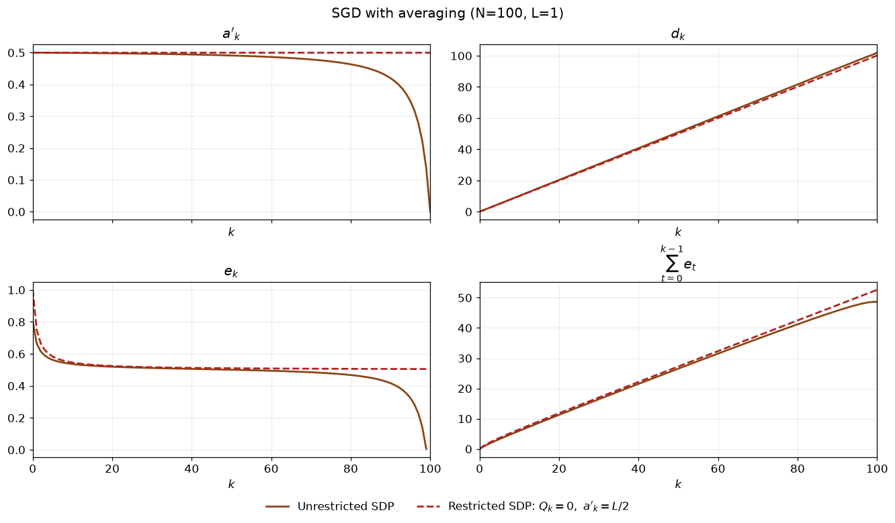
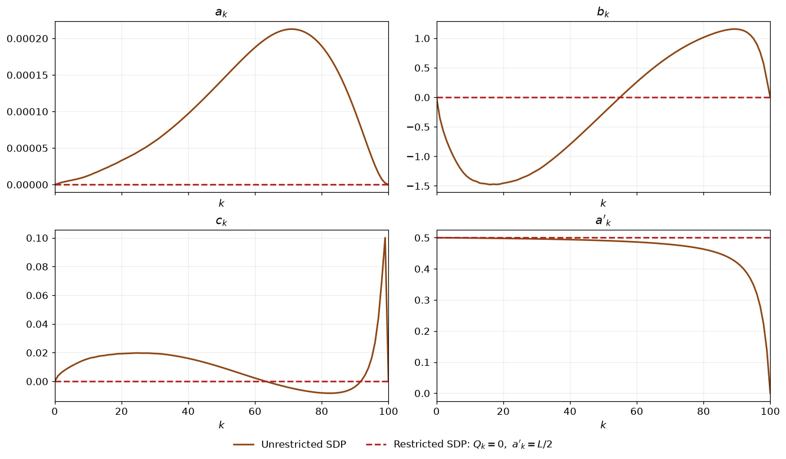
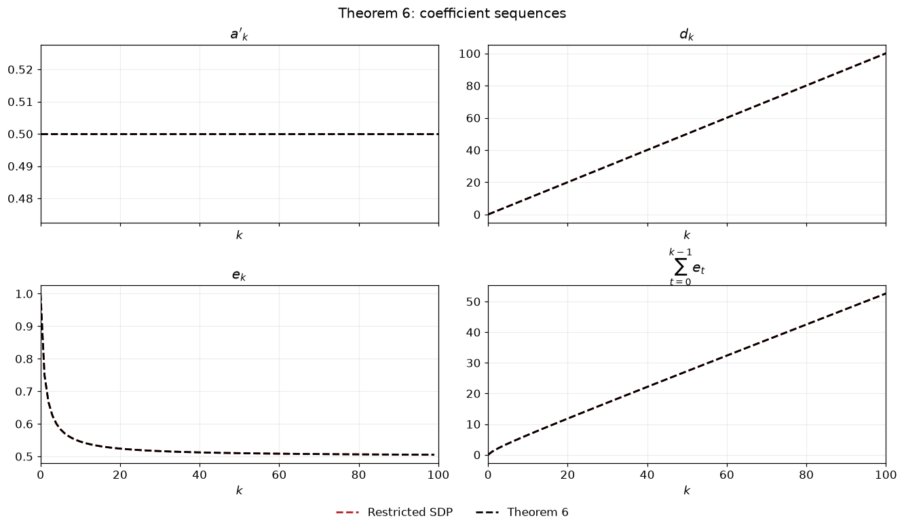
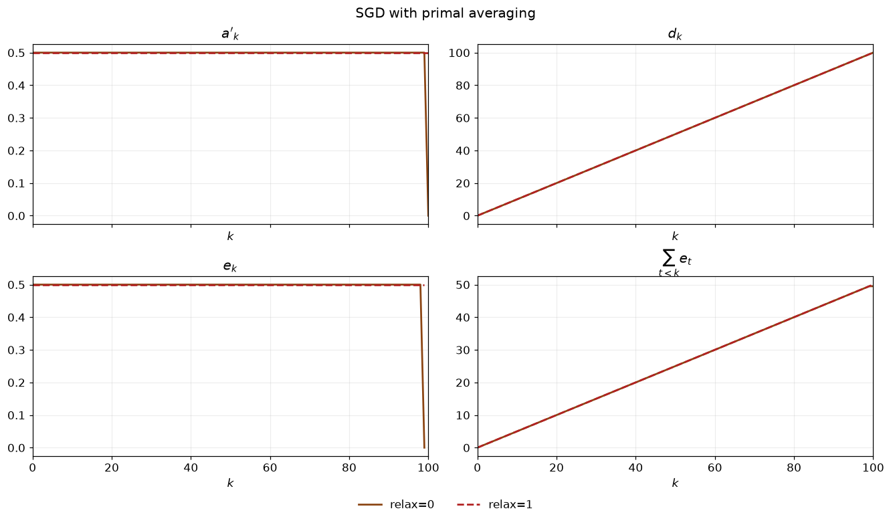
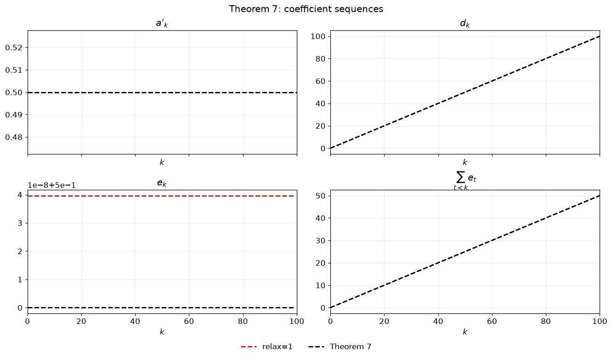
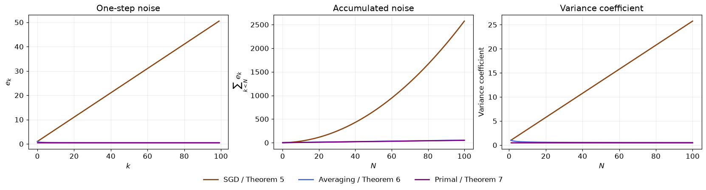
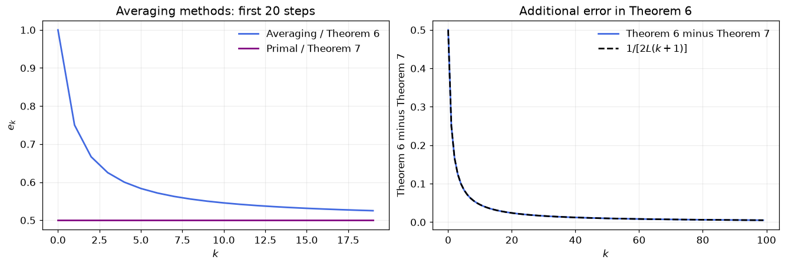
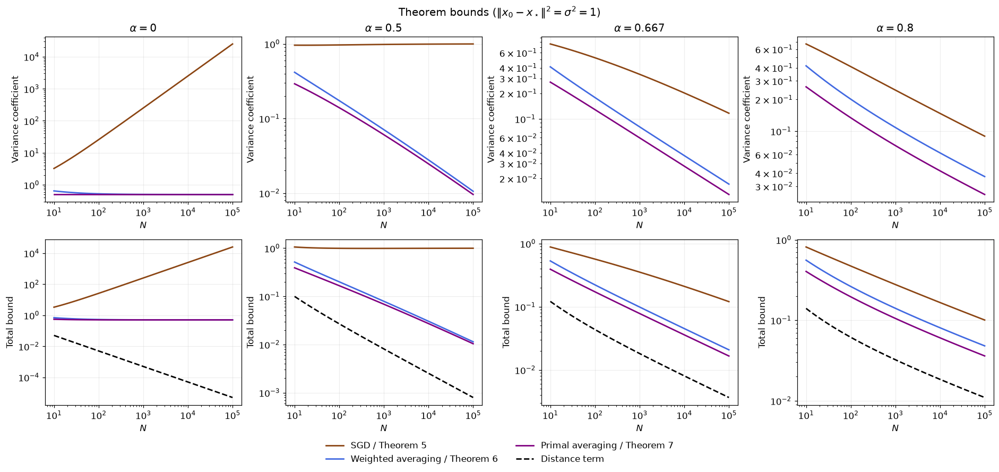
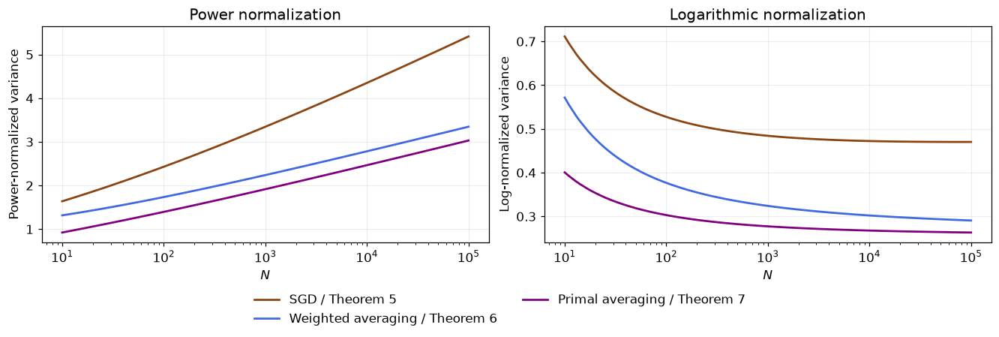
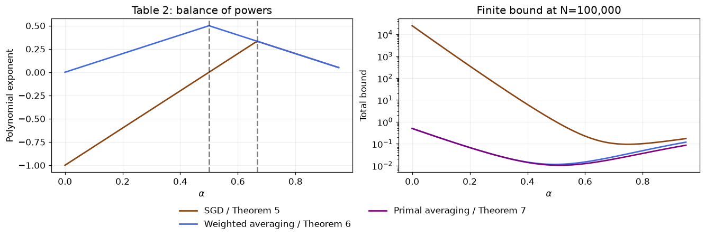

# Averaging · Theorem 6·7과 Table 2

앞선 SGD에서 $\delta_k=1/L$일 때 Theorem 5의 계수는

$$d_N=N,\qquad e_k=\frac{k+2}{2L},\qquad
\frac{\sum_{k=0}^{N-1}e_k}{d_N}=\frac{N+3}{4L}$$

이었다. 함수값 계수는 증가하지만, variance에 곱해지는 계수도 함께 증가한다. 이번에는 마지막 반복점 대신 평균점을 사용하여 이 계수를 줄인다.

## A. SGD with averaging

### 1단계 · 알고리즘과 가정

$f\in\mathcal F_L$는 $L$-smooth convex function이고, $x_\star\in\arg\min f$, $f_\star=f(x_\star)$로 둔다. Stochastic oracle은

$$\mathbb E_iG(x_k;i)=f'(x_k),\qquad
\mathbb E_i\|G(x_k;i)-f'(x_k)\|^2\le\sigma^2$$

를 만족한다. SGD with averaging의 한 단계는

$$x_{k+1}^{(i)}=x_k-L^{-1}G(x_k;i),\qquad
z_{k+1}^{(i)}=\frac{x_{k+1}^{(i)}+kz_k}{k+1}$$

이다. SGD 갱신 뒤에 새 반복점을 평균에 넣으므로

$$z_N=\frac{x_1+x_2+\cdots+x_N}{N}.$$

Oracle은 $x_k$에서 평가하고, 함수값은 평균점 $z_N$에서 평가한다.

### 2단계 · Parameterized potential 설정

평균점의 함수값 상한을 구하기 위해 다음 형태의 Lyapunov potential을 선택하고 계수 수열을 decision variable로 둔다.

$$\phi_k^f=a_k\|z_k-x_\star\|^2+b_k\|f'(z_k)\|^2
+2c_k\langle f'(z_k),z_k-x_\star\rangle
+d_k(f(z_k)-f_\star)+a'_k\|x_k-x_\star\|^2.$$

기본 실험의 초기·최종 potential $\phi_0^f,\phi_N^f$와, oracle의 variance에 따른 오차항을 포함한 **Lyapunov 조건**을 다음과 같이 두면

$$\mathbb E_i\phi_{k+1}^f\le\phi_k^f+e_k\sigma^2,\qquad
\phi_0^f=\frac L2\|x_0-x_\star\|^2,\qquad
\phi_N^f=d_N(f(z_N)-f_\star)$$

$$\Longrightarrow\quad\mathbb E[f(z_N)-f_\star]
\le\frac{L\|x_0-x_\star\|^2}{2d_N}
+\frac{\sum_{k=0}^{N-1}e_k}{d_N}\sigma^2.$$

따라서 $d_N$이 클수록 초기 거리 항의 상한이 작아진다. SDP는 먼저 $d_N$을 최대화하고, 그 값을 거의 유지하면서 $\sum_{k=0}^{N-1}e_k$를 최소화한다.

#### 공통 실험 설정

$$L=1,\quad\texttt{m}=0,\quad\delta_k=L^{-1}.$$

### 3단계 · LMI/SDP로 계수 수치 탐색

초기·최종 계수 조건은 `relax` 값에 따라 다음과 같다.

| `relax` | $a_0$ | $a_N$ | $b_0$ | $b_N$ | $c_0$ | $c_N$ | $d_0$ | $d_N$ | $a'_0$ | $a'_N$ |
| --- | --- | --- | --- | --- | --- | --- | --- | --- | --- | --- |
| 0 | $0$ | $0$ | $0$ | $0$ | $0$ | $0$ | $0$ | $\texttt{tau}$ | $L/2$ | $0$ |
| 1 | $0$ | $0$ | $0$ | $0$ | $0$ | $0$ | $0$ | $\texttt{tau}$ | $L/2$ | $L/2$ |

#### Potential을 Gram 행렬과 함수값의 선형식으로 쓰기

최적점에서는 $f'(x_\star)=0$이고, 좌표와 함수값의 기준을 옮겨 $x_\star=0$, $f_\star=0$으로 둔다. Oracle 결과를 $n=2$개, 각 결과의 확률을 $1/2$로 두고 벡터와 함수값을 다음과 같이 모은다.

$$P=[x_k\quad z_k\quad f'(z_k)\quad G(x_k;1)\quad G(x_k;2)
\quad f'(z_{k+1}^{(1)})\quad f'(z_{k+1}^{(2)})],\qquad G=P^\top P\succeq0,$$

$$F=[f(z_k)\quad f(x_k)\quad f(z_{k+1}^{(1)})\quad f(z_{k+1}^{(2)})].$$

공식 구현의 점 순서에 따라, $P$와 $F$에서 각 값을 고르는 계수벡터를 다음과 같이 둔다.

| $p$ | $P\mathbf x_p$ | $P\mathbf g_p$ | $F\mathbf f_p$ |
| --- | --- | --- | --- |
| 1 | $x_\star=0$ | $0$ | $f_\star=0$ |
| 2 | $x_k$ | $f'(x_k)$ | $f(x_k)$ |
| 3 | $z_k$ | $f'(z_k)$ | $f(z_k)$ |
| 4 | $z_{k+1}^{(1)}$ | $f'(z_{k+1}^{(1)})$ | $f(z_{k+1}^{(1)})$ |
| 5 | $z_{k+1}^{(2)}$ | $f'(z_{k+1}^{(2)})$ | $f(z_{k+1}^{(2)})$ |

Oracle 결과의 계수벡터는 Appendix E.7의 표기 $\mathbf G_i$를 사용한다.

$$P\mathbf G_1=G(x_k;1),\qquad P\mathbf G_2=G(x_k;2),\qquad
\mathbf g_2=\frac{\mathbf G_1+\mathbf G_2}{2}.$$

갱신식을 대입하면

$$x_{k+1}^{(i)}=P(\mathbf x_2-L^{-1}\mathbf G_i),\qquad
\mathbf x_{3+i}=\frac{\mathbf x_2-L^{-1}\mathbf G_i+k\mathbf x_3}{k+1},
\quad i=1,2.$$

Potential의 이차항 계수행렬은

$$\begin{aligned}
V_k={}&[\mathbf x_3-\mathbf x_1\quad\mathbf g_3]
\begin{pmatrix}a_k&c_k\\c_k&b_k\end{pmatrix}
[\mathbf x_3-\mathbf x_1\quad\mathbf g_3]^\top
+a'_k(\mathbf x_2-\mathbf x_1)(\mathbf x_2-\mathbf x_1)^\top,\\
V_{k+1}^{(i)}={}&[\mathbf x_{3+i}-\mathbf x_1\quad\mathbf g_{3+i}]
\begin{pmatrix}a_{k+1}&c_{k+1}\\c_{k+1}&b_{k+1}\end{pmatrix}
[\mathbf x_{3+i}-\mathbf x_1\quad\mathbf g_{3+i}]^\top\\
&+a'_{k+1}(\mathbf x_2-L^{-1}\mathbf G_i-\mathbf x_1)
(\mathbf x_2-L^{-1}\mathbf G_i-\mathbf x_1)^\top.
\end{aligned}$$

그러면 potential의 이차항은 $\operatorname{Tr}(GV_k)$가 되고, 한 단계 차이는

$$\begin{aligned}
\mathbb E_i\phi_{k+1}^f-\phi_k^f
={}&\operatorname{Tr}\!\left[G\left(\frac12V_{k+1}^{(1)}+\frac12V_{k+1}^{(2)}-V_k\right)\right]\\
&+F\left[\frac{d_{k+1}}2(\mathbf f_4+\mathbf f_5)-d_k\mathbf f_3\right]
\end{aligned}$$

로 표현된다.

#### Smooth convex interpolation inequality

위 다섯 점 중 서로 다른 두 점 $x_p,x_q$에 대해

$$f(x_p)-f(x_q)-\langle f'(x_q),x_p-x_q\rangle
-\frac1{2L}\|f'(x_p)-f'(x_q)\|^2\ge0.$$

Appendix D.4는 이를 다음 행렬로 표현한다.

$$M_{p,q}=[\mathbf x_p\quad\mathbf x_q\quad\mathbf g_p\quad\mathbf g_q]
M[\mathbf x_p\quad\mathbf x_q\quad\mathbf g_p\quad\mathbf g_q]^\top,$$

$$F(\mathbf f_p-\mathbf f_q)+\operatorname{Tr}(GM_{p,q})\ge0,\qquad
p,q\in\{1,2,3,4,5\},\quad p\ne q.$$

논문의 식 (19)에서

$$M=\frac12\begin{pmatrix}
0&0&0&-1\\0&0&0&1\\0&0&-1/L&1/L\\-1&1&1/L&-1/L
\end{pmatrix}.$$

Variance 조건도 행렬로 쓰면

$$A_{\rm var}=\frac12(\mathbf G_1-\mathbf g_2)(\mathbf G_1-\mathbf g_2)^\top
+\frac12(\mathbf G_2-\mathbf g_2)(\mathbf G_2-\mathbf g_2)^\top,$$

$$\operatorname{Tr}(GA_{\rm var})
=\frac12\|G(x_k;1)-f'(x_k)\|^2+\frac12\|G(x_k;2)-f'(x_k)\|^2\le\sigma^2.$$

#### Lagrangian

Potential 차이에서 $e_k\sigma^2$를 빼고, interpolation 부등식과 variance 조건의 비음수 가중합을 더한다.

$$\begin{aligned}
&\mathbb E_i\phi_{k+1}^f-\phi_k^f-e_k\sigma^2\\
&\quad+\sum_{p\ne q}\lambda_{p,q}
\left[F(\mathbf f_p-\mathbf f_q)+\operatorname{Tr}(GM_{p,q})\right]
+e_k\left[\sigma^2-\operatorname{Tr}(GA_{\rm var})\right]\\
&=\operatorname{Tr}\!\left[G\left(
\frac12V_{k+1}^{(1)}+\frac12V_{k+1}^{(2)}-V_k-e_kA_{\rm var}
+\sum_{p\ne q}\lambda_{p,q}M_{p,q}\right)\right]\\
&\quad+F\left[\frac{d_{k+1}}2(\mathbf f_4+\mathbf f_5)-d_k\mathbf f_3
+\sum_{p\ne q}\lambda_{p,q}(\mathbf f_p-\mathbf f_q)\right],\\
&\lambda_{p,q}\ge0,\quad e_k\ge0.
\end{aligned}$$

추가한 항들은 모두 비음수다. 따라서 이 식을 $0$ 이하로 만들면 $\mathbb E_i\phi_{k+1}^f\le\phi_k^f+e_k\sigma^2$를 얻는다.

#### LMI

함수값의 계수가 0이 아니면 $F$를 바꾸어 가중합을 얼마든지 크게 만들 수 있으므로 다음 선형 등식이 필요하다.

$$\frac{d_{k+1}}2(\mathbf f_4+\mathbf f_5)-d_k\mathbf f_3
+\sum_{p\ne q}\lambda_{p,q}(\mathbf f_p-\mathbf f_q)=0$$

$F$의 네 성분에 대한 식을 각각 쓰면

$$\begin{aligned}
f(z_k):\quad&-d_k+\lambda_{3,1}+\lambda_{3,2}+\lambda_{3,4}+\lambda_{3,5}
-\lambda_{1,3}-\lambda_{2,3}-\lambda_{4,3}-\lambda_{5,3}=0,\\
f(x_k):\quad&\lambda_{2,1}+\lambda_{2,3}+\lambda_{2,4}+\lambda_{2,5}
-\lambda_{1,2}-\lambda_{3,2}-\lambda_{4,2}-\lambda_{5,2}=0,\\
f(z_{k+1}^{(1)}):\quad&\frac{d_{k+1}}2+\lambda_{4,1}+\lambda_{4,2}+\lambda_{4,3}+\lambda_{4,5}
-\lambda_{1,4}-\lambda_{2,4}-\lambda_{3,4}-\lambda_{5,4}=0,\\
f(z_{k+1}^{(2)}):\quad&\frac{d_{k+1}}2+\lambda_{5,1}+\lambda_{5,2}+\lambda_{5,3}+\lambda_{5,4}
-\lambda_{1,5}-\lambda_{2,5}-\lambda_{3,5}-\lambda_{4,5}=0.
\end{aligned}$$

그러면 행렬항만 남는다. 모든 $G\succeq0$에 대해 그 trace가 0 이하가 되도록 하는 조건이 다음 **LMI**다.

$$\boxed{\frac12V_{k+1}^{(1)}+\frac12V_{k+1}^{(2)}-V_k-e_kA_{\rm var}
+\sum_{p\ne q}\lambda_{p,q}M_{p,q}\preceq0.}$$

#### SDP

**1차 최적화 · 함수값 계수 최대화**

$$\boxed{\begin{aligned}
\max\quad &d_N\\
\text{s.t.}\quad &d_N=\texttt{tau}\ge0,\\
&\frac12V_{k+1}^{(1)}+\frac12V_{k+1}^{(2)}-V_k-e_kA_{\rm var}
+\sum_{p\ne q}\lambda_{p,q}M_{p,q}\preceq0,\\
&\frac{d_{k+1}}2(\mathbf f_4+\mathbf f_5)-d_k\mathbf f_3
+\sum_{p\ne q}\lambda_{p,q}(\mathbf f_p-\mathbf f_q)=0,\\
&\lambda_{p,q}\ge0,\quad e_k\ge0,\qquad k=0,\ldots,N-1.
\end{aligned}}$$

**2차 최적화 · 오차 계수의 누적합 최소화**

$$\boxed{\begin{aligned}
\min\quad &\sum_{k=0}^{N-1}e_k\\
\text{s.t.}\quad &d_N=\texttt{tau}\ge0,\qquad d_N\ge\text{1차 최적값}-10^{-5},\\
&\frac12V_{k+1}^{(1)}+\frac12V_{k+1}^{(2)}-V_k-e_kA_{\rm var}
+\sum_{p\ne q}\lambda_{p,q}M_{p,q}\preceq0,\\
&\frac{d_{k+1}}2(\mathbf f_4+\mathbf f_5)-d_k\mathbf f_3
+\sum_{p\ne q}\lambda_{p,q}(\mathbf f_p-\mathbf f_q)=0,\\
&\lambda_{p,q}\ge0,\quad e_k\ge0,\qquad k=0,\ldots,N-1.
\end{aligned}}$$

### 4단계 · 계수 패턴 관찰과 단순화

#### 함수값 계수와 오차 계수의 누적합

3단계의 SDP를 $N=100$에서 풀어, 두 최적화의 결과를 비교한다.

| 설정 | 최적화 단계 | $d_N$ | $\sum_{k=0}^{N-1}e_k$ | $(\sum e_k)/d_N$ |
| --- | --- | --- | --- | --- |
| 0 | 1: 함수값 계수 최대화 | 102.00000086 | 5216.906032 | 51.146137 |
| 0 | 2: 누적 오차 최소화 | 101.99990306 | 48.634944 | 0.476814 |
| 1 | 1: 함수값 계수 최대화 | 100.11848875 | 28319.771650 | 282.862556 |
| 1 | 2: 누적 오차 최소화 | 100.11846808 | 52.604190 | 0.525419 |

`relax=0`에서는 $d_N\approx102$를 유지하면서 $\sum e_k$가 약 $5216.91$에서 $48.63$으로 줄었다. `relax=1`에서는 $d_N\approx100.12$를 유지하면서 $\sum e_k$가 약 $28319.77$에서 $52.60$으로 줄었다.

이제 두 번째 최적화에서 얻은 중간 계수들을 살펴본다.

#### 중간 계수들을 제한하며 potential 단순화하기

같은 $N=100$에서 아래 두 설정을 비교한다.

| `relax` | 중간 계수들에 대한 제한 | 색 / 선 | $a'_0$ | $a'_N$ |
| --- | --- | --- | --- | --- |
| 0 | 없음 | 갈색 실선 | $L/2$ | $0$ |
| 1 | $a_k=b_k=c_k=0,\ a'_k=L/2$ | 빨간 점선 | $L/2$ | $L/2$ |

각 설정의 potential은 다음과 같다.

**`relax=0`**

$$\phi_k^f=a_k\|z_k-x_\star\|^2+b_k\|f'(z_k)\|^2
+2c_k\langle f'(z_k),z_k-x_\star\rangle
+d_k(f(z_k)-f_\star)+a'_k\|x_k-x_\star\|^2.$$

$$\phi_0^f=\frac L2\|x_0-x_\star\|^2,\qquad
\phi_N^f=d_N(f(z_N)-f_\star).$$

**`relax=1`**

$$\phi_k^f=d_k(f(z_k)-f_\star)+\frac L2\|x_k-x_\star\|^2.$$

$$\phi_0^f=\frac L2\|x_0-x_\star\|^2,\qquad
\phi_N^f=d_N(f(z_N)-f_\star)+\frac L2\|x_N-x_\star\|^2.$$

평균점의 이차항 계수 $a_k,b_k,c_k$도 함께 살펴본다.

`relax=1`은 $a_k,b_k,c_k$를 모두 $0$으로 두었는데도 $d_{100}\approx100.12$를 얻는다. $e_k$도 SGD처럼 $k$에 비례해 증가하지 않고, 약 $1/(2L)$로 가까워진다.

이 결과를 바탕으로 다음 형태를 선택한다.

$$\boxed{\phi_k^f=d_k(f(z_k)-f_\star)+\frac L2\|x_k-x_\star\|^2.}$$

### 5단계 · 해석적 potential inequality와 convergence rate

Theorem 6에 $\delta_k=1/L$, averaging weight $k$를 적용하면 계수는

$$\boxed{a_k=0,\qquad b_k=0,\qquad c_k=0,\qquad d_k=k,\qquad a'_k=\frac L2,\qquad
 e_k=\frac1{2L}\left(1+\frac1{k+1}\right).}$$

이다. 이 계수로 정의한 potential은 오차항을 포함한 Lyapunov 조건 $\mathbb E_i[\phi_{k+1}^f]\le\phi_k^f+e_k\sigma^2$를 만족한다.

#### Theorem 6의 계수 수열과 수치해 비교하기

3·4단계에서 구한 수치 계수와 Theorem 6의 계수식의 값을 비교한다. 빨간 점선은 `relax=1`에서 구한 SDP 계수이고, 검정 점선은 Theorem 6의 수열이다.

| 계수 수열 | $d_N$ | $\sum_{k=0}^{N-1}e_k$ | $(\sum e_k)/d_N$ |
| --- | --- | --- | --- |
| relax=1 수치해 | 100.11846808 | 52.60419013 | 0.52541945 |
| Theorem 6 | 100.00000000 | 52.59368876 | 0.52593689 |

같은 형태의 potential에서 수치적으로 구한 계수와 Theorem 6의 계수는 서로 가깝다. 수치해는 $d_N$과 $\sum e_k$가 모두 조금 더 크고, 최종 상한에 들어가는 비율 $(\sum e_k)/d_N$은 조금 더 작다.

#### Telescoping으로 평균점의 함수값 상한 얻기

Theorem 6의 수열은 다음 potential을 준다.

$$\phi_k^f=k(f(z_k)-f_\star)+\frac L2\|x_k-x_\star\|^2.$$

위 potential은 오차항을 포함한 Lyapunov 조건 $\mathbb E_i[\phi_{k+1}^f]\le\phi_k^f+e_k\sigma^2$를 만족한다. 이 식에 전체 기댓값을 취하고 $k=0,\ldots,N-1$에 대해 합하면

$$N\mathbb E[f(z_N)-f_\star]+\frac L2\mathbb E\|x_N-x_\star\|^2
\le\frac L2\|x_0-x_\star\|^2+\frac{N+\sum_{j=1}^N1/j}{2L}\sigma^2.$$

따라서

$$\boxed{\mathbb E[f(z_N)-f_\star]
\le\frac{L\|x_0-x_\star\|^2}{2N}
+\frac{\sigma^2}{2L}\left(1+\frac{\sum_{j=1}^N1/j}{N}\right).}$$

SGD에서 $(N+3)/(4L)$로 증가하던 variance 계수는 averaging에서 $1/(2L)$로 수렴한다.

## B. Primal averaging

### 1단계 · 알고리즘과 가정

$f\in\mathcal F_L$는 $L$-smooth convex function이고, $x_\star\in\arg\min f$, $f_\star=f(x_\star)$로 둔다. Primal averaging의 한 단계는

$$y_{k+1}=\frac{ky_k+x_k}{k+1},\qquad
x_{k+1}^{(i)}=x_k-L^{-1}G(y_{k+1};i)$$

이다. 평균점을 먼저 만든 뒤 그 점에서 oracle을 평가하며,

$$\mathbb E_iG(y_{k+1};i)=f'(y_{k+1}),\qquad
\mathbb E_i\|G(y_{k+1};i)-f'(y_{k+1})\|^2\le\sigma^2$$

로 둔다. 평균점 $y_{k+1}$은 이번 oracle 결과가 나오기 전에 정해진다. 따라서 출력은

$$y_N=\frac{x_0+x_1+\cdots+x_{N-1}}N.$$

### 2단계 · Parameterized potential 설정

평균점 $y_k$의 함수값과 SGD 반복점 $x_k$의 거리항을 넣어 다음 형태의 Lyapunov potential을 선택한다.

$$\phi_k^f=a_k\|y_k-x_\star\|^2+b_k\|f'(y_k)\|^2
+2c_k\langle f'(y_k),y_k-x_\star\rangle
+d_k(f(y_k)-f_\star)+a'_k\|x_k-x_\star\|^2.$$

이번에는 $d_k$가 평균 갱신식에도 들어간다. $d_0=0$, $d_{k+1}=d_k+L\delta_k$로 두면 현재 step-size에서는 $d_k=k$이다.

기본 실험의 초기·최종 potential과, oracle의 variance에 따른 오차항을 포함한 **Lyapunov 조건**을 다음과 같이 두면

$$\mathbb E_i\phi_{k+1}^f\le\phi_k^f+e_k\sigma^2,\qquad
\phi_0^f=\frac L2\|x_0-x_\star\|^2,\qquad
\phi_N^f=N(f(y_N)-f_\star)$$

$$\Longrightarrow\quad\mathbb E[f(y_N)-f_\star]
\le\frac{L\|x_0-x_\star\|^2}{2N}
+\frac{\sum_{k=0}^{N-1}e_k}{N}\sigma^2.$$

따라서 $d_k=k$로 고정하고, 나머지 potential 계수 중에서 $\sum_{k=0}^{N-1}e_k$를 최소화한다.

#### 공통 실험 설정

$$L=1,\quad\texttt{m}=0,\quad\delta_k=L^{-1}.$$

### 3단계 · LMI/SDP로 계수 수치 탐색

초기·최종 계수 조건은 `relax` 값에 따라 다음과 같다.

| `relax` | $a_0$ | $a_N$ | $b_0$ | $b_N$ | $c_0$ | $c_N$ | $d_0$ | $d_N$ | $a'_0$ | $a'_N$ |
| --- | --- | --- | --- | --- | --- | --- | --- | --- | --- | --- |
| 0 | $0$ | $0$ | $0$ | $0$ | $0$ | $0$ | $0$ | $N$ | $L/2$ | $0$ |
| 1 | $0$ | $0$ | $0$ | $0$ | $0$ | $0$ | $0$ | $N$ | $L/2$ | $L/2$ |

#### Potential을 Gram 행렬과 함수값의 선형식으로 쓰기

최적점에서는 $f'(x_\star)=0$이고, 좌표와 함수값의 기준을 옮겨 $x_\star=0$, $f_\star=0$으로 둔다. Oracle 결과를 $n=2$개, 각 결과의 확률을 $1/2$로 두고 벡터와 함수값을 다음과 같이 모은다.

$$P=[x_k\quad y_k\quad f'(y_k)\quad G(y_{k+1};1)\quad G(y_{k+1};2)],
\qquad G=P^\top P\succeq0,\qquad F=[f(y_k)\quad f(y_{k+1})].$$

공식 구현의 점 순서에 따라, $P$와 $F$에서 각 값을 고르는 계수벡터를 다음과 같이 둔다.

| $p$ | $P\mathbf x_p$ | $P\mathbf g_p$ | $F\mathbf f_p$ |
| --- | --- | --- | --- |
| 1 | $x_\star=0$ | $0$ | $f_\star=0$ |
| 2 | $y_k$ | $f'(y_k)$ | $f(y_k)$ |
| 3 | $y_{k+1}$ | $f'(y_{k+1})$ | $f(y_{k+1})$ |

SGD 반복점과 oracle 결과의 계수벡터는

$$P\mathbf x_0=x_k,\qquad
P\mathbf G_1=G(y_{k+1};1),\qquad P\mathbf G_2=G(y_{k+1};2),\qquad
\mathbf g_3=\frac{\mathbf G_1+\mathbf G_2}{2}$$

로 둔다. 갱신식을 대입하면

$$\mathbf x_3=\frac{k\mathbf x_2+\mathbf x_0}{k+1},\qquad
x_{k+1}^{(i)}=P(\mathbf x_0-L^{-1}\mathbf G_i),\quad i=1,2.$$

Potential의 이차항 계수행렬은

$$\begin{aligned}
V_k={}&[\mathbf x_2-\mathbf x_1\quad\mathbf g_2]
\begin{pmatrix}a_k&c_k\\c_k&b_k\end{pmatrix}
[\mathbf x_2-\mathbf x_1\quad\mathbf g_2]^\top
+a'_k(\mathbf x_0-\mathbf x_1)(\mathbf x_0-\mathbf x_1)^\top,\\
V_{k+1}^{(i)}={}&[\mathbf x_3-\mathbf x_1\quad\mathbf g_3]
\begin{pmatrix}a_{k+1}&c_{k+1}\\c_{k+1}&b_{k+1}\end{pmatrix}
[\mathbf x_3-\mathbf x_1\quad\mathbf g_3]^\top\\
&+a'_{k+1}(\mathbf x_0-L^{-1}\mathbf G_i-\mathbf x_1)
(\mathbf x_0-L^{-1}\mathbf G_i-\mathbf x_1)^\top.
\end{aligned}$$

그러면 potential의 이차항은 $\operatorname{Tr}(GV_k)$가 되고, 한 단계 차이는

$$\begin{aligned}
\mathbb E_i\phi_{k+1}^f-\phi_k^f
={}&\operatorname{Tr}\!\left[G\left(\frac12V_{k+1}^{(1)}+\frac12V_{k+1}^{(2)}-V_k\right)\right]\\
&+F\left[d_{k+1}\mathbf f_3-d_k\mathbf f_2\right]
\end{aligned}$$

로 표현된다.

#### Smooth convex interpolation inequality

위 세 점 중 서로 다른 두 점 $x_p,x_q$에 대해

$$f(x_p)-f(x_q)-\langle f'(x_q),x_p-x_q\rangle
-\frac1{2L}\|f'(x_p)-f'(x_q)\|^2\ge0.$$

Appendix D.4는 이를 다음 행렬로 표현한다.

$$M_{p,q}=[\mathbf x_p\quad\mathbf x_q\quad\mathbf g_p\quad\mathbf g_q]
M[\mathbf x_p\quad\mathbf x_q\quad\mathbf g_p\quad\mathbf g_q]^\top,$$

$$F(\mathbf f_p-\mathbf f_q)+\operatorname{Tr}(GM_{p,q})\ge0,\qquad
p,q\in\{1,2,3\},\quad p\ne q.$$

논문의 식 (19)에서

$$M=\frac12\begin{pmatrix}
0&0&0&-1\\0&0&0&1\\0&0&-1/L&1/L\\-1&1&1/L&-1/L
\end{pmatrix}.$$

Variance 조건도 행렬로 쓰면

$$A_{\rm var}=\frac12(\mathbf G_1-\mathbf g_3)(\mathbf G_1-\mathbf g_3)^\top
+\frac12(\mathbf G_2-\mathbf g_3)(\mathbf G_2-\mathbf g_3)^\top,$$

$$\operatorname{Tr}(GA_{\rm var})
=\frac12\|G(y_{k+1};1)-f'(y_{k+1})\|^2+\frac12\|G(y_{k+1};2)-f'(y_{k+1})\|^2\le\sigma^2.$$

#### Lagrangian

Potential 차이에서 $e_k\sigma^2$를 빼고, interpolation 부등식과 variance 조건의 비음수 가중합을 더한다.

$$\begin{aligned}
&\mathbb E_i\phi_{k+1}^f-\phi_k^f-e_k\sigma^2\\
&\quad+\sum_{p\ne q}\lambda_{p,q}
\left[F(\mathbf f_p-\mathbf f_q)+\operatorname{Tr}(GM_{p,q})\right]
+e_k\left[\sigma^2-\operatorname{Tr}(GA_{\rm var})\right]\\
&=\operatorname{Tr}\!\left[G\left(
\frac12V_{k+1}^{(1)}+\frac12V_{k+1}^{(2)}-V_k-e_kA_{\rm var}
+\sum_{p\ne q}\lambda_{p,q}M_{p,q}\right)\right]\\
&\quad+F\left[d_{k+1}\mathbf f_3-d_k\mathbf f_2
+\sum_{p\ne q}\lambda_{p,q}(\mathbf f_p-\mathbf f_q)\right],\\
&\lambda_{p,q}\ge0,\quad e_k\ge0.
\end{aligned}$$

추가한 항들은 모두 비음수다. 따라서 이 식을 $0$ 이하로 만들면 $\mathbb E_i\phi_{k+1}^f\le\phi_k^f+e_k\sigma^2$를 얻는다.

#### LMI

함수값의 계수가 0이 아니면 $F$를 바꾸어 가중합을 얼마든지 크게 만들 수 있으므로 다음 선형 등식이 필요하다.

$$d_{k+1}\mathbf f_3-d_k\mathbf f_2
+\sum_{p\ne q}\lambda_{p,q}(\mathbf f_p-\mathbf f_q)=0.$$

두 성분을 각각 쓰면

$$\begin{aligned}
f(y_k):\quad&-d_k+\lambda_{2,1}+\lambda_{2,3}-\lambda_{1,2}-\lambda_{3,2}=0,\\
f(y_{k+1}):\quad&d_{k+1}+\lambda_{3,1}+\lambda_{3,2}-\lambda_{1,3}-\lambda_{2,3}=0.
\end{aligned}$$

그러면 행렬항만 남는다. 모든 $G\succeq0$에 대해 그 trace가 0 이하가 되도록 하는 조건이 다음 **LMI**다.

$$\frac12V_{k+1}^{(1)}+\frac12V_{k+1}^{(2)}-V_k-e_kA_{\rm var}
+\sum_{p\ne q}\lambda_{p,q}M_{p,q}\preceq0.$$

#### SDP

$$\boxed{\begin{aligned}
\min\quad&\sum_{k=0}^{N-1}e_k\\
\text{s.t.}\quad&
\frac12V_{k+1}^{(1)}+\frac12V_{k+1}^{(2)}-V_k-e_kA_{\rm var}
+\sum_{p\ne q}\lambda_{p,q}M_{p,q}\preceq0,\\
&d_{k+1}\mathbf f_3-d_k\mathbf f_2
+\sum_{p\ne q}\lambda_{p,q}(\mathbf f_p-\mathbf f_q)=0,\\
&\lambda_{p,q}\ge0,\quad e_k\ge0,\quad d_k=k,
\qquad k=0,\ldots,N-1.
\end{aligned}}$$

### 4단계 · 계수 패턴 관찰과 단순화

#### 중간 계수들을 제한하며 potential 단순화하기

같은 $N=100$에서 아래 두 설정을 비교한다. 두 설정 모두 $d_k=k$이다.

| `relax` | 중간 계수들에 대한 제한 | 색 / 선 | $a'_0$ | $a'_N$ |
| --- | --- | --- | --- | --- |
| 0 | $d_k=k$ | 갈색 실선 | $L/2$ | $0$ |
| 1 | $a_k=b_k=c_k=0,\ d_k=k,\ a'_k=L/2$ | 빨간 점선 | $L/2$ | $L/2$ |

각 설정의 potential은 다음과 같다.

**`relax=0`**

$$\phi_k^f=a_k\|y_k-x_\star\|^2+b_k\|f'(y_k)\|^2
+2c_k\langle f'(y_k),y_k-x_\star\rangle
+k(f(y_k)-f_\star)+a'_k\|x_k-x_\star\|^2.$$

$$\phi_0^f=\frac L2\|x_0-x_\star\|^2,\qquad
\phi_N^f=N(f(y_N)-f_\star).$$

**`relax=1`**

$$\phi_k^f=k(f(y_k)-f_\star)+\frac L2\|x_k-x_\star\|^2.$$

$$\phi_0^f=\frac L2\|x_0-x_\star\|^2,\qquad
\phi_N^f=N(f(y_N)-f_\star)+\frac L2\|x_N-x_\star\|^2.$$

| 설정 | $d_N$ | $a'_N$ | $e_{N-1}$ | $\sum_{k=0}^{N-1}e_k$ | $(\sum e_k)/d_N$ |
| --- | --- | --- | --- | --- | --- |
| 0 | 100 | 0 | 1.35695e-07 | 49.5 | 0.495 |
| 1 | 100 | 0.5 | 0.5 | 50 | 0.5 |

`relax=0`에서는 마지막 오차 계수가 거의 $0$이고, `relax=1`에서는 약 $0.5$이다. $y_N$은 마지막 oracle 호출 전에 정해지므로, 최종 potential이 $N(f(y_N)-f_\star)$이면 마지막 stochastic 갱신의 오차가 들어가지 않는다. 최종 거리항을 유지하면 이 오차가 남는다.

`relax=1`의 $e_k$는 전체 단계에서 거의 일정하다. 이 결과를 바탕으로 다음 형태를 선택한다.

$$\boxed{\phi_k^f=k(f(y_k)-f_\star)+\frac L2\|x_k-x_\star\|^2.}$$

### 5단계 · 해석적 potential inequality와 convergence rate

Theorem 7에 $\delta_k=1/L$, $d_0=0$을 적용하면 계수는

$$\boxed{a_k=0,\qquad b_k=0,\qquad c_k=0,\qquad d_k=k,\qquad a'_k=\frac L2,\qquad e_k=\frac1{2L}.}$$

이다. 이 계수로 정의한 potential은 오차항을 포함한 Lyapunov 조건 $\mathbb E_i[\phi_{k+1}^f]\le\phi_k^f+e_k\sigma^2$를 만족한다.

#### Theorem 7의 계수 수열과 수치해 비교하기

3·4단계에서 구한 수치 계수와 Theorem 7의 계수식의 값을 비교한다. 빨간 점선은 `relax=1`에서 구한 SDP 계수이고, 검정 점선은 Theorem 7의 수열이다.

| 계수 | 수치해의 마지막 값 | Theorem 7의 마지막 값 | 수열의 최대 절댓값 차이 |
| --- | --- | --- | --- |
| $a'_k$ | 0.5 | 0.5 | 0.000e+00 |
| $d_k$ | 100 | 100 | 0.000e+00 |
| $e_k$ | 0.50000004 | 0.5 | 3.968e-08 |
| $\sum_{t=0}^{k-1}e_t$ | 50.000004 | 50 | 3.968e-06 |

수치해의 $e_k$는 전체 단계에서 $1/(2L)=0.5$에 가깝다. Averaging의 $e_k$에 있던 $1/[2L(k+1)]$ 항이 여기서는 없다.

#### Telescoping으로 평균점의 함수값 상한 얻기

Theorem 7의 수열은 다음 potential을 준다.

$$\phi_k^f=k(f(y_k)-f_\star)+\frac L2\|x_k-x_\star\|^2.$$

위 potential은 오차항을 포함한 Lyapunov 조건 $\mathbb E_i[\phi_{k+1}^f]\le\phi_k^f+e_k\sigma^2$를 만족한다. 이 식에 전체 기댓값을 취하고 $k=0,\ldots,N-1$에 대해 합하면

$$N\mathbb E[f(y_N)-f_\star]+\frac L2\mathbb E\|x_N-x_\star\|^2
\le\frac L2\|x_0-x_\star\|^2+\frac N{2L}\sigma^2.$$

따라서

$$\boxed{\mathbb E[f(y_N)-f_\star]
\le\frac{L\|x_0-x_\star\|^2}{2N}+\frac{\sigma^2}{2L}.}$$

## C. 세 방법 비교 · Table 2

Theorem 5·6·7의 $e_k$와 함수값 계수를 같은 기준으로 비교한다.

### 1. 고정 step-size에서 비교

$\delta_k=1/L$이고 초기 함수값 계수가 $0$이면 세 정리의 최종 함수값 계수는 모두 $N$이다.

| 방법 | 출력 | $e_k$ | $\sum_{k=0}^{N-1}e_k$ | $\sigma^2$의 계수 |
| --- | --- | --- | --- | --- |
| SGD · Theorem 5 | $x_N$ | $(k+2)/(2L)$ | $N(N+3)/(4L)$ | $(N+3)/(4L)$ |
| Averaging · Theorem 6 | $z_N$ | $(1+1/(k+1))/(2L)$ | $(N+\sum_{j=1}^N1/j)/(2L)$ | $(1+N^{-1}\sum_{j=1}^N1/j)/(2L)$ |
| Primal averaging · Theorem 7 | $y_N$ | $1/(2L)$ | $N/(2L)$ | $1/(2L)$ |

세 함수값 상한을 각각 쓰면 다음과 같다.

**SGD**

$$\mathbb E[f(x_N)-f_\star]
\le\frac{L\|x_0-x_\star\|^2}{2N}+\frac{N+3}{4L}\sigma^2.$$

**Averaging**

$$\mathbb E[f(z_N)-f_\star]
\le\frac{L\|x_0-x_\star\|^2}{2N}
+\frac1{2L}\left(1+\frac{\sum_{j=1}^N1/j}{N}\right)\sigma^2.$$

**Primal averaging**

$$\mathbb E[f(y_N)-f_\star]
\le\frac{L\|x_0-x_\star\|^2}{2N}+\frac1{2L}\sigma^2.$$

$N=100$, $L=1$에서 계수는 다음과 같다.

| 방법 | $\sum e_k$ | 명시적 합 | Variance coefficient | 초기 거리 계수 |
| --- | --- | --- | --- | --- |
| SGD / Theorem 5 | 2575 | 2575 | 25.75 | 0.005 |
| Averaging / Theorem 6 | 52.593689 | 52.593689 | 0.52593689 | 0.005 |
| Primal / Theorem 7 | 50 | 50 | 0.5 | 0.005 |

SGD의 $e_k$는 선형으로 증가하고, $\sum e_k$는 이차식이다. Averaging의 $e_k$는 $1/(2L)$로 감소하고, primal averaging의 $e_k$는 처음부터 $1/(2L)$이다.

두 평균법의 차이를 확대하면 다음과 같다.

$$\frac1{2L}\left(1+\frac1{k+1}\right)-\frac1{2L}=\frac1{2L(k+1)}.$$

고정 step-size에서는 두 평균법의 variance 계수가 $0$으로 가지 않는다. 다음에는 step-size를 줄였을 때의 상한을 비교한다.

### 2. 감소 step-size에서 비교

세 방법에 감소 step-size를 적용한다.

$$L=1,\qquad\delta_k=\frac1{L(k+1)^\alpha},\qquad
\alpha\in\left\{0,\frac12,\frac23,0.8\right\}.$$

$10\le N\le10^5$에서 각 정리의 계수 합을 계산한다. 전체 상한을 비교할 때는 $\|x_0-x_\star\|^2=\sigma^2=1$로 둔다.

#### 알고리즘별 평균과 계수

**SGD · Theorem 5**

$$x_{k+1}^{(i)}=x_k-\delta_kG(x_k;i),\qquad
d_0=0,\quad d_{k+1}=d_k+L\delta_k,$$

$$d_N=\sum_{k=0}^{N-1}L\delta_k,\qquad
e_k=\frac{L\delta_k^2}{2}(1+d_{k+1}).$$

**Weighted averaging · Theorem 6, Appendix E.5**

Appendix E.5에서 $d_k$는 averaging weight, $D_k$는 함수값 계수다.

$$d_0=0,\qquad d_{k+1}=\frac{\delta_k}{\delta_{k+1}}(d_k+1),$$

$$D_0=0,\qquad D_k=L\delta_{k-1}(d_{k-1}+1)=L\delta_kd_k\quad(k\ge1),
\qquad D_{k+1}=D_k+L\delta_k$$

로 둔다. 갱신식과 출력은

$$x_{k+1}^{(i)}=x_k-\delta_kG(x_k;i),\qquad
z_{k+1}^{(i)}=\frac{D_kz_k+L\delta_kx_{k+1}^{(i)}}{D_{k+1}},$$

$$z_N=\frac{\sum_{k=0}^{N-1}\delta_kx_{k+1}}{\sum_{k=0}^{N-1}\delta_k}$$

이다. 새 반복점의 가중치는 step-size에 비례한다. $\alpha=0$일 때는 앞의 SDP 실험에서 사용한 arithmetic average와 같다. 계수는

$$D_N=\sum_{k=0}^{N-1}L\delta_k,\qquad
e_k=\frac{L\delta_k^2}{2}\left(1+\frac{L^2\delta_k^2}{D_{k+1}}\right).$$

**Primal averaging · Theorem 7**

$$d_0=0,\qquad d_{k+1}=d_k+L\delta_k,$$

$$y_{k+1}=\frac{d_ky_k+L\delta_kx_k}{d_{k+1}},\qquad
x_{k+1}^{(i)}=x_k-\delta_kG(y_{k+1};i),$$

$$y_N=\frac{\sum_{k=0}^{N-1}\delta_kx_k}{\sum_{k=0}^{N-1}\delta_k},
\qquad d_N=\sum_{k=0}^{N-1}L\delta_k,
\qquad e_k=\frac{L\delta_k^2}{2}.$$

세 정리의 계수를 한 표에 모으면 다음과 같다.

| 방법 | 함수값 계수 | $e_k$ | $\sum_{k=0}^{N-1}e_k$ |
| --- | --- | --- | --- |
| SGD | $d_N=\sum_{k=0}^{N-1}L\delta_k$ | $\frac{L\delta_k^2}{2}(1+d_{k+1})$ | $\frac1{2L}\sum_{k=0}^{N-1}(L\delta_k)^2(1+\sum_{t=0}^kL\delta_t)$ |
| Weighted averaging | $D_N=\sum_{k=0}^{N-1}L\delta_k$ | $\frac{L\delta_k^2}{2}(1+L^2\delta_k^2/D_{k+1})$ | $\frac1{2L}[\sum_{k=0}^{N-1}(L\delta_k)^2+\sum_{k=0}^{N-1}(L\delta_k)^4/(\sum_{t=0}^kL\delta_t)]$ |
| Primal averaging | $d_N=\sum_{k=0}^{N-1}L\delta_k$ | $L\delta_k^2/2$ | $\frac1{2L}\sum_{k=0}^{N-1}(L\delta_k)^2$ |

#### 비교할 함수값 상한

**SGD**

$$\mathbb E[f(x_N)-f_\star]
\le\frac{L\|x_0-x_\star\|^2}{2d_N}
+\frac{\sum_{k=0}^{N-1}e_k}{d_N}\sigma^2.$$

**Weighted averaging**

$$\mathbb E[f(z_N)-f_\star]
\le\frac{L\|x_0-x_\star\|^2}{2D_N}
+\frac{\sum_{k=0}^{N-1}e_k}{D_N}\sigma^2.$$

**Primal averaging**

$$\mathbb E[f(y_N)-f_\star]
\le\frac{L\|x_0-x_\star\|^2}{2d_N}
+\frac{\sum_{k=0}^{N-1}e_k}{d_N}\sigma^2.$$

각 식의 $e_k$는 바로 위 표의 해당 방법에 대한 계수다. 세 분모는 모두 $\sum_{k=0}^{N-1}L\delta_k$와 같다.

#### 수치 비교

그림 위쪽은 variance 계수, 아래쪽은 초기 거리 항과 variance 항을 더한 전체 상한이다.

$N=10^5$에서 계수 합과 variance 계수는 다음과 같다.

| $\alpha$ | 방법 | $\sum_{k<N}L\delta_k$ | $\sum_{k<N}e_k$ | $(\sum_{k<N}e_k)/(\sum_{k<N}L\delta_k)$ |
| --- | --- | --- | --- | --- |
| 0 | SGD / Theorem 5 | 100000 | 2.50008e+09 | 25000.8 |
| 0 | Weighted averaging / Theorem 6 | 100000 | 50006 | 0.50006 |
| 0 | Primal averaging / Theorem 7 | 100000 | 50000 | 0.5 |
| 0.5 | SGD / Theorem 5 | 630.997 | 628.839 | 0.99658 |
| 0.5 | Weighted averaging / Theorem 6 | 630.997 | 6.67628 | 0.0105805 |
| 0.5 | Primal averaging / Theorem 7 | 630.997 | 6.04507 | 0.0095802 |
| 0.6667 | SGD / Theorem 5 | 136.8 | 15.9552 | 0.116631 |
| 0.6667 | Weighted averaging / Theorem 6 | 136.8 | 2.34086 | 0.0171115 |
| 0.6667 | Primal averaging / Theorem 7 | 136.8 | 1.76815 | 0.0129251 |
| 0.8 | SGD / Theorem 5 | 45.5625 | 4.08558 | 0.0896698 |
| 0.8 | Weighted averaging / Theorem 6 | 45.5625 | 1.68936 | 0.0370779 |
| 0.8 | Primal averaging / Theorem 7 | 45.5625 | 1.14205 | 0.0250656 |

초기 거리 계수와 전체 상한도 함께 비교한다. Log–log slope는 그림에 사용한 $N$ 중 가장 큰 8개에서 계산했다.

| $\alpha$ | 방법 | $\sum_{k<N}L\delta_k$ | 초기 거리 계수 | Variance coefficient | Total bound | variance 계수의 log–log slope |
| --- | --- | --- | --- | --- | --- | --- |
| 0 | SGD / Theorem 5 | 100000 | 5e-06 | 25000.8 | 25000.8 | 1.0000 |
| 0 | Weighted averaging / Theorem 6 | 100000 | 5e-06 | 0.50006 | 0.500065 | -0.0002 |
| 0 | Primal averaging / Theorem 7 | 100000 | 5e-06 | 0.5 | 0.500005 | -0.0000 |
| 0.5 | SGD / Theorem 5 | 630.997 | 0.000792397 | 0.99658 | 0.997372 | 0.0016 |
| 0.5 | Weighted averaging / Theorem 6 | 630.997 | 0.000792397 | 0.0105805 | 0.0113729 | -0.4238 |
| 0.5 | Primal averaging / Theorem 7 | 630.997 | 0.000792397 | 0.0095802 | 0.0103726 | -0.4154 |
| 0.6667 | SGD / Theorem 5 | 136.8 | 0.00365496 | 0.116631 | 0.120286 | -0.2432 |
| 0.6667 | Weighted averaging / Theorem 6 | 136.8 | 0.00365496 | 0.0171115 | 0.0207665 | -0.3349 |
| 0.6667 | Primal averaging / Theorem 7 | 136.8 | 0.00365496 | 0.0129251 | 0.01658 | -0.3332 |
| 0.8 | SGD / Theorem 5 | 45.5625 | 0.0109739 | 0.0896698 | 0.100644 | -0.2148 |
| 0.8 | Weighted averaging / Theorem 6 | 45.5625 | 0.0109739 | 0.0370779 | 0.0480518 | -0.2212 |
| 0.8 | Primal averaging / Theorem 7 | 45.5625 | 0.0109739 | 0.0250656 | 0.0360395 | -0.2210 |

$\alpha=1/2$에서는 두 평균법의 상한이 SGD보다 작다. $\alpha=0.8$에서는 세 방법 모두 step-size를 더 빠르게 줄이지만, 초기 거리 계수도 더 커진다. 따라서 variance 항만 줄이는 것과 전체 상한을 줄이는 것은 다르다.

### 3. Table 2의 convergence rate와 로그 인자

Table 2는 초기 거리 항과 variance 항의 거듭제곱 차수를 비교하고, 최적 $\alpha$에서 생기는 로그 인자는 생략한다.

| 방법 | 초기 거리 항 | Table 2의 variance 항 | Table 2의 최적 $\alpha$ |
| --- | --- | --- | --- |
| SGD | $O(N^{\alpha-1})$ | $O(N^{1-2\alpha})$ | $2/3$ |
| Averaging | $O(N^{\alpha-1})$ | $O(N^{-\alpha})$ | $1/2$ |
| Primal averaging | $O(N^{\alpha-1})$ | $O(N^{-\alpha})$ | $1/2$ |

계수 합에서 로그 인자와 $\alpha$ 범위를 반영하면 다음과 같다.

| 방법 | $\alpha$ 범위 | variance 계수의 차수 |
| --- | --- | --- |
| SGD | $0\le\alpha<2/3$ | $O(N^{1-2\alpha})$ |
| SGD | $\alpha=2/3$ | $O((\log N)N^{-1/3})$ |
| SGD | $2/3<\alpha<1$ | $O(N^{\alpha-1})$ |
| Averaging | $0\le\alpha<1/2$ | $O(N^{-\alpha})$ |
| Averaging | $\alpha=1/2$ | $O((\log N)N^{-1/2})$ |
| Averaging | $1/2<\alpha<1$ | $O(N^{\alpha-1})$ |
| Primal averaging | $0\le\alpha<1/2$ | $O(N^{-\alpha})$ |
| Primal averaging | $\alpha=1/2$ | $O((\log N)N^{-1/2})$ |
| Primal averaging | $1/2<\alpha<1$ | $O(N^{\alpha-1})$ |

$\alpha=2/3$인 SGD와 $\alpha=1/2$인 두 평균법을 따로 본다. 왼쪽 그림은 variance 계수에 각각 $N^{1/3}$, $N^{1/2}$를 곱한 값이고, 오른쪽은 그 값을 다시 $\log N$으로 나눈 값이다.

| 방법 | $\alpha$ | 거듭제곱 차수 | log–log slope | Log-normalized variance |
| --- | --- | --- | --- | --- |
| SGD / Theorem 5 | 0.666667 | 0.333333 | -0.24321 | 0.470213 |
| Weighted averaging / Theorem 6 | 0.5 | 0.5 | -0.42384 | 0.290617 |
| Primal averaging / Theorem 7 | 0.5 | 0.5 | -0.41540 | 0.263141 |

거듭제곱만 곱하면 로그 증가가 남는다. $\log N$까지 나눈 값은 상수에 가까워진다. 따라서 이 실험에서 slope가 바로 $-1/3$이나 $-1/2$로 나오지 않는 것은 로그 인자와 함께 읽으면 된다.

### 4. Step-size 지수 $\alpha$ 선택

Table 2의 거듭제곱 차수를 기준으로 고르는 값과, $N=10^5$에서 상한의 유한 합을 직접 최소화한 값을 비교한다.

| 방법 | Table 2의 최적 $\alpha$ | 로그 인자를 포함한 상한의 차수 |
| --- | --- | --- |
| SGD | $2/3$ | $O((\log N)N^{-1/3})$ |
| Averaging | $1/2$ | $O((\log N)N^{-1/2})$ |
| Primal averaging | $1/2$ | $O((\log N)N^{-1/2})$ |

수치 탐색에서는

$$N=10^5,\qquad \|x_0-x_\star\|^2=\sigma^2=1,
\qquad\alpha\in\{0,0.01,\ldots,0.95\}$$

로 둔다. 왼쪽은 로그를 제외한 거듭제곱 지수, 오른쪽은 해당 $N$에서의 전체 상한이다.

| 방법 | 격자의 최적 $\alpha$ | 유한 합의 상한 | Table 2의 $\alpha$ |
| --- | --- | --- | --- |
| SGD / Theorem 5 | 0.75 | 0.0944023 | 0.666667 |
| Weighted averaging / Theorem 6 | 0.50 | 0.0113729 | 0.5 |
| Primal averaging / Theorem 7 | 0.51 | 0.0103387 | 0.5 |

이 격자에서 가장 작은 상한은 SGD에서 $\alpha=0.75$, averaging에서 $0.50$, primal averaging에서 $0.51$일 때 얻는다. Table 2의 값은 점근적인 거듭제곱 차수를 기준으로 하고, 이 격자 실험은 $N=10^5$에서 로그와 상수까지 포함한 상한을 기준으로 한다.

세 방법의 차이는 $e_k$와 그 누적합에서 드러난다. 고정 step-size에서 SGD는 $e_k$가 증가하고, averaging은 $e_k$가 상수로 가까워지며, primal averaging은 처음부터 일정한 $e_k$를 갖는다. 감소 step-size에서는 이 차이가 Table 2의 $\alpha$ 선택과 convergence rate로 이어진다.

[논문: Theorem 5·6·7, Table 2, Appendix E.5](https://proceedings.mlr.press/v99/taylor19a/taylor19a.pdf) · [Averaging 공식 구현](https://github.com/AdrienTaylor/Potential-functions-for-first-order-methods/blob/master/2_Stochastic_BoundedVariance/B_StochasticGradientDescentWithAveraging.m) · [Primal averaging 공식 구현](https://github.com/AdrienTaylor/Potential-functions-for-first-order-methods/blob/master/2_Stochastic_BoundedVariance/C_StochasticGradientDescentWithPrimalAveraging.m)
