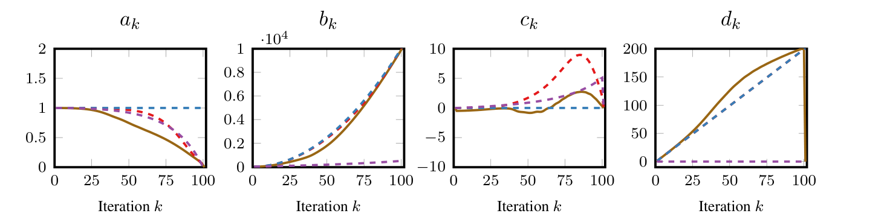

# Gradient Descent — Figure 1·Theorem 3

Potential의 한 단계 감소 조건을 Lagrangian과 LMI로 바꾸는 과정이 논문 §3.2.1의 SDP와 Theorem 3을 연결하는 출발점이야.

이번에는 다음 순서로 진행하자.

1. Potential과 Gram 표현을 정리하고, Lagrangian에서 LMI가 어떻게 나오는지 유도
2. §3.2.1 식 (3): 왜 $b_N$을 최대화하는지
3. Figure 1: SDP 수치해에서 계수 패턴을 발견하는 과정
4. Theorem 3: 발견한 계수 수열이 실제로 potential inequality를 만족한다는 증명
5. 최종적으로 gradient norm 제곱의 $O(k^{-2})$ convergence rate 도출

## 1. Potential과 Gram 표현

먼저 함수 클래스, potential의 계수, 한 단계 계산에 사용할 Gram matrix를 정리하자.

### 1.1. Interpolation inequality의 부호

$f\in\mathcal F_L$는 $L$-smooth convex function이고, $x_\star$는 최적점, $f_\star=f(x_\star)$야. 따라서 $f'(x_\star)=0$이고, 이 문서의 GD 업데이트는 다음과 같아.

$$
x_{k+1}=x_k-\frac1L f'(x_k).
$$

Smooth convex interpolation inequality는 다음 방향으로 써.

$$
\boxed{ f(x)\ge f(y)+\langle f'(y),x-y\rangle +\frac1{2L}\Vert f'(x)-f'(y)\Vert ^2 }
$$

이 부등식의 우변을 좌변으로 옮겨 얻는 비음수 식이 §2에서 사용할 interpolation constraint야.

### 1.2. $\phi_k$와 $\phi_{k+1}$의 계수 구분

우리는 하나의 고정된 potential을 찾는 것이 아니라, 다음 계수 수열을 찾고 있어.

$$
\{(a_k,b_k,c_k,d_k)\}_{k=0}^{N}
$$

따라서

$$
\begin{aligned} \phi_k^f ={}&a_k\Vert x_k-x_\star\Vert ^2+b_k\Vert f'(x_k)\Vert ^2\\ &+2c_k\langle f'(x_k),x_k-x_\star\rangle +d_k(f(x_k)-f_\star), \\[4pt] \phi_{k+1}^f ={}&a_{k+1}\Vert x_{k+1}-x_\star\Vert ^2 +b_{k+1}\Vert f'(x_{k+1})\Vert ^2\\ &+2c_{k+1}\langle f'(x_{k+1}),x_{k+1}-x_\star\rangle +d_{k+1}(f(x_{k+1})-f_\star). \end{aligned}
$$

### 1.3. 한 단계의 Gram representation

한 단계에서 필요한 벡터와 함수값을 다음과 같이 모으자.

$$
\begin{aligned}
P&=\bigl[x_k-x_\star\quad f'(x_k)\quad f'(x_{k+1})\bigr]
\in\mathbb R^{d\times3},\\
F&=\bigl[f(x_k)-f_\star\quad f(x_{k+1})-f_\star\bigr]
\in\mathbb R^{1\times2}.
\end{aligned}
$$

Appendix D.4는 $x_\star=f_\star=0$으로 평행이동한 좌표를 사용해. 여기서는 같은 이동을 $P$와 $F$의 정의에 직접 반영했어. $P$의 열 사이의 내적을 모은 행렬이 Gram matrix야.

$$
\boxed{
G=P^\top P=
\begin{pmatrix}
\Vert x_k-x_\star\Vert^2
&\langle x_k-x_\star,f'(x_k)\rangle
&\langle x_k-x_\star,f'(x_{k+1})\rangle\\
\langle f'(x_k),x_k-x_\star\rangle
&\Vert f'(x_k)\Vert^2
&\langle f'(x_k),f'(x_{k+1})\rangle\\
\langle f'(x_{k+1}),x_k-x_\star\rangle
&\langle f'(x_{k+1}),f'(x_k)\rangle
&\Vert f'(x_{k+1})\Vert^2
\end{pmatrix}\succeq0.
}
$$

$G\succeq0$인 이유는 모든 $v\in\mathbb R^3$에 대해 $v^\top Gv=\Vert Pv\Vert^2\ge0$이기 때문이야. 반대로 PSD 행렬은 $P^\top P$로 분해할 수 있으므로, 차원에 제한을 두지 않는 논문의 분석에서는 $G\succeq0$으로 실제 벡터들의 내적 관계를 표현할 수 있어.

이제 점과 gradient를 $P$의 열 조합으로 나타내는 **계수벡터**를 굵은 글씨로 쓰자.

$$
\begin{aligned}
\mathbf x_k&=(1,0,0)^\top,
&\mathbf g_k&=(0,1,0)^\top,\\
\mathbf x_{k+1}&=(1,-L^{-1},0)^\top,
&\mathbf g_{k+1}&=(0,0,1)^\top,\\
\mathbf x_\star&=0\in\mathbb R^3,
&\mathbf g_\star&=0\in\mathbb R^3.
\end{aligned}
$$

함수값을 고르는 계수벡터는

$$
\mathbf f_k=(1,0)^\top,\qquad
\mathbf f_{k+1}=(0,1)^\top,\qquad
\mathbf f_\star=0\in\mathbb R^2
$$

야. 이 정의에 따라 $p\in\{\star,k,k+1\}$에 대해

$$
P\mathbf x_p=x_p-x_\star,\qquad
P\mathbf g_p=f'(x_p),\qquad
F\mathbf f_p=f(x_p)-f_\star
$$

가 성립해. 특히 $\mathbf x_{k+1}$에 이미 GD 업데이트가 반영되어 있어.

예를 들어 내적은

$$
\langle f'(x_k),x_k-x_\star\rangle
=\mathbf g_k^\top G\mathbf x_k
=G_{12}
$$

이고, GD 업데이트를 대입하면 다음 세 항을 얻어.

$$
\begin{aligned}
\|x_{k+1}-x_\star\|^2&=G_{11}-\frac2L G_{12}+\frac1{L^2}G_{22},\\
\|f'(x_{k+1})\|^2&=G_{33},\\
\langle f'(x_{k+1}),x_{k+1}-x_\star\rangle&=G_{13}-\frac1L G_{23}.
\end{aligned}
$$

Appendix D.4, p.36의 표기를 그대로 사용하면 potential의 이차항 계수행렬은

$$
\begin{aligned}
V_k&=[\mathbf x_k-\mathbf x_\star\quad\mathbf g_k]
\begin{pmatrix}a_k&c_k\\c_k&b_k\end{pmatrix}
[\mathbf x_k-\mathbf x_\star\quad\mathbf g_k]^\top,\\
V_{k+1}&=[\mathbf x_{k+1}-\mathbf x_\star\quad\mathbf g_{k+1}]
\begin{pmatrix}a_{k+1}&c_{k+1}\\c_{k+1}&b_{k+1}\end{pmatrix}
[\mathbf x_{k+1}-\mathbf x_\star\quad\mathbf g_{k+1}]^\top.
\end{aligned}
$$

따라서 위의 세 항을 전개하면

$$
V_{k+1}-V_k=
\begin{pmatrix}
a_{k+1}-a_k&-a_{k+1}/L-c_k&c_{k+1}\\
-a_{k+1}/L-c_k&a_{k+1}/L^2-b_k&-c_{k+1}/L\\
c_{k+1}&-c_{k+1}/L&b_{k+1}
\end{pmatrix},
$$

$$
\boxed{\phi_{k+1}^f-\phi_k^f
=\operatorname{Tr}\bigl(G(V_{k+1}-V_k)\bigr)
+F\bigl[d_{k+1}(\mathbf f_{k+1}-\mathbf f_\star)
-d_k(\mathbf f_k-\mathbf f_\star)\bigr].}
$$

Potential 계수를 고정하면 이 차이는 $G$와 $F$에 대한 선형식이야. 반대로 $L$과 업데이트를 고정하면 $V_{k+1}-V_k$의 각 성분이 미지의 potential 계수에 대한 선형식이야.

출처: 논문 Appendix D.4, pp.35–36; 첨부 GD 실험 사양서 `3_2_1_Figure_1_1A_GradientDescent.md`의 §3 「Finite-dimensional Gram representation」와 §5. 이후에는 이 파일을 「GD 실험 사양서」라고 부를게.

## 2. Lagrangian에서 LMI까지 — Appendix D.4

이제 Gram 표현에 함수 클래스의 interpolation constraint를 결합하자.

### 2.1. Interpolation constraint를 모두 적용

논문의 실제 SDP는

$$
I_k=\{\star,k,k+1\}
$$

의 세 점을 사용해.

각 순서쌍 $p,q\inI_k$에 대해

$$
f(x_p)-f(x_q)-\langle f'(x_q),x_p-x_q\rangle
-\frac1{2L}\|f'(x_p)-f'(x_q)\|^2\ge0.
$$

서로 다른 순서쌍은 총 6개야. 각 부등식에 독립적인 multiplier $\lambda_{p,q}\ge0$를 부여해. 여기서 $\lambda_{p,q}$는 현재 전이 $k\to k+1$에서 사용하는 값이며, 단계 의존성은 표기에서 생략했어. 전체 SDP에서는 각 전이의 multiplier를 따로 선택해.

각 순서쌍의 이차항을 $G$의 선형식으로 만드는 행렬은 Appendix D.4의 다음 정의를 사용해.

$$
\begin{aligned}
M&=\frac12
\begin{pmatrix}
0&0&0&-1\\
0&0&0&1\\
0&0&-L^{-1}&L^{-1}\\
-1&1&L^{-1}&-L^{-1}
\end{pmatrix}\in\mathbb S^4,\\
M_{p,q}
&=
[\mathbf x_p\ \mathbf x_q\ \mathbf g_p\ \mathbf g_q]\,
M\,
[\mathbf x_p\ \mathbf x_q\ \mathbf g_p\ \mathbf g_q]^\top
\in\mathbb S^3.
\end{aligned}
$$

여기서 $M$은 $L$이 정해지면 모든 순서쌍과 모든 단계에서 공통으로 사용하는 $4\times4$ 행렬이야. $M_{p,q}$는 그 $M$에 해당 점들의 계수벡터를 넣어 만든 $3\times3$ 행렬이야. 예를 들어 $x_\star,x_k$ 사이의 부등식에는 $M_{\star,k}$를 사용해.

이렇게 구성하면

$$
F(\mathbf f_p-\mathbf f_q)+\operatorname{Tr}(GM_{p,q})\ge0.
$$

이 식의 trace 항은 정확히

$$
\operatorname{Tr}(GM_{p,q})
=-\langle f'(x_q),x_p-x_q\rangle
-\frac1{2L}\Vert f'(x_p)-f'(x_q)\Vert^2
$$

야. $p=q$인 항은 0이므로 합에 포함해도 값이 바뀌지 않고, 코드에서는 제외해.

출처: 논문 Appendix D.4, 식 (19), p.35; 첨부 GD 실험 사양서 §4 「Interpolation matrices + multipliers」.

### 2.2. 비음수 가중합을 전개

Potential 차이에 여섯 interpolation 부등식의 비음수 가중합을 더하면

$$
\begin{aligned}
&\phi_{k+1}^f-\phi_k^f
+\sum_{p,q\inI_k}\lambda_{p,q}
\bigl[F(\mathbf f_p-\mathbf f_q)+\operatorname{Tr}(GM_{p,q})\bigr]\\
&\quad=\operatorname{Tr}\left[G\left(V_{k+1}-V_k+
\sum_{p,q\inI_k}\lambda_{p,q}M_{p,q}\right)\right]\\
&\qquad+F\left[d_{k+1}(\mathbf f_{k+1}-\mathbf f_\star)
-d_k(\mathbf f_k-\mathbf f_\star)
+\sum_{p,q\inI_k}\lambda_{p,q}(\mathbf f_p-\mathbf f_q)\right].
\end{aligned}
$$

이것이 한 단계 potential 감소를 검증할 때 사용하는 가중합이야.

### 2.3. 왜 선형 등식과 LMI가 나오는가?

Interpolation 부등식을 만족하는 $G,F$에서는 추가한 항들이 모두 비음수야. 따라서 위에 전개한 식을 모든 $G\succeq0$와 제한 없는 $F\in\mathbb R^{1\times2}$에 대해 0 이하로 만들면 $\phi_{k+1}^f-\phi_k^f\le0$을 보장할 수 있어.

여기서 $G$와 $F$를 나누어 보면 조건이 명확해져.

첫 번째: $F$에 대한 조건

$F$는 이 조건에서 제한 없는 함수값 변수이므로 그 계수가 0이 아니면 위 가중합을 무한히 크게 만들 수 있어.

따라서

$$
\boxed{ d_{k+1}(\mathbf f_{k+1}-\mathbf f_\star)-d_k(\mathbf f_k-\mathbf f_\star) +\sum_{p,q}\lambda_{p,q} (\mathbf f_p-\mathbf f_q)=0 }
$$

이어야 해. 이것이 linear equality constraint야.

두 번째: $G$에 대한 조건

함수값 항이 제거되면 남는 식은

$$
\operatorname{Tr}\left[ \left(V_{k+1}-V_k+\sum_{p,q}\lambda_{p,q}M_{p,q}\right)G \right].
$$

우리는 $G\succeq0$인 모든 Gram matrix에 대해 이 값이 0 이하이기를 원해.

그러므로

$$
\boxed{ V_{k+1}-V_k+\sum_{p,q}\lambda_{p,q}M_{p,q}\preceq0 }
$$

이어야 해. 이것이 **Linear Matrix Inequality (LMI)**야.

$L$과 업데이트를 고정하면 $M_{p,q}$는 상수행렬이고, $V_{k+1}-V_k$의 성분은 potential 계수의 선형식이야. 따라서 위 행렬의 성분은 potential 계수와 $\lambda_{p,q}$에 대해 선형이고, 일부 계수를 경계조건으로 고정하면 상수항을 포함하는 affine 식이 돼.

따라서 한 단계 potential inequality에 대한 SDP 조건은 다음 세 가지로 정리돼.

$$
\boxed{ \begin{gathered} V_{k+1}-V_k+\sum_{p,q\inI_k} \lambda_{p,q}M_{p,q}\preceq0, \\[5pt] d_{k+1}(\mathbf f_{k+1}-\mathbf f_\star)-d_k(\mathbf f_k-\mathbf f_\star) +\sum_{p,q\inI_k} \lambda_{p,q}(\mathbf f_p-\mathbf f_q)=0, \\[5pt] \lambda_{p,q}\ge0. \end{gathered} }
$$

이 세 조건이 논문 Appendix D.4, p.36의 최종 LMI formulation에 해당해. 논문은 이 경우의 reformulation을 lossless한 것으로 제시하고 있어.

이제부터는 $G$를 직접 최적화할 필요가 없어. 대신 potential 계수와 multiplier를 decision variable로 두고 위 조건을 만족시키면 되는 것이야.

## 3. §3.2.1 — SDP로 $b_N$ 최대화

논문 pp.6–7, 식 (2)–(3)

### 3.1. 무엇을 최적화하려는가?

논문의 Example I는 $N$번의 gradient descent 이후

$$
\boxed{\Vert f'(x_N)\Vert ^2}
$$

을 가능한 한 작게 upper-bound하는 것이 목적이야.

이를 위해 초기 potential과 최종 potential을 다음과 같이 선택해.

$$
\begin{aligned} \phi_0^f&=L^2\Vert x_0-x_\star\Vert ^2,\\ \phi_N^f&=b_N\Vert f'(x_N)\Vert ^2. \end{aligned}
$$

이것은 아직 Theorem 3의 potential이 아니라, 처음 수치 실험에서 사용하는 경계조건이야.

모든 단계에서

$$
\phi_{k+1}^f\le\phi_k^f
$$

가 성립하면 telescoping에 의해

$$
\phi_N^f\le\phi_0^f.
$$

따라서

$$
b_N\Vert f'(x_N)\Vert ^2 \le L^2\Vert x_0-x_\star\Vert ^2.
$$

즉,

$$
\boxed{ \Vert f'(x_N)\Vert ^2 \le\frac{L^2\Vert x_0-x_\star\Vert ^2}{b_N} }
$$

이므로 $b_N$이 클수록 더 좋은 bound를 얻게 돼.

이것이 식 (3)에서 $b_N$을 최대화하는 이유야.

### 3.2. SDP formulation — Equation (3)

논문의 식 (3)은

$$
\boxed{ \begin{aligned} b_N^{\mathrm{opt}} =\max_{\phi_1^f,\ldots,\phi_{N-1}^f,b_N}\quad &b_N\\ \text{s.t.}\quad &(\phi_k^f,\phi_{k+1}^f)\in\mathcal V_k,\\ &k=0,\ldots,N-1. \end{aligned} }
$$

여기서 $\mathcal V_k$는 앞 절에서 유도한 LMI로 검증되는, 한 단계 potential inequality를 만족하는 potential 쌍의 집합이야.

실제로 SDP에 넣는 것은 각 단계의

$$
a_k,b_k,c_k,d_k,\lambda_{p,q}
$$

이며, 모든 단계의 linear equality와 LMI를 동시에 만족시키면서 $b_N$을 최대화해.

중요한 점은 step-size $\delta_k=1/L$는 고정이라는 거야. 이번 SDP가 최적화하는 것은 GD의 step-size가 아니라 potential의 계수들이야.

### 3.3. 논문 표기와 Python 코드의 대응

수식의 상태 인덱스는 $k=0,\ldots,N$이고, 전이 인덱스는 $k=0,\ldots,N-1$이야. 첨부 Python 코드의 딕셔너리 키는 1부터 시작하므로 다음처럼 대응해.

| 수식 | Python 표현 | 의미 |
| --- | --- | --- |
| $\begin{pmatrix}a_k&c_k\\c_k&b_k\end{pmatrix}$ | `Q[k+1]` | Potential 이차항의 $2\times2$ 대칭 계수 행렬 |
| $d_k$ | `d[k+1]` | 함수값 차이의 계수 |
| $b_N$ | `tau`, `bN` | 최대화하는 최종 gradient norm 제곱의 계수 |
| $\lambda_{p,q}$ | `lam[k+1][i-1,j-1]` | 전이 $k\to k+1$의 interpolation multiplier |
| $V_{k+1}-V_k+\sum_{p,q}\lambda_{p,q}M_{p,q}$ | `cons_SDP[k+1]` | `<< 0`으로 제한하는 LMI의 좌변 |
| §2.3의 함수값 계수벡터 | `cons_LIN[k+1].T` | 0으로 두는 선형 등식의 좌변 |

코드의 점 번호 `1, 2, 3`은 각각 $\star,k,k+1$에 대응해. 수식의 계수벡터는 열벡터이고 코드의 `xk`, `gxk`, `fxk` 등은 행벡터라서, 예를 들어 $\mathbf x_k$는 `xk.T`에 대응해. 또한 코드의 `G`, `F`는 gradient·함수값 계수벡터를 담은 딕셔너리이므로, 여기서 정의한 Gram matrix $G$ 및 함수값 행렬 $F$와 구별해서 읽으면 돼.

코드는 $G$를 decision variable로 선언하는 대신 §2의 조건을 사용해 potential 계수와 multiplier를 구해. `Q[k+1]`에는 대칭 조건을 두며 별도의 PSD 제약은 두지 않아. 모든 전이의 조건을 하나로 모아 `tau`를 최대화하고, $N=100$이면 $3\times3$ LMI 100개와 함수값에 대한 scalar equality 200개가 생겨.

출처: 첨부 GD 실험 사양서 §1, §3, §5–6. 이 대응표는 논문의 Appendix D.4 조건이 코드에서 어디에 구성되는지 연결한 것이야.

## 4. Figure 1 — 수치해에서 규칙 발견하기

논문 p.6–7, Figure 1

논문에서 $N$을 바꿔 식 (3)을 수치적으로 풀었더니 다음 결과가 나왔어.

| $N$                       | 1 | 2 | 3  | 4  | 5  | 100   |
| ----------------------------- | - | - | -- | -- | -- | ----- |
| $b_N^{\mathrm{opt}}$ (근사) | 4 | 9 | 16 | 25 | 36 | 10201 |

즉, 수치해가 다음 패턴을 보였어.

$$
\boxed{b_N^{\mathrm{opt}}\approx(N+1)^2}
$$

논문에서는 이를 수치적 관찰로 보고하고, 이어서 계수 수열을 단순화해 분석 가능한 potential을 찾는 과정을 진행해.

Figure 1의 네 곡선은 다음과 같은 실험을 나타내.

| 곡선 | 코드 설정 | 중간 상태 $k=1,\ldots,N-1$의 계수 조건 |
| --- | --- | --- |
| 갈색 실선 | `relax=0` | 원래 SDP, 중간 계수 자유 |
| 빨간 점선 | `relax=1` | $d_k=(2k+1)L$ |
| 파란 점선 | `relax=2` | $d_k=(2k+1)L,\ c_k=0,\ a_k=L^2$ |
| 보라 점선 | `relax=3` | $d_k=0$ |

이 실험들을 코드와 연결할 때는 **초기·최종 potential도 설정에 맞게 정한다**는 점을 함께 봐야 해. 공통 조건은

$$
a_0=L^2,\qquad b_0=c_0=c_N=0,\qquad b_N=\texttt{tau}
$$

이고, 나머지 경계조건은 다음과 같아.

| 곡선·설정 | $d_0$ | $a_N$ | $d_N$ |
| --- | --- | --- | --- |
| 갈색, `relax=0` | $0$ | $0$ | $0$ |
| 빨간색, `relax=1` | $L$ | $0$ | $(2N+1)L$ |
| 파란색, `relax=2` | $L$ | $L^2$ | $(2N+1)L$ |
| 보라색, `relax=3` | $0$ | $0$ | $0$ |

즉, 각 설정의 시작과 끝은

$$
\begin{aligned}
\phi_0^f&=L^2\Vert x_0-x_\star\Vert^2+d_0(f(x_0)-f_\star),\\
\phi_N^f&=a_N\Vert x_N-x_\star\Vert^2
+b_N\Vert f'(x_N)\Vert^2+d_N(f(x_N)-f_\star)
\end{aligned}
$$

로 읽으면 돼. §3.1의 순수한 거리항에서 gradient norm 항으로 이어지는 경계조건은 갈색 기본 설정에 해당하고, 파란색 설정은 뒤의 Theorem 3과 같은 형태의 초기·최종 potential을 사용해.

출처: 논문 §3.2.1과 Figure 1, pp.6–7; 첨부 GD 실험 사양서 §1–2의 `relax`별 중간 계수 및 경계조건, §9의 곡선 대응.

갈색 수치해에서 출발하여 빨간색, 파란색 순서로 단순화해 보니, 특히 파란색의 간단한 구조로도 $b_N=O(N^2)$을 유지할 수 있었어.

반면 $d_k=0$으로 제한하면 원하는 $O(N^{-2})$ gradient norm 제곱 convergence rate를 얻지 못했어.

그래서 논문은 다음과 같은 형태의 potential을 선택하게 돼.

$$
\boxed{ \phi_k^f =d_k(f(x_k)-f_\star) +b_k\Vert f'(x_k)\Vert ^2 +L^2\Vert x_k-x_\star\Vert ^2 }
$$

이제 남은 것은 $d_k,b_k$를 어떻게 선택하면 실제로

$$
\phi_{k+1}^f\le\phi_k^f
$$

가 성립하는지 증명하는 거야.

## 5. Theorem 3 — 해석적 증명

논문 p.7 Theorem 3, p.25 Appendix D.1

### 5.1. Theorem 3의 Statement

$f\in\mathcal F_L$이고

$$
x_{k+1}=x_k-\frac1L f'(x_k)
$$

라고 하자.

다음 potential을 생각한다.

$$
\phi_k^f =d_k(f(x_k)-f_\star) +b_k\Vert f'(x_k)\Vert ^2 +L^2\Vert x_k-x_\star\Vert ^2.
$$

Theorem 3은 $b_k,d_k\ge0$일 때, 다음 두 recurrence를 만족하면

$$
\boxed{ \begin{aligned} d_{k+1}&=d_k+2L,\\ b_{k+1}&=b_k+2+\frac{d_k}{L} \end{aligned} }
$$

반드시

$$
\boxed{\phi_{k+1}^f\le\phi_k^f}
$$

가 성립한다는 정리야.

이 recurrence가 왜 등장하는지 §2의 Lagrangian으로 직접 확인해 보자.

### 5.2. Potential difference를 다시 작성

Theorem 3에서는

$$
a_k=a_{k+1}=L^2,\qquad c_k=c_{k+1}=0
$$

으로 고정했으므로, 앞서 구한 $V_{k+1}-V_k$는

$$
V_{k+1}-V_k= \begin{pmatrix} 0&-L&0\\ -L&1-b_k&0\\ 0&0&b_{k+1} \end{pmatrix}
$$

로 단순해져.

따라서

$$
\boxed{ \begin{aligned} \phi_{k+1}^f-\phi_k^f ={}&d_{k+1}(f(x_{k+1})-f_\star)-d_k(f(x_k)-f_\star)\\ &-2LG_{12}+(1-b_k)G_{22} +b_{k+1}G_{33}. \end{aligned} }
$$

이제 interpolation inequality를 더해서 이 값이 0 이하임을 증명하면 돼.

### 5.3. 필요한 interpolation inequality 세 개

전체 SDP에서는 여섯 개의 순서쌍을 사용하지만, Theorem 3의 증명에는 세 개만으로 충분해.

GD 업데이트를 대입하면 다음과 같이 정리할 수 있어.

$$
\begin{aligned}
F(\mathbf f_\star-\mathbf f_k)+\operatorname{Tr}(GM_{\star,k})
&=-(f(x_k)-f_\star)+G_{12}-\frac{G_{22}}{2L}\ge0,\\
F(\mathbf f_k-\mathbf f_{k+1})+\operatorname{Tr}(GM_{k,k+1})
&=f(x_k)-f(x_{k+1})-\frac{G_{22}+G_{33}}{2L}\ge0,\\
F(\mathbf f_{k+1}-\mathbf f_k)+\operatorname{Tr}(GM_{k+1,k})
&=f(x_{k+1})-f(x_k)+\frac{G_{22}+2G_{23}-G_{33}}{2L}\ge0.
\end{aligned}
$$

각각 $x_\star,x_k$, $x_k,x_{k+1}$, $x_{k+1},x_k$에 해당하는 interpolation inequality야.

### 5.4. Lagrangian multiplier 선택

Appendix D.1에서 논문이 찾아낸 multiplier는 다음과 같아.

$$
\boxed{ \begin{aligned} \lambda_{\star,k}&=2L,\\ \lambda_{k,k+1}&=2d_k+2L(2+b_k),\\ \lambda_{k+1,k}&=d_k+2L(1+b_k). \end{aligned} }
$$

나머지 multiplier는 0으로 두면 돼.

$b_k,d_k\ge0$이므로 세 multiplier는 모두 nonnegative야.

이 세 multiplier를 §2의 가중합에 대입하자.

첫 번째: 함수값 계수의 소거

Linear equality는

$$
\begin{cases} -d_k-\lambda_{\star,k} +\lambda_{k,k+1}-\lambda_{k+1,k}=0,\\ d_{k+1}-\lambda_{k,k+1} +\lambda_{k+1,k}=0. \end{cases}
$$

여기에 multiplier를 대입하면

$$
\boxed{d_{k+1}=d_k+2L}
$$

을 얻어.

두 번째: 이차항과 LMI

$b_{k+1}$에 대해서는

$$
b_{k+1}=b_k+2+\frac{d_k}{L}
$$

로 선택하자.

그러면 직접 행렬을 전개했을 때

$$
\boxed{ \begin{aligned} &V_{k+1}-V_k+\lambda_{\star,k}M_{\star,k} +\lambda_{k,k+1}M_{k,k+1} +\lambda_{k+1,k}M_{k+1,k}\\ &\quad=-\frac{\lambda_{k+1,k}}{2L} \begin{pmatrix} 0&0&0\\ 0&1&-1\\ 0&-1&1 \end{pmatrix} \preceq0. \end{aligned} }
$$

이것이 실제로 Theorem 3의 계수들이 LMI를 만족한다는 해석적 certificate야.

위 행렬이 negative semidefinite인 이유는

$$
\begin{pmatrix} 0&0&0\\ 0&1&-1\\ 0&-1&1 \end{pmatrix} = \begin{pmatrix}0\\-1\\1\end{pmatrix} \begin{pmatrix}0&-1&1\end{pmatrix} \succeq0
$$

이기 때문이야.

즉, 앞서 유도한 두 SDP 조건을 모두 만족했어.

따라서 위 가중합의 행렬항은

$$
\operatorname{Tr}\left[G\left(V_{k+1}-V_k
+\lambda_{\star,k}M_{\star,k}
+\lambda_{k,k+1}M_{k,k+1}
+\lambda_{k+1,k}M_{k+1,k}\right)\right]
=-\frac{\lambda_{k+1,k}}{2L}\|f'(x_{k+1})-f'(x_k)\|^2\le0.
$$

함수값 계수는 소거되었고, 더한 interpolation 부등식의 좌변과 multiplier는 모두 비음수이므로

$$
\phi_{k+1}^f-\phi_k^f
\le\operatorname{Tr}\left[G\left(V_{k+1}-V_k
+\lambda_{\star,k}M_{\star,k}
+\lambda_{k,k+1}M_{k,k+1}
+\lambda_{k+1,k}M_{k+1,k}\right)\right]\le0.
$$

결론적으로

$$
\boxed{\phi_{k+1}^f\le\phi_k^f}.
$$

Theorem 3이 증명되었어.

참고로 논문의 Appendix D.1은 세 번째 interpolation inequality 대신 더 약한 일반 convexity inequality를 사용하여 동일한 결론을 등식 형태의 가중합으로 보여줘. 여기서는 우리가 유도한 LMI에 직접 연결하기 위해 세 번째에도 full interpolation inequality를 사용했어.

## 6. Theorem 3에서 실제 계수 수열 구하기

이제 recurrence를 풀어보자.

$$
d_{k+1}=d_k+2L.
$$

초기값을 $d_0=L$로 선택하면

$$
\boxed{d_k=(2k+1)L}.
$$

다음으로

$$
b_{k+1}=b_k+2+\frac{d_k}{L}
$$

에 방금 구한 식을 대입하면

$$
b_{k+1}-b_k=2k+3.
$$

$b_0=0$으로 두면

$$
\begin{aligned} b_k &=\sum_{t=0}^{k-1}(2t+3)\\ &=k(k-1)+3k\\ &=\boxed{k(k+2)}. \end{aligned}
$$

따라서 우리가 찾은 potential은

$$
\boxed{ \begin{aligned} \phi_k^f ={}&(2k+1)L(f(x_k)-f_\star)\\ &+k(k+2)\Vert f'(x_k)\Vert ^2\\ &+L^2\Vert x_k-x_\star\Vert ^2. \end{aligned} }
$$

이것이 논문 p.6에서 제시한 해석적 potential이야.

## 7. Convergence rate 도출

모든 단계에서 potential이 감소하므로

$$
\phi_k^f\le\phi_0^f.
$$

$d_0=L,\ b_0=0$이기 때문에

$$
\phi_0^f=L(f(x_0)-f_\star)+L^2\Vert x_0-x_\star\Vert ^2.
$$

따라서

$$
\begin{aligned} &(2k+1)L(f(x_k)-f_\star) +k(k+2)\Vert f'(x_k)\Vert ^2\\ &\qquad+L^2\Vert x_k-x_\star\Vert ^2\\ &\le L(f(x_0)-f_\star)+L^2\Vert x_0-x_\star\Vert ^2. \end{aligned}
$$

왼쪽의 모든 항은 비음수야.

따라서 각각 다른 항을 버리고 상한을 얻을 수 있어.

Function value convergence

$$
\boxed{ f(x_k)-f_\star \le \frac{L(f(x_0)-f_\star)+L^2\Vert x_0-x_\star\Vert ^2} {(2k+1)L} =O(k^{-1}). }
$$

Gradient norm convergence

$$
\boxed{ \Vert f'(x_k)\Vert ^2 \le \frac{L(f(x_0)-f_\star)+L^2\Vert x_0-x_\star\Vert ^2} {k(k+2)} =O(k^{-2}). }
$$

즉, 하나의 potential로 함수값 오차와 gradient norm 제곱의 convergence rate를 동시에 증명한 거야.

## 8. SDP 최적해와 Theorem 3의 차이

여기서 한 가지 구분이 중요해.

|              | 식 (3)의 수치 SDP                   | Theorem 3의 해석적 potential                           |
| ------------ | ------------------------------- | -------------------------------------------------- |
| 초기 potential | $L^2\Vert x_0-x_\star\Vert ^2$ | $L(f(x_0)-f_\star)+L^2\Vert x_0-x_\star\Vert ^2$ |
| 최종 potential | $b_N\Vert f'(x_N)\Vert ^2$      | 함수값·gradient·거리항 포함                                |
| $b_N$    | 약 $(N+1)^2$                 | $N(N+2)$                                       |
| $N=100$  | 약 10201                         | 10200                                              |
| 역할           | 주어진 경계조건에서 최적 계수 탐색             | 모든 $k$에 대해 검증되는 해석적 수열                         |

따라서 Theorem 3이 원래 SDP의 최적값 $b_N^{\mathrm{opt}}=(N+1)^2$을 엄밀히 증명한 것은 아니야. 경계조건이 다른, 단순하면서도 동일한 $O(k^{-2})$ convergence rate를 보장하는 potential을 구성한 것이지.

## 9. 지금까지 이해한 내용을 연결하면

Parameterized Potential

$a_k,b_k,c_k,d_k$를 결정할 문제로 설정

One-step Potential Inequality

$\phi_{k+1}^f-\phi_k^f\le0$

Gram Representation + Interpolation

$G\succeq0,\quad F(\mathbf f_p-\mathbf f_q)+\operatorname{Tr}(GM_{p,q})\ge0$

Lagrangian → LMI

함수값 계수 소거 + NSD 행렬 조건

SDP — Equation (3)

$\max b_N$

Numerical Pattern — Figure 1

$a_k=L^2,\ c_k=0,\ d_k=(2k+1)L$

Analytical Certificate — Theorem 3

Multiplier를 직접 구성해 LMI 성립 증명

Convergence Certificate

$\Vert f'(x_k)\Vert ^2=O(k^{-2}),\quad f(x_k)-f_\star=O(k^{-1})$

가장 중요한 연결은 이것이야.

SDP는 수치적으로 좋은 potential의 계수를 발견하는 도구이고, Theorem 3은 그 계수의 단순화된 수열이 실제로 성립한다는 수학적 증명이야.

그리고 §2에서 구성한 Lagrangian의 multiplier가 바로 §5의 증명을 구성하는 데 사용되었어.
