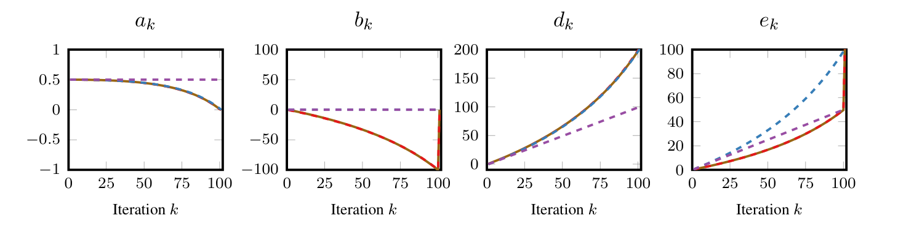

# Stochastic Gradient Descent — Figure 2·Theorem 5

이번 §3.2.2는 앞서 공부한 §3.2.1 Gradient Descent의 SDP 구조를 확장하는 사례야.

가장 큰 차이는 GD에서

$$
\phi_{k+1}^f-\phi_k^f\le0
$$

를 요구했다면, SGD에서는 stochastic noise 때문에

$$
\boxed{ \mathbb E_{i_k}[\phi_{k+1}^f] -\phi_k^f-e_k\sigma^2\le0 }
$$

를 요구한다는 것이야.

이 작은 차이 때문에 variance constraint 하나가 추가되고, 최적화할 대상도 하나에서 두 개로 늘어나.

진행 순서는 다음과 같아.

1. SGD와 bounded variance assumption
2. Parameterized potential과 SDP 목적함수 식 (4)
3. Stochastic Gram representation
4. Interpolation + variance constraint
5. Lagrangian → linear equality + LMI
6. Figure 2의 수치 결과와 계수 단순화
7. Theorem 5와 Appendix E.1의 증명
8. 해석적 SDP certificate와 최종 convergence bound

## 1. §3.2.2 — Stochastic smooth convex minimization

논문 pp.7–8, §3.2.2

### 1.1. Assumptions

먼저

$$
\boxed{f\in\mathcal F_L}
$$

즉, $f$는 $L$-smooth convex function이라고 가정한다.

GD에서는 deterministic gradient $f'(x_k)$를 정확히 계산했지만, SGD에서는 stochastic oracle $G(x_k;i_k)$를 사용해.

여기서 $i_k$는 $\{1,\ldots,n\}$에서 균등하게 선택된 random index야.

Oracle에 다음 두 조건을 둔다.

Unbiasedness

$$
\boxed{\mathbb E_i[G(x;i)]=f'(x)}
$$

즉, stochastic gradient의 기대값이 true gradient와 같다는 조건이야.

Uniformly bounded variance

$$
\boxed{ \mathbb E_i\Vert G(x;i)-f'(x)\Vert ^2\le\sigma^2 }
$$

이 조건은 모든 $x\in\mathbb R^d$에 대해 성립한다고 가정해.

Unbiasedness를 이용하면

$$
\begin{aligned} \mathbb E_i\Vert G(x;i)\Vert ^2 &=\mathbb E_i\Vert G(x;i)-f'(x)+f'(x)\Vert ^2\\ &=\mathbb E_i\Vert G(x;i)-f'(x)\Vert ^2 +\Vert f'(x)\Vert ^2. \end{aligned}
$$

따라서

$$
\boxed{ \mathbb E_i\Vert G(x;i)\Vert ^2 \le\sigma^2+\Vert f'(x)\Vert ^2 }
$$

를 얻어. 이것이 Theorem 5의 statement에 나타나는 조건이야.

이때 $\mathbb E_{i_k}$는 현재 $x_k$를 고정한 상태에서 이번 단계의 $i_k$에 대해서만 취하는 conditional expectation이야.

### 1.2. Stochastic Gradient Descent

SGD 업데이트는

$$
\boxed{ x_{k+1}^{(i_k)} =x_k-\delta_kG(x_k;i_k). }
$$

여기서 $\delta_k$는 step-size야.

Figure 2의 수치탐색에서는

$$
\boxed{\delta_k=\frac1L}
$$

로 고정해.

Theorem 5에서는 조금 더 일반적으로 $\delta_k\ge0$을 다루고, 결과적으로 $\delta_k\le1/L$이면 유효한 sufficient condition이 된다는 것을 증명할 거야.

GD와 달리 $x_{k+1}$이 random이므로, potential inequality에서도 기대값을 취해야 해.

## 2. Parameterized potential과 SDP objective

논문 p.8, 식 (4)

### 2.1. Parameterized potential

Potential family 자체는 GD와 동일해.

$$
\boxed{ \begin{aligned} \phi_k^f ={}& \begin{pmatrix} x_k-x_\star\\ f'(x_k) \end{pmatrix}^{\!\top} (Q_k\otimes I_d) \begin{pmatrix} x_k-x_\star\\ f'(x_k) \end{pmatrix}\\ &+d_k(f(x_k)-f_\star), \qquad Q_k= \begin{pmatrix} a_k&c_k\\ c_k&b_k \end{pmatrix}. \end{aligned} }
$$

전개하면

$$
\begin{aligned} \phi_k^f ={}&a_k\Vert x_k-x_\star\Vert ^2 +b_k\Vert f'(x_k)\Vert ^2\\ &+2c_k\langle f'(x_k),x_k-x_\star\rangle +d_k(f(x_k)-f_\star). \end{aligned}
$$

그런데 SGD에서는 계수 수열이 하나 더 필요해.

$$
\boxed{ \{(a_k,b_k,c_k,d_k,e_k)\} }
$$

여기서 $e_k$는 potential 자체의 계수가 아니라, stochastic error에 곱해지는 계수야.

$$
\boxed{ \mathbb E_{i_k} [\phi_{k+1}^f(x_{k+1}^{(i_k)})] \le\phi_k^f(x_k)+e_k\sigma^2 }
$$

따라서 $e_k$가 작을수록 한 단계에서 허용하는 오차가 작아져.

### 2.2. Initial and terminal potentials

논문 식 (4)의 기본 수치문제에서는 다음 초기·최종 potential을 선택해.

$$
\phi_0^f=\frac L2\Vert x_0-x_\star\Vert ^2
$$

그리고

$$
\phi_N^f=d_N(f(x_N)-f_\star).
$$

이 최종 경계조건은 코드의 `relax=0,1,2`에 해당해. 뒤에서 볼 `relax=3`에서는 최종 단계에도 거리항을 유지하므로 $\phi_N^f=d_N(f(x_N)-f_\star)+(L/2)\Vert x_N-x_\star\Vert^2$야. 이 경우에는 최종 거리항을 버려 아래와 같은 함수값 상한을 얻어. 네 설정의 차이는 §6.2에서 함께 비교할 거야.

GD와는 초기 거리항 계수가 다르다는 점을 주의하자.

GD §3.2.1에서는 $L^2$였지만, SGD §3.2.2에서는 $L/2$야.

각 단계의 expected potential inequality를 반복 적용하면

$$
\mathbb E[\phi_N^f] \le\phi_0^f+\sigma^2\sum_{k=0}^{N-1}e_k.
$$

따라서

$$
d_N\mathbb E[f(x_N)-f_\star] \le\frac L2\Vert x_0-x_\star\Vert ^2 +\sigma^2\sum_{k=0}^{N-1}e_k.
$$

$d_N>0$이면

$$
\boxed{ \mathbb E[f(x_N)-f_\star] \le \underbrace{\frac{L\Vert x_0-x_\star\Vert ^2}{2d_N}}_{\text{Initial-distance contribution}} + \underbrace{ \frac{\sigma^2}{d_N}\sum_{k=0}^{N-1}e_k }_{\text{Accumulated stochastic error}}. }
$$

이 식이 이번 수치탐색의 목적을 전부 설명해.

### 2.3. 왜 SDP를 두 번 푸는가?

GD에서는

$$
\max b_N
$$

하나만 풀었어.

그런데 SGD에서는 최종 upper bound에 $d_N$과 $\sum e_k$가 모두 등장해.

- $d_N$을 크게 하면 초기 거리항에 대한 bound가 좋아져.
- $\sum e_k$를 작게 하면 stochastic noise로 인한 누적 오차가 줄어들어.

따라서 논문은 두 단계의 최적화를 제안해.

Stage 1 — Final function-value coefficient 최대화

$$
\boxed{ \begin{aligned} d_N^{\mathrm{opt}} =\max_{\phi_1^f,\ldots,\phi_{N-1}^f,d_N,e_0,\ldots,e_{N-1}} \quad &d_N\\ \text{s.t.}\quad &(\phi_k^f,\phi_{k+1}^f,e_k)\in\mathcal V_k,\\ &k=0,\ldots,N-1. \end{aligned} }
$$

첫 번째 SDP에서는 $d_N$을 최대화해. 이때 $e_k$는 potential inequality가 성립하도록 선택하지만, 아직 그 합을 최소화하는 것은 아니야.

Stage 2 — Accumulated error 최소화

$$
\boxed{ \begin{aligned} \min_{\phi_1^f,\ldots,\phi_{N-1}^f,e_0,\ldots,e_{N-1}} \quad&\sum_{k=0}^{N-1}e_k\\ \text{s.t.}\quad &d_N=d_N^{\mathrm{opt}},\\ &(\phi_k^f,\phi_{k+1}^f,e_k)\in\mathcal V_k,\\ &k=0,\ldots,N-1. \end{aligned} }
$$

즉, 첫 번째 SDP에서 확보한 $d_N$을 유지하면서, 두 번째 SDP에서 variance accumulation을 줄이는 전략이야.

연결된 Python 코드도 동일한 두 단계 구조를 사용해. 다만 수치 오차를 허용하기 위해 두 번째 SDP에서 정확한 등식 대신

$$
d_N\ge d_N^{\mathrm{opt}}-10^{-5}
$$

를 적용해. 코드에서는 `reoptimize=1`이 이 두 번째 최적화를 수행하는 설정이야.

수식의 상태 인덱스는 $k=0,\ldots,N$, 전이 인덱스는 $k=0,\ldots,N-1$이야. 코드에서는 $Q_k,d_k$가 각각 `Q[k+1]`, `d[k+1]`에, 전이 계수 $e_k$와 interpolation multiplier가 `e[k+1]`, `lam[k+1]`에 대응해.

출처: 논문 §3.2.2 식 (4), Appendix E.7 및 첨부된 `3_2_2_Figure_2_2A_StochasticGradientDescent.md`의 §1–2·§6.

이제 중요한 질문은 하나야.

Stochasticity가 추가된 이 최적화 문제를 어떻게 앞서 배운 Gram matrix, interpolation, LMI의 형태로 바꾸는가?

## 3. Stochastic finite-dimensional Gram representation

Appendix E.7, pp.48–49

### 3.1. GD와 무엇이 달라지는가?

GD에서는 한 단계에서 가능한 다음 점이 하나였어.

$$
x_{k+1}=x_k-\frac1L f'(x_k).
$$

그래서

$$
P=[x_k-x_\star,\ f'(x_k),\ f'(x_{k+1})]
$$

라는 세 벡터만 필요했지.

SGD에서는 선택한 index $i$에 따라 서로 다른 다음 점이 발생해.

$$
x_{k+1}^{(i)}=x_k-\delta_kG(x_k;i).
$$

따라서 모든 가능한 outcome을 한꺼번에 표현해야 해.

논문은

$$
\boxed{ \begin{aligned} P=[\;&x_k-x_\star,\, G(x_k;1),\ldots,G(x_k;n),\\ &f'(x_{k+1}^{(1)}),\ldots, f'(x_{k+1}^{(n)})\;],\\[3pt] F=[\;&f(x_k)-f_\star,\, f(x_{k+1}^{(1)})-f_\star,\ldots, f(x_{k+1}^{(n)})-f_\star\;] \end{aligned} }
$$

를 사용해.

그리고 이전과 동일하게

$$
\boxed{G=P^\top P\succeq0}
$$

라는 Gram matrix를 구성하지.

여기서 단독으로 쓰는 $G=P^\top P$는 Gram matrix이고, $G(x;i)$는 stochastic oracle이라는 점을 구분해야 해.

행렬 크기는

$$
\boxed{ G\in\mathbb S_+^{1+2n},\qquad F\in\mathbb R^{1\times(n+1)}. }
$$

따라서 Figure 2의 $n=2$ 실험에서는

$$
G\in\mathbb S_+^5,\qquad F\in\mathbb R^{1\times3}.
$$

### 3.2. $n=2$일 때의 실제 Gram matrix

최적점을 원점으로 평행이동하여 $x_\star=0$으로 두자.

$$
P= \begin{bmatrix} x_k& G(x_k;1)& G(x_k;2)& f'(x_{k+1}^{(1)})& f'(x_{k+1}^{(2)}) \end{bmatrix}.
$$

그럼

$$
G=P^\top P= \begin{pmatrix} G_{11}&G_{12}&G_{13}&G_{14}&G_{15}\\ G_{12}&G_{22}&G_{23}&G_{24}&G_{25}\\ G_{13}&G_{23}&G_{33}&G_{34}&G_{35}\\ G_{14}&G_{24}&G_{34}&G_{44}&G_{45}\\ G_{15}&G_{25}&G_{35}&G_{45}&G_{55} \end{pmatrix}.
$$

예를 들어

$$
\begin{aligned} G_{11}&=\Vert x_k-x_\star\Vert ^2,\\ G_{22}&=\Vert G(x_k;1)\Vert ^2,\\ G_{23}&=\langle G(x_k;1),G(x_k;2)\rangle,\\ G_{44}&=\Vert f'(x_{k+1}^{(1)})\Vert ^2. \end{aligned}
$$

이야.

여기서 GD와 매우 중요한 차이가 하나 더 있어.

GD에서는 $f'(x_k)$ 자체를 $P$의 열로 사용했지만, SGD에서는

$$
\boxed{ f'(x_k)=\frac1n\sum_{i=1}^nG(x_k;i) }
$$

를 사용해.

따라서 $n=2$에서는

$$
f'(x_k)=\frac12\big(G(x_k;1)+G(x_k;2)\big)
$$

이며,

$$
\boxed{ \Vert f'(x_k)\Vert ^2 =\frac14(G_{22}+2G_{23}+G_{33}). }
$$

즉, unbiasedness 조건을 별도의 비선형 제약으로 처리하지 않고, Gram matrix의 계수벡터 구성에 직접 반영한 거야.

### 3.3. Potential difference의 linearity

GD에서 했던 것처럼 기대 potential 차이를 전개해 보자. $n=2$이고 $\delta_k$는 고정되어 있다고 하자.

$$
\begin{aligned}
\mathbb E_i[\phi_{k+1}^f]-\phi_k^f
={}&(a_{k+1}-a_k)G_{11}\\
&-(a_{k+1}\delta_k+c_k)(G_{12}+G_{13})\\
&+\frac{a_{k+1}\delta_k^2}{2}(G_{22}+G_{33})
-\frac{b_k}{4}(G_{22}+2G_{23}+G_{33})\\
&+\frac{b_{k+1}}2(G_{44}+G_{55})\\
&+c_{k+1}\big[G_{14}+G_{15}-\delta_k(G_{24}+G_{35})\big]\\
&+\frac{d_{k+1}}2\left[f(x_{k+1}^{(1)})+f(x_{k+1}^{(2)})-2f_\star\right]-d_k\left[f(x_k)-f_\star\right].
\end{aligned}
$$

각 Gram 성분 $G_{ij}$와 함수값 차이 $f(x_k)-f_\star$, $f(x_{k+1}^{(i)})-f_\star$는 일차로 등장해. 반대로 $G,F$를 고정해서 보면, 각 항의 계수도 미지의 potential 계수 $a_k,b_k,c_k,d_k,a_{k+1},b_{k+1},c_{k+1},d_{k+1}$에 대해 선형이야. 여기서 step-size $\delta_k$와 $L$은 고정된 상수야. 두 변수군을 동시에 미지수로 보면 계수와 Gram 성분의 곱이 있으므로 jointly linear라는 뜻은 아니야.

다음 절에서는 논문 Appendix E.7의 $V_k,V_{k+1}^{(i)}$로 이 식을 나타낼 거야.

### 3.4. 일반 $n$에서의 계수벡터와 potential 행렬

이제 §4의 interpolation과 §8의 certificate에서 사용할 계수벡터를 정의하자. 여기서는 한 전이 $k\to k+1$을 고정해. $\mathbf x_0$의 $0$은 현재 점을 가리키는 번호이고, 알고리즘 전체의 초기점 $x_0$를 뜻하지 않아.

앞의 $P$와 $F$는 이미 $x_\star,f_\star$를 뺀 값으로 구성되어 있고, 최적점에서는 $f'(x_\star)=0$이야. 따라서 최적점에 대응하는 계수벡터는 $\mathbf x_\star=\mathbf g_\star=0$, $\mathbf f_\star=0$으로 둘 수 있어. 나머지는 다음처럼 정의해. 아래에서 $i=1,\ldots,n$이야.

| 계수벡터 | 차원과 성분 | $P$ 또는 $F$와 곱했을 때의 값 |
| --- | --- | --- |
| $\mathbf x_0$ | $\mathbb R^{1+2n}$, 첫 번째 성분이 1이고 나머지는 0 | $P\mathbf x_0=x_k-x_\star$ |
| $\mathbf G_i$ | $\mathbb R^{1+2n}$, $1+i$번째 성분이 1이고 나머지는 0 | $P\mathbf G_i=G(x_k;i)$ |
| $\mathbf g_i$ | $\mathbb R^{1+2n}$, $1+n+i$번째 성분이 1이고 나머지는 0 | $P\mathbf g_i=f'(x_{k+1}^{(i)})$ |
| $\mathbf f_0$ | $\mathbb R^{1+n}$, 첫 번째 성분이 1이고 나머지는 0 | $F\mathbf f_0=f(x_k)-f_\star$ |
| $\mathbf f_i$ | $\mathbb R^{1+n}$, $1+i$번째 성분이 1이고 나머지는 0 | $F\mathbf f_i=f(x_{k+1}^{(i)})-f_\star$ |

현재 gradient와 다음 점의 계수벡터는 unbiasedness와 SGD 업데이트를 그대로 반영해.

$$
\boxed{
\mathbf g_0=\frac1n\sum_{i=1}^n\mathbf G_i,
\qquad
\mathbf x_i=\mathbf x_0-\delta_k\mathbf G_i.
}
$$

그러면

$$
P\mathbf g_0=f'(x_k),
\qquad
P\mathbf x_i=x_{k+1}^{(i)}-x_\star.
$$

이 계수벡터로 potential의 이차항을 나타내는 행렬을 구성하면

$$
\begin{aligned}
V_k
&=[\mathbf x_0-\mathbf x_\star\ \mathbf g_0]\,
Q_k\,[\mathbf x_0-\mathbf x_\star\ \mathbf g_0]^\top,\\
V_{k+1}^{(i)}
&=[\mathbf x_i-\mathbf x_\star\ \mathbf g_i]\,
Q_{k+1}\,[\mathbf x_i-\mathbf x_\star\ \mathbf g_i]^\top
\end{aligned}
$$

가 돼. 두 행렬은 $\mathbb S^{1+2n}$에 속하고, 각각 $\operatorname{Tr}(GV_k)$와 $\operatorname{Tr}(GV_{k+1}^{(i)})$가 현재와 다음 potential의 이차항이야.

따라서 일반 $n$에서 potential difference 전체는

$$
\mathbb E_i[\phi_{k+1}^f]-\phi_k^f
=\operatorname{Tr}\!\left[G\left(\frac1n\sum_{i=1}^nV_{k+1}^{(i)}-V_k\right)\right]
+F\left[\frac{d_{k+1}}n\sum_{i=1}^n\mathbf f_i-d_k\mathbf f_0\right]
$$

야. $n=2$를 대입하면 §3.3에서 성분별로 전개한 식과 같아.

출처: 논문 Appendix E.7 및 첨부된 SGD 실험 사양서 §3.

## 4. Interpolation inequality + variance constraint

이번에는 앞서 사용한 interpolation constraint에 variance constraint를 추가해야 해.

### 4.1. Interpolation inequality

우리가 이미 알고 있는 조건은

$$
\boxed{ \begin{aligned} {}&f(x_p)-f(x_q)\\ &-\langle f'(x_q),x_p-x_q\rangle\\ &-\frac1{2L}\Vert f'(x_p)-f'(x_q)\Vert ^2 \ge0. \end{aligned} }
$$

이야.

다만 SGD에서는 interpolation point가

$$
I= \{\star,0,1,\ldots,n\}
$$

으로 늘어났어. 여기서 $0$은 현재 점 $x_k$, $i$는 stochastic outcome에 따른 $x_{k+1}^{(i)}$를 뜻해.

$n=2$이면

$$
I=\{\star,0,1,2\}.
$$

따라서 네 점 사이에서 서로 다른 순서쌍을 선택하면

$$
4(4-1)=12
$$

개의 interpolation inequality가 나와.

이 부등식의 내적·gradient norm 항에는 GD에서 사용한 동일한 $4\times4$ 행렬 $M$을 사용해.

$$
\boxed{
M=\frac1{2L}
\begin{pmatrix}
0&0&0&-L\\
0&0&0&L\\
0&0&-1&1\\
-L&L&1&-1
\end{pmatrix}.
}
$$

이것은 논문 식 (19)의 smooth convex interpolation 행렬이야. 실제 Gram matrix와 곱할 행렬은 각 점 쌍의 계수벡터를 넣어 구성해.

$$
\boxed{
M_{p,q}
=[\mathbf x_p\ \mathbf x_q\ \mathbf g_p\ \mathbf g_q]\,
M\,
[\mathbf x_p\ \mathbf x_q\ \mathbf g_p\ \mathbf g_q]^\top
\in\mathbb S^{1+2n}.
}
$$

따라서

$$
F(\mathbf f_p-\mathbf f_q) +\operatorname{Tr}(GM_{p,q})\ge0
$$

로 표현할 수 있어.

$M$은 $L$로 정해지는 고정 행렬이고, $M_{p,q}$는 이 $M$을 현재 Gram 좌표로 옮긴 행렬이야. $M_{p,q}$에는 $\mathbf x_i=\mathbf x_0-\delta_k\mathbf G_i$가 들어가므로 step-size $\delta_k$가 달라지면 행렬도 달라질 수 있어. 한 전이의 $\delta_k$를 고정한 뒤에는 SDP의 결정변수와 무관한 상수행렬이야.

논문 Appendix E.7과 같이 각 constraint에는 $\lambda_{p,q}\ge0$를 곱해. 실제 SDP에서는 각 전이 $k$마다 서로 독립적인 multiplier들을 선택해.

출처: 논문 Appendix D.4의 식 (19), Appendix E.7 및 첨부된 SGD 실험 사양서 §4.

### 4.2. Variance constraint의 Gram 표현

이번에 새로 등장하는 부분이야.

원래 variance assumption은

$$
\mathbb E_i\Vert G(x_k;i)-f'(x_k)\Vert ^2\le\sigma^2
$$

였지.

Gram matrix를 이용하면 이를

$$
\boxed{ \operatorname{Tr}(GA_{\mathrm{var}})\le\sigma^2 }
$$

로 표현할 수 있어.

여기서

$$
\boxed{ A_{\mathrm{var}} =\frac1n\sum_{i=1}^n (\mathbf G_i-\mathbf g_0) (\mathbf G_i-\mathbf g_0)^\top }
$$

이고,

$$
P\mathbf G_i=G(x_k;i),\qquad P\mathbf g_0=f'(x_k)
$$

야.

실제로 $n=2$라면

$$
\mathbf G_1= \begin{pmatrix}0\\1\\0\\0\\0\end{pmatrix}, \quad \mathbf G_2= \begin{pmatrix}0\\0\\1\\0\\0\end{pmatrix}, \quad \mathbf g_0= \begin{pmatrix}0\\1/2\\1/2\\0\\0\end{pmatrix}.
$$

따라서

$$
\boxed{ A_{\mathrm{var}} =\frac14 \begin{pmatrix}0\\1\\-1\\0\\0\end{pmatrix} \begin{pmatrix}0&1&-1&0&0\end{pmatrix} }
$$

가 돼.

이제 variance constraint 역시 Gram matrix에 대한 선형 부등식이 되었어.

이것이 SGD에서도 SDP formulation이 가능한 핵심이야.

## 5. 가중합에서 Linear equality와 LMI로

Appendix E.7, p.49

### 5.1. 우리가 원하는 조건

$$
\mathbb E_i[\phi_{k+1}^f]-\phi_k^f-e_k\sigma^2\le0.
$$

가능한 $G,F$는 $G\succeq0$, §4.1의 모든 interpolation 부등식, 그리고 $\operatorname{Tr}(GA_{\mathrm{var}})\le\sigma^2$를 만족해. 이 조건 아래에서 위 식의 좌변이 항상 0 이하임을 보이면 돼.

### 5.2. 비음수 가중합을 더하기

Appendix E.7에서는 interpolation 부등식에 $\lambda_{p,q}\ge0$을 곱하고, 분산 부등식에는 오차 계수와 같은 $e_k\ge0$을 곱해. 이를 원하는 부등식의 좌변에 더하면

$$
\begin{aligned}
&\mathbb E_i[\phi_{k+1}^f]-\phi_k^f-e_k\sigma^2\\
&\quad+\sum_{p,q\in I}\lambda_{p,q}
\left[F(\mathbf f_p-\mathbf f_q)+\operatorname{Tr}(GM_{p,q})\right]\\
&\quad+e_k\left[\sigma^2-\operatorname{Tr}(GA_{\mathrm{var}})\right]\\
&=\operatorname{Tr}\!\left[
G\left(\frac1n\sum_{i=1}^nV_{k+1}^{(i)}-V_k-e_kA_{\mathrm{var}}
+\sum_{p,q\in I}\lambda_{p,q}M_{p,q}\right)\right]\\
&\quad+F\left[\frac{d_{k+1}}n\sum_{i=1}^n\mathbf f_i-d_k\mathbf f_0
+\sum_{p,q\in I}\lambda_{p,q}(\mathbf f_p-\mathbf f_q)\right].
\end{aligned}
$$

두 $\sigma^2$ 항은 소거돼. 원래 조건을 만족하는 $G,F$에서는 더한 항들이 모두 비음수이므로, 이 가중합을 모든 $G\succeq0,F$에 대해 0 이하로 만들면 원하는 potential inequality가 성립해.

여기서 $V_k,V_{k+1}^{(i)}$는 §3.4에서 정의한 논문의 potential 행렬이고, $M_{p,q}$는 §4.1의 interpolation 행렬이야. GD의 행렬 조건에 추가된 항은 $-e_kA_{\mathrm{var}}$야.

### 5.3. Linear equality

함수값 벡터 $F$를 자유롭게 움직여도 가중합이 0 이하이려면 그 계수가 0이어야 해.

$$
\boxed{\frac{d_{k+1}}n\sum_{i=1}^n(\mathbf f_i-\mathbf f_\star)
-d_k(\mathbf f_0-\mathbf f_\star)
+\sum_{p,q\in I}\lambda_{p,q}(\mathbf f_p-\mathbf f_q)=0.}
$$

$n=2$이면 $F\mathbf f_0,F\mathbf f_1,F\mathbf f_2$에 곱해지는 계수를 소거하는 세 개의 scalar linear equality야.

### 5.4. LMI

함수값 항이 소거된 뒤에는 다음 조건을 요구해.

$$
\boxed{\frac1n\sum_{i=1}^nV_{k+1}^{(i)}-V_k-e_kA_{\mathrm{var}}
+\sum_{p,q\in I}\lambda_{p,q}M_{p,q}\preceq0.}
$$

그러면 모든 $G\succeq0$에 대해 남은 trace 항이 0 이하가 돼. 위 선형 등식, LMI, 그리고 $\lambda_{p,q}\ge0$, $e_k\ge0$이 Appendix E.7의 최종 조건이야.

업데이트를 고정했으므로 $V_k,V_{k+1}^{(i)}$는 $Q_k,Q_{k+1}$의 성분에 선형이고, $A_{\mathrm{var}},M_{p,q}$는 상수행렬이야. 따라서 LMI 좌변의 각 성분은 potential 계수와 multiplier에 대해 affine해.

Figure 2의 설정 $n=2,N=100$에서는 각 전이마다 $5\times5$ LMI 하나가 생겨 총 100개가 되고, 함수값 선형 등식은 총 300개야.

$G\succeq0$는 Gram matrix의 조건이고, potential 계수 행렬 $Q_k$에 별도로 $Q_k\succeq0$를 요구하는 것은 아니야. 이는 뒤의 Figure 2에서 음수인 $b_k$가 등장하는 이유와 연결돼.

## 6. Figure 2 — 수치해에서 계수 수열 발견하기

논문 pp.8–9, Figure 2

논문 Figure 2 원본 그래프. $n=2,\ N=100,\ L=1$.

### 6.1. SDP의 numerical optimal value

논문은 $\delta_k=1/L$로 고정한 후, $N$과 $n$을 바꾸어 SDP를 풀었어.

| $N$                  | 1   | 2   | 3   | 4   | 5   | 100   |
| ------------------------ | --- | --- | --- | --- | --- | ----- |
| $d_N^{\mathrm{opt}}$ | 3   | 5   | 7   | 9   | 11  | 201   |
| 마지막 오차 계수                | 1.5 | 2.5 | 3.5 | 4.5 | 5.5 | 100.5 |

이 결과는 $n=2$와 $n=10$에서 동일하게 보고되었어.

수치적으로는

$$
\boxed{d_N^{\mathrm{opt}}\approx2N+1}
$$

이라는 패턴이 관찰돼.

여기서 마지막 오차 계수는 논문 표에 $e_N^{\mathrm{opt}}$로 적혀 있지만, 우리가 사용하는 0-based 전이 인덱스로는 $e_{N-1}$에 해당해.

또한 $100.5$는 마지막 개별 오차 계수이지,

$$
\sum_{k=0}^{99}e_k
$$

가 아니라는 점도 중요해.

### 6.2. Figure 2의 네 수치 실험

Figure 2는 단순히 한 번 구한 최적해를 보여주는 그림이 아니야.

한 번은 자유로운 potential을 탐색하고, 그다음에는 일부 계수를 강제로 고정하면서 결과가 얼마나 유지되는지를 비교하고 있어.

| 설정 | 중간 계수 조건 $(k=1,\ldots,N-1)$ | 최종 거리항 계수 $a_N$ | Figure 2 |
| --- | --- | --- | --- |
| `relax=0` | $a_k,b_k,c_k,d_k$ 자유 | $0$ | 갈색 실선 |
| `relax=1` | $c_k=0$ | $0$ | 빨간 점선 |
| `relax=2` | $b_k=c_k=0$ | $0$ | 파란 점선 |
| `relax=3` | $a_k=L/2,\ b_k=c_k=0$ | $L/2$ | 보라 점선 |

네 설정 모두 $b_N=c_N=0$이고 최종 함수값 계수 $d_N$을 최적화해. `relax=3`에서는 중간 계수뿐 아니라 최종 거리항도 유지한다는 점을 함께 봐야 해.

$$
\phi_N^f=
\begin{cases}
d_N(f(x_N)-f_\star), & \texttt{relax}=0,1,2,\\
d_N(f(x_N)-f_\star)+\dfrac L2\Vert x_N-x_\star\Vert^2,
& \texttt{relax}=3.
\end{cases}
$$

따라서 `relax=3`의 결과는 최종 거리항을 남긴 potential inequality이고, 그 비음수 항을 버리면 §2.2의 함수값 상한으로 읽을 수 있어.

그래프를 보면 몇 가지 특징이 있어.

첫째, 자유로운 potential에서 $d_k$는 상당히 빠르게 증가한다.

갈색 곡선은 $d_{100}\approx201$에 도달해.

반면 보라색 곡선은 $d_{100}=100$에 도달하고 있어.

즉, potential을 단순화하면서 함수값 계수의 증가 속도를 일부 포기하는 거야.

둘째, 원래 SDP에서는 $b_k$가 음수가 될 수 있다.

이는 앞에서 설명한 것처럼 $Q_k\succeq0$를 직접 요구하지 않기 때문이야.

중간 potential이 항상 비음수일 필요는 없어. 한 단계 expected potential inequality가 연속해서 성립하고, 최종적으로 얻는 bound를 올바르게 해석할 수 있으면 돼.

셋째, $b_k=c_k=0$으로 제거해도 분석이 가능하다.

그 결과 potential에서 gradient norm 제곱과 교차항을 모두 제거해 다음처럼 단순한 구조를 얻어.

$$
\boxed{ \phi_k^f =d_k(f(x_k)-f_\star) +\frac L2\Vert x_k-x_\star\Vert ^2 }
$$

이것이 바로 Theorem 5의 potential이야.

Figure 2의 보라색 설정은 이 형태를 사용하므로 Theorem 5와 직접 연결돼. 반면 갈색 곡선은 더 넓은 potential family에서 얻은 수치 최적해야.

출처: 논문 p.9 Figure 2 및 설명, 첨부된 `3_2_2_Figure_2_2A_StochasticGradientDescent.md`의 §1–2·§9.

## 7. Theorem 5 — Analytical potential

논문 p.9 Theorem 5, Appendix E.1 p.40

### 7.1. Statement

$f\in\mathcal F_L$이고,

$$
x_{k+1}^{(i_k)} =x_k-\delta_kG(x_k;i_k)
$$

이며

$$
\mathbb E_{i_k}\Vert G(x_k;i_k)\Vert ^2 \le\sigma^2+\Vert f'(x_k)\Vert ^2
$$

라고 하자.

다음 potential을 선택한다.

$$
\boxed{ \phi_k^f(x_k) =d_k(f(x_k)-f_\star) +\frac L2\Vert x_k-x_\star\Vert ^2. }
$$

Theorem 5는

$$
\boxed{ \begin{aligned} d_{k+1}&=d_k+\delta_kL,\\ e_k&=\frac{L\delta_k^2}{2}(1+d_{k+1}),\\ \delta_kd_{k+1}&\ge e_k \end{aligned} }
$$

이고 $d_k,\delta_k\ge0$이면,

$$
\boxed{ \mathbb E_{i_k} [\phi_{k+1}^f(x_{k+1}^{(i_k)})] \le\phi_k^f(x_k)+e_k\sigma^2 }
$$

가 성립한다는 정리야.

이제 왜 이 recurrence가 등장하는지 증명해 보자.

### 7.2. Appendix E.1 — 필요한 부등식 세 개

GD의 Theorem 3에서는 smooth convex interpolation의 가중합을 사용했지.

이번에도 같은 원리지만, 증명을 단순화하기 위해 다음 세 부등식을 사용할 수 있어.

(1) Convexity

$$
f_\star\ge f(x_k)+ \langle f'(x_k),x_\star-x_k\rangle.
$$

다음처럼 정리하면

$$
f(x_k)-f_\star+ \langle f'(x_k),x_\star-x_k\rangle\le0.
$$

(2) Averaged smoothness

Descent lemma에서

$$
\begin{aligned} \mathbb E_i f(x_{k+1}^{(i)}) \le{}&f(x_k)\\ &+\mathbb E_i\langle f'(x_k),x_{k+1}^{(i)}-x_k\rangle\\ &+\frac L2\mathbb E_i\Vert x_{k+1}^{(i)}-x_k\Vert ^2. \end{aligned}
$$

따라서 이 식의 좌변에서 우변을 빼면

$$
\begin{aligned} {}&\mathbb E_i f(x_{k+1}^{(i)})-f(x_k)\\ &-\mathbb E_i\langle f'(x_k),x_{k+1}^{(i)}-x_k\rangle\\ &-\frac L2\mathbb E_i\Vert x_{k+1}^{(i)}-x_k\Vert ^2 \le0. \end{aligned}
$$

(3) Bounded variance

$$
\boxed{
\mathbb E_i\Vert G(x_k;i)-f'(x_k)\Vert^2-\sigma^2
\le0.
}
$$

세 부등식을 모두 좌변이 $\le0$이 되는 방향으로 썼어.

### 7.3. Multiplier 선택

Appendix E.1은 다음 가중치를 사용해.

$$
\boxed{ \begin{aligned} \lambda_1&=\delta_kL,\\ \lambda_2&=d_{k+1},\\ \lambda_3&=e_k =\frac{L\delta_k^2}{2}(1+d_{k+1}). \end{aligned} }
$$

이 가중치로 앞의 세 부등식의 좌변을 더하면 0 이하야. 다음 절에서 그 가중합을 직접 전개할 거야.

### 7.4. 가중합 전개

먼저 SGD 업데이트와 unbiasedness에서

$$
\mathbb E_i[x_{k+1}^{(i)}-x_k] =-\delta_k f'(x_k)
$$

이고,

$$
\mathbb E_i\Vert x_{k+1}^{(i)}-x_k\Vert ^2 =\delta_k^2\mathbb E_i\Vert G(x_k;i)\Vert ^2
$$

이야.

거리항도 전개하면

$$
\begin{aligned} &\frac L2\mathbb E_i\Vert x_{k+1}^{(i)}-x_\star\Vert ^2 -\frac L2\Vert x_k-x_\star\Vert ^2\\ &\quad= -L\delta_k\langle f'(x_k),x_k-x_\star\rangle\\ &\qquad+\frac{L\delta_k^2}{2} \mathbb E_i\Vert G(x_k;i)\Vert ^2. \end{aligned}
$$

이제 앞의 세 부등식에 multiplier를 곱해 합산하고

$$
d_{k+1}=d_k+\delta_kL
$$

및

$$
e_k=\frac{L\delta_k^2}{2}(1+d_{k+1})
$$

를 대입하면 정확히 다음 등식을 얻어.

$$
\boxed{\begin{aligned}
&\lambda_1\left[f(x_k)-f_\star+\langle f'(x_k),x_\star-x_k\rangle\right]\\
&+\lambda_2\left[\mathbb E_i f(x_{k+1}^{(i)})-f(x_k)
-\mathbb E_i\langle f'(x_k),x_{k+1}^{(i)}-x_k\rangle
-\frac L2\mathbb E_i\Vert x_{k+1}^{(i)}-x_k\Vert^2\right]\\
&+\lambda_3\left[\mathbb E_i\Vert G(x_k;i)-f'(x_k)\Vert^2-\sigma^2\right]\\
&=\mathbb E_i[\phi_{k+1}^f]-\phi_k^f-e_k\sigma^2
+(\delta_kd_{k+1}-e_k)\Vert f'(x_k)\Vert^2.
\end{aligned}}
$$

왼쪽은 세 nonpositive inequality의 nonnegative weighted sum이므로 0 이하야.

따라서

$$
\begin{aligned} \mathbb E_i[\phi_{k+1}^f]-\phi_k^f \le{}&e_k\sigma^2\\ &-(\delta_kd_{k+1}-e_k)\Vert f'(x_k)\Vert ^2. \end{aligned}
$$

그런데 Theorem 5는

$$
\delta_kd_{k+1}-e_k\ge0
$$

를 요구했으므로, 마지막 항을 버릴 수 있어.

결국

$$
\boxed{ \mathbb E_i[\phi_{k+1}^f] \le\phi_k^f+e_k\sigma^2. }
$$

Theorem 5의 핵심 부등식이 증명되었어.

참고: Appendix E.1의 인쇄된 weighted-sum 전개에서 smoothness 항의 부호는 앞의 averaged smoothness inequality 및 뒤의 최종 등식과 일치하지 않는다. 위 전개는 부등식의 올바른 방향에 맞춰 쓴 것이다.

### 7.5. 왜 $\delta_k\le1/L$이면 충분한가?

Theorem 5는

$$
\delta_kd_{k+1}\ge e_k
$$

를 요구했어.

정의된 $d_{k+1}$과 $e_k$를 대입하면

$$
\begin{aligned} \delta_kd_{k+1}-e_k &=\delta_k(d_k+L\delta_k) -\frac{L\delta_k^2}{2}(1+d_k+L\delta_k)\\ &=\frac{\delta_k}{2} \left[ (2-L\delta_k)d_k +L\delta_k(1-L\delta_k) \right]. \end{aligned}
$$

여기서

$$
d_k\ge0,\qquad 0\le L\delta_k\le1
$$

이면 대괄호 안의 두 항이 모두 비음수야.

그러므로

$$
\boxed{ 0\le\delta_k\le\frac1L \quad\Longrightarrow\quad \delta_kd_{k+1}\ge e_k. }
$$

단, $\delta_k\le1/L$은 충분조건이지 Theorem 5가 허용하는 유일한 step-size 조건은 아니야.

## 8. Theorem 5를 LMI certificate로 직접 확인

앞의 증명은 Appendix E.1의 가중합 방식이었어.

이번에는 한 걸음 더 나아가 앞에서 유도한 Appendix E.7의 LMI 자체에 Theorem 5의 계수를 넣어 보자.

### 8.1. Potential 계수 고정

Theorem 5는

$$
a_k=\frac L2,\qquad b_k=c_k=0
$$

를 모든 단계에서 선택해.

따라서

$$
Q_k=Q_{k+1}= \begin{pmatrix} L/2&0\\ 0&0 \end{pmatrix}.
$$

그리고

$$
d_{k+1}=d_k+\delta_kL,\qquad e_k=\frac{L\delta_k^2}{2}(1+d_{k+1}).
$$

### 8.2. Full interpolation multiplier 구성

Appendix E.7의 interpolation 제약을 사용해 다음 multiplier를 선택할 수 있어.

$$
\boxed{ \lambda_{\star,0}=\delta_kL,\qquad \lambda_{0,i}=\frac{d_{k+1}}n \quad(i=1,\ldots,n). }
$$

나머지는 모두 0으로 둔다.

이것은 Appendix E.1의 descent lemma를 사용하는 증명과는 조금 다른, full interpolation inequality를 이용한 명시적 certificate야.

먼저 함수값에 대한 linear equality는

$$
\begin{aligned} &\frac{d_{k+1}}n\sum_i\mathbf f_i -d_k\mathbf f_0 +\delta_kL(\mathbf f_\star-\mathbf f_0)\\ &\qquad+\frac{d_{k+1}}n\sum_i (\mathbf f_0-\mathbf f_i)\\ &=(d_{k+1}-d_k-\delta_kL)\mathbf f_0\\ &=0. \end{aligned}
$$

따라서 성립해.

다음으로 matrix inequality의 좌변을 전개하면

$$
\begin{aligned} &\frac1n\sum_i V_{k+1}^{(i)} -V_k-e_kA_{\mathrm{var}} +\delta_kLM_{\star,0} +\frac{d_{k+1}}n\sum_iM_{0,i}\\ &=-\left(\delta_kd_{k+1}-e_k+\frac{\delta_k}{2}\right) \mathbf g_0\mathbf g_0^\top\\ &\quad-\frac{d_{k+1}}{2Ln} \sum_i \big(\mathbf g_i-\mathbf g_0 +L\delta_k\mathbf G_i\big) \big(\mathbf g_i-\mathbf g_0 +L\delta_k\mathbf G_i\big)^\top. \end{aligned}
$$

각 outer product는 PSD이고,

$$
\delta_kd_{k+1}-e_k\ge0,\qquad d_{k+1}\ge0
$$

이므로 오른쪽은 NSD야.

즉,

$$
\boxed{ \frac1n\sum_i V_{k+1}^{(i)} -V_k-e_kA_{\mathrm{var}} +\sum_{p,q}\lambda_{p,q}M_{p,q}\preceq0. }
$$

이제 linear equality와 LMI를 모두 만족했어.

따라서 Theorem 5에서 제시한 계수 수열은 앞서 구성한 stochastic SDP의 실제 feasible certificate라는 것을 확인한 거야.

## 9. Theorem 5의 구체적 계수와 convergence bound

### 9.1. Fixed step-size $\delta_k=1/L$

Figure 2와 동일하게

$$
\delta_k=\frac1L,\qquad d_0=0
$$

을 선택하자.

Recurrence에 대입하면

$$
d_{k+1}=d_k+1.
$$

따라서

$$
\boxed{d_k=k}.
$$

그리고

$$
\begin{aligned} e_k &=\frac{L}{2L^2}(1+d_{k+1})\\ &=\boxed{\frac{k+2}{2L}}. \end{aligned}
$$

결국

$$
\boxed{ \phi_k^f =k(f(x_k)-f_\star) +\frac L2\Vert x_k-x_\star\Vert ^2 }
$$

이고, 한 단계 부등식은

$$
\boxed{ \begin{aligned} &(k+1)\mathbb E_i[f(x_{k+1}^{(i)})-f_\star] +\frac L2\mathbb E_i\Vert x_{k+1}^{(i)}-x_\star\Vert ^2\\ &\qquad\le k(f(x_k)-f_\star) +\frac L2\Vert x_k-x_\star\Vert ^2 +\frac{k+2}{2L}\sigma^2. \end{aligned} }
$$

### 9.2. Telescoping

전체 $N$단계에 대해 기댓값을 취해 합산하면

$$
\mathbb E[\phi_N^f] \le\phi_0^f+\sigma^2\sum_{k=0}^{N-1}e_k.
$$

여기서

$$
\begin{aligned} \sum_{k=0}^{N-1}e_k &=\frac1{2L}\sum_{k=0}^{N-1}(k+2)\\ &=\boxed{\frac{N(N+3)}{4L}}. \end{aligned}
$$

따라서

$$
\boxed{ \begin{aligned} &N\mathbb E[f(x_N)-f_\star] +\frac L2\mathbb E\Vert x_N-x_\star\Vert ^2\\ &\qquad\le \frac L2\Vert x_0-x_\star\Vert ^2 +\frac{N(N+3)}{4L}\sigma^2. \end{aligned} }
$$

최종 거리항을 버리면

$$
\boxed{ \mathbb E[f(x_N)-f_\star] \le \frac{L\Vert x_0-x_\star\Vert ^2}{2N} +\frac{N+3}{4L}\sigma^2. }
$$

여기서 중요한 사실이 드러나.

첫 번째 항은 $O(N^{-1})$로 감소하지만, 두 번째 noise term은 $O(N)$이야.

즉, 고정 step-size $1/L$에 대한 이 upper bound만으로는 함수값 오차가 0으로 수렴함을 보장할 수 없어.

그래서 stochastic setting에서는 감소하는 step-size를 고려해야 해.

### 9.3. Decreasing step-size와 $\alpha=2/3$

논문은 다음 step-size policy를 고려해.

$$
\boxed{ \delta_k=\frac1{L(k+1)^\alpha}. }
$$

이 절은 논문의 $k=0$부터 시작하는 step-size policy를 사용해. 첨부 사양서의 원본 코드는 전이 루프를 1부터 시작하여 `delta(1)`이 $1/(L2^\alpha)$이므로, $\alpha>0$이면 시작 인덱스가 한 단계 달라져. Figure 2의 기본값 $\alpha=0$에서는 모두 $\delta_k=1/L$로 같아.

Theorem 5에서

$$
d_{k+1}=d_k+L\delta_k
$$

이므로 $d_0=0$이면

$$
d_N=\sum_{k=0}^{N-1}L\delta_k.
$$

$0<\alpha<1$에 대해

$$
d_N=\Theta(N^{1-\alpha}).
$$

한편

$$
e_k=\frac{L\delta_k^2}{2}(1+d_{k+1})
$$

이기 때문에 큰 $k$에서

$$
e_k=O(k^{1-3\alpha}).
$$

특히 $\alpha=2/3$이면

$$
d_N=\Theta(N^{1/3}),\qquad e_k=O(k^{-1}).
$$

따라서

$$
\sum_{k=0}^{N-1}e_k=O(\log N).
$$

최종 함수값 bound는

$$
\boxed{ \mathbb E[f(x_N)-f_\star] =O\left(\frac{L\Vert x_0-x_\star\Vert ^2}{N^{1/3}} +\frac{\sigma^2\log N}{L\,N^{1/3}}\right). }
$$

여기까지는 논문 Table 2에서 선택한 $\alpha=2/3$을 대입했을 때의 수렴률을 확인한 거야. 다른 $\alpha$와 비교해 왜 이 지수가 최적인지는 다음 `Averaging_expansion_Theorem_6-7_Table_2.md`의 §9에서 누적합의 구간별 차수를 비교하며 유도해. 이 수렴률 계산의 원문은 Appendix E.5야.

## 10. Figure 2의 수치 최적해와 Theorem 5의 차이

마지막으로 GD의 Figure 1과 Theorem 3을 비교했던 것처럼, 이번에도 차이를 명확히 정리하자.

$L=1,n=2,N=100$, 고정 step-size $\delta_k=1/L$에서 비교하면 다음과 같아.

| 항목 | Figure 2의 기본 수치 SDP | Theorem 5의 해석적 선택 |
| --- | --- | --- |
| 최종 함수값 계수 | $d_N^{\mathrm{opt}}\approx201$ | $d_N=N=100$ |
| 중간 계수 | $a_k,b_k,c_k,d_k$ 자유 | $a_k=L/2,\ b_k=c_k=0,\ d_k=k$ |
| 최종 potential | $d_N(f(x_N)-f_\star)$ | $N(f(x_N)-f_\star)+(L/2)\Vert x_N-x_\star\Vert^2$ |
| 누적 오차 $\sum_{k=0}^{N-1}e_k$ | 약 $2057.5$ | $2575$ |

수치 SDP의 $201$과 $2057.5$는 첨부 실험 사양서에 기록된 값이야. Theorem 5의 $100$과 $2575$는 §9.1–9.2의 명시적 계수 수열을 대입한 결과야. 특히 `relax=3`은 potential의 형태를 정리와 같게 고정하지만, 정리의 recurrence까지 SDP 제약으로 고정하는 설정은 아니므로 두 방식에서 얻는 계수 수열을 자동으로 같다고 두면 안 돼.

따라서 두 결과는 같은 것이 아니야. 원래 SDP는 더 넓은 potential family와 다른 최종 경계조건을 사용하고, Theorem 5는 단순한 계수 recurrence로 모든 단계의 부등식을 증명하는 것이 목적이야.

## 11. 전체 논리 연결

SGD + Bounded Variance

$\mathbb E_iG(x;i)=f'(x)$, variance $\le\sigma^2$

Parameterized Potential

$\phi_k^f=a_k\|x_k-x_\star\|^2+b_k\|f'(x_k)\|^2+2c_k\langle f'(x_k),x_k-x_\star\rangle+d_k(f(x_k)-f_\star)$

Expected Potential Inequality

$\mathbb E_i\phi_{k+1}^f-\phi_k^f-e_k\sigma^2\le0$

Gram + Interpolation + Variance

$G\succeq0$, §4.1의 interpolation 부등식, $\operatorname{Tr}(GA_{\mathrm{var}})\le\sigma^2$

비음수 가중합 → LMI

함수값 계수 소거 + NSD 행렬 조건

Two-stage SDP — Equation (4)

$\max d_N\quad\longrightarrow\quad\min\sum e_k$

Numerical Pattern — Figure 2

계수 단순화: $a_k=L/2,\ b_k=c_k=0$

Analytical Certificate — Theorem 5

$d_{k+1}=d_k+\delta_kL$, $e_k=\frac{L\delta_k^2}{2}(1+d_{k+1})$

Convergence Bound

$$
\mathbb E[f(x_N)-f_\star] \le\frac{L\Vert x_0-x_\star\Vert ^2}{2d_N} +\frac{\sigma^2\sum e_k}{d_N}
$$

이번 절에서 가장 중요한 연결은 다음이야.

GD에서는 potential 감소 자체를 증명했지만, SGD에서는 potential의 기대 증가를 variance 항으로 제어한다. 따라서 SDP도 단순히 최종 계수를 키우는 것에서 끝나지 않고, 누적 stochastic error를 얼마나 줄일 수 있는지까지 탐색하게 돼.

그리고 Figure 2에서 얻은 단순한 potential 구조에 대해 Theorem 5가 명시적인 계수 recurrence와 certificate를 제공한 것이야.
