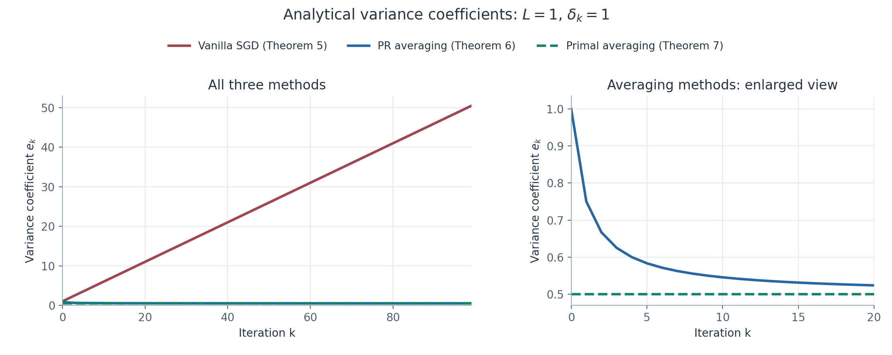

# Averaging 확장 — Theorem 6·7·Table 2

이번에는 §3.2.1의 Theorem 3, §3.2.2의 Theorem 5를 바탕으로 **SGD with Polyak–Ruppert Averaging (Theorem 6)**과 **SGD with Primal Averaging (Theorem 7)**을 연결해 보자.

두 방법은 매우 비슷한 potential을 사용하지만, stochastic gradient를 평가하는 위치가 다르고, 그 차이가 variance accumulation과 SDP의 구조에 직접 반영돼.

이번 절의 핵심은 세 가지야.

1. Averaging이 Theorem 5의 큰 variance accumulation을 어떻게 줄이는가?
2. Theorem 6과 7의 potential 및 LMI certificate는 어떻게 구성되는가?
3. 왜 Table 2에서 vanilla SGD의 optimal $\alpha$는 $2/3$이고 averaging을 적용하면 $1/2$가 되는가?

## 1. Theorem 5에서 Averaging으로 넘어가는 이유

### 1.1. Theorem 5의 결과 복습

지금까지 배운 bounded variance SGD는

$$
x_{k+1}^{(i_k)}=x_k-\delta_kG(x_k;i_k)
$$

이고, oracle은

$$
\begin{aligned} \mathbb E_{i_k}G(x_k;i_k)&=f'(x_k),\\ \mathbb E_{i_k}\Vert G(x_k;i_k)-f'(x_k)\Vert ^2&\le\sigma^2 \end{aligned}
$$

를 만족해.

Theorem 5에서는

$$
\boxed{ \phi_k^f =d_k(f(x_k)-f_\star) +\frac L2\Vert x_k-x_\star\Vert ^2 }
$$

를 구성했고, 다음 recurrence를 얻었어.

$$
\begin{aligned} d_{k+1}&=d_k+\delta_kL,\\ e_k&=\frac{L\delta_k^2}{2}(1+d_{k+1}). \end{aligned}
$$

적절한 step-size 조건에서

$$
\boxed{ \mathbb E_{i_k}\phi_{k+1}^f \le\phi_k^f+e_k\sigma^2 }
$$

가 성립했지.

여기서 문제는 $e_k$에 $d_{k+1}$이 곱해진다는 점이야.

특히 $\delta_k=1/L$, $d_0=0$이면

$$
d_k=k,\qquad e_k=\frac{k+2}{2L}.
$$

따라서 누적 오차는

$$
\boxed{ \sum_{k=0}^{N-1}e_k =\frac{N(N+3)}{4L}=O(N^2). }
$$

한편 $d_N=N$이므로 최종 함수값 상한에 나타나는 noise contribution은 $O(N)$이 돼.

즉, potential에서 함수값의 계수를 키우는 동안 variance penalty도 함께 빠르게 증가하는 문제가 생긴 거야.

### 1.2. Averaging의 목적

이를 개선하기 위해 최종 iterate $x_N$ 대신 여러 iterate의 평균을 출력하는 방법을 고려해.

다만 이번 논문에서 averaging은 단순한 후처리만을 뜻하지 않아.

- Theorem 6: SGD로 $x_{k+1}$을 계산한 다음 평균 $z_{k+1}$을 갱신한다.
- Theorem 7: 먼저 평균 $y_{k+1}$을 계산하고, 그 평균점에서 stochastic gradient를 평가한다.

Theorem 7은 gradient 평가점 자체가 바뀌므로 Theorem 6과 실제 알고리즘이 달라.

## 2. Theorem 6 — Stochastic Gradient with Averaging

논문 p.10 Theorem 6, Appendix E.2 pp.40–41

### 2.1. Algorithm

먼저 일반적인 SGD update를 수행해.

$$
\boxed{ x_{k+1}^{(i_k)} =x_k-\delta_kG(x_k;i_k). }
$$

그다음 새 SGD iterate를 기존 평균 $z_k$에 반영해.

$$
\boxed{ z_{k+1}^{(i_k)} =\frac1{d_k+1}x_{k+1}^{(i_k)} +\frac{d_k}{d_k+1}z_k. }
$$

여기서 $d_k\ge0$은 averaging weight를 결정하는 보조 계수야.

논문의 Theorem 6은 한 단계의 다음 함수값 계수에 들어가는 $d_k+1$을 $d_{k+1}$이라고 표기해. 여기서는 그 한 단계 식을 $(d_k+1)\delta_kL$로 직접 써 두자. 뒤의 §4에서 step-size가 변할 때 여러 단계를 연결하는 averaging weight 수열과 구분하기 위해서야.

고정 step-size의 대표적인 선택은

$$
d_0=0,\qquad d_k=k
$$

이므로

$$
\boxed{ z_{k+1}^{(i_k)} =\frac1{k+1}x_{k+1}^{(i_k)} +\frac{k}{k+1}z_k. }
$$

이 과정을 반복하면

$$
\boxed{ z_N=\frac1N\sum_{t=1}^N x_t. }
$$

즉, $z_N$은 첫 $N$개의 SGD update 결과의 산술평균이야.

### 2.2. Parameterized potential

Theorem 6에서 실제로 사용할 potential은

$$
\boxed{ \phi_k^f =d_k\delta_kL(f(z_k)-f_\star) +\frac L2\Vert x_k-x_\star\Vert ^2 }
$$

와 연결되는 형태야.

여기서 주의해야 할 것이 있어.

- 함수값은 **averaged iterate $z_k$**에서 평가해.
- 거리 제곱은 **SGD iterate $x_k$**에서 평가해.

즉, 하나의 potential에 서로 다른 두 상태가 등장해.

더 정확하게는 Theorem 6의 한 단계 부등식에서 현재 함수값의 계수는 $d_k\delta_kL$, 다음 함수값의 계수는 $(d_k+1)\delta_kL$이야. 따라서 step-size가 변할 때는 이 계수들을 다음 단계와 연결하도록 조정해야 해.

### 2.3. Theorem 6 — Statement

$f\in\mathcal F_L$이고 stochastic oracle이

$$
\mathbb E_{i_k}\Vert G(x_k;i_k)\Vert ^2 \le\sigma^2+\Vert f'(x_k)\Vert ^2
$$

를 만족한다고 하자.

Theorem 6은 다음 부등식이 성립한다는 것을 보장해.

$$
\boxed{ \begin{aligned} &(d_k+1)\delta_kL\, \mathbb E_{i_k}[f(z_{k+1}^{(i_k)})-f_\star]\\ &\qquad+\frac L2 \mathbb E_{i_k}\Vert x_{k+1}^{(i_k)}-x_\star\Vert ^2\\ &\le d_k\delta_kL(f(z_k)-f_\star) +\frac L2\Vert x_k-x_\star\Vert ^2 +e_k\sigma^2. \end{aligned} }
$$

여기서

$$
\boxed{ e_k= \frac{L\delta_k^2}{2} \frac{1+d_k+L\delta_k}{1+d_k} }
$$

이고 step-size는

$$
\boxed{ 0\le\delta_k\le\frac{1+\sqrt5}{2L} }
$$

를 만족하면 돼.

이제 Theorem 5와 $e_k$를 비교해 보자.

|                          | Theorem 5                               | Theorem 6                                                         |
| ------------------------ | --------------------------------------- | ----------------------------------------------------------------- |
| 함수값 평가점                  | $x_k$                               | $z_k$                                                         |
| 거리항 평가점                  | $x_k$                               | $x_k$                                                         |
| 오차 계수 $e_k$          | $\frac{L\delta_k^2}{2}(1+d_{k+1})$ | $\frac{L\delta_k^2}{2}\left(1+\frac{L\delta_k}{1+d_k}\right)$ |
| 고정 step-size에서 $e_k$ | $O(k)$                              | $O(1)$                                                        |

Theorem 6에서는 $d_k$가 증가하더라도

$$
\frac{L\delta_k}{1+d_k}
$$

가 작아져.

따라서 고정 step-size에서는 오차 계수가 $O(k)$로 증가하지 않고 $O(1)$ 수준으로 유지돼.

이것이 첫 번째 averaging의 핵심 개선이야.

## 3. Theorem 6의 증명 — Appendix E.2

앞에서 한 Theorem 3, Theorem 5와 완전히 같은 논리로 진행해 보자.

### 3.1. 필요한 interpolation inequality

한 단계에서 다음 네 종류의 부등식을 사용해.

첫 번째는 $x_\star,x_k$ 사이의 interpolation inequality야.

$$
\boxed{ I_{\star,x_k} =f_\star-f(x_k) -\langle f'(x_k),x_\star-x_k\rangle -\frac1{2L}\Vert f'(x_k)\Vert ^2 \ge0. }
$$

두 번째는 $x_k,z_{k+1}^{(i)}$ 사이의 interpolation이야.

$$
\boxed{ \begin{aligned} I_{x_k,z_{k+1}^{(i)}} ={}&f(x_k)-f(z_{k+1}^{(i)})\\ &-\langle f'(z_{k+1}^{(i)}),x_k-z_{k+1}^{(i)}\rangle\\ &-\frac1{2L} \Vert f'(x_k)-f'(z_{k+1}^{(i)})\Vert ^2 \ge0. \end{aligned} }
$$

세 번째는 $z_k,z_{k+1}^{(i)}$ 사이의 interpolation이야.

$$
\boxed{ \begin{aligned} I_{z_k,z_{k+1}^{(i)}} ={}&f(z_k)-f(z_{k+1}^{(i)})\\ &-\langle f'(z_{k+1}^{(i)}),z_k-z_{k+1}^{(i)}\rangle\\ &-\frac1{2L} \Vert f'(z_k)-f'(z_{k+1}^{(i)})\Vert ^2 \ge0. \end{aligned} }
$$

마지막은 bounded variance constraint야.

$$
\boxed{ \mathbb E_i\Vert G(x_k;i)-f'(x_k)\Vert ^2-\sigma^2\le0. }
$$

Theorem 3에서는 interpolation constraint만 필요했고, Theorem 5에서는 convexity, descent lemma, variance constraint를 사용했어.

이번에는 세 interpolation inequality와 variance constraint의 가중합을 사용하는 거야.

### 3.2. Lagrangian multiplier 선택

Appendix E.2의 multiplier는

$$
\boxed{ \begin{aligned} \lambda_1&=\delta_kL,\\ \lambda_2&=\delta_kL,\\ \lambda_3&=d_k\delta_kL,\\ \lambda_4&=e_k =\frac{L\delta_k^2}{2} \frac{1+d_k+L\delta_k}{1+d_k}. \end{aligned} }
$$

이야.

앞의 세 multiplier는 각각의 interpolation inequality에, 네 번째는 variance constraint에 적용해.

$I_{p,q}\ge0$ 표기를 유지하면, 모두 0 이하인 항들의 가중합을 다음처럼 쓸 수 있어.

$$
\begin{aligned} 0\ge{}& -\lambda_1I_{\star,x_k}\\ &-\lambda_2\mathbb E_i I_{x_k,z_{k+1}^{(i)}}\\ &-\lambda_3\mathbb E_i I_{z_k,z_{k+1}^{(i)}}\\ &+e_k\big[ \mathbb E_i\Vert G(x_k;i)-f'(x_k)\Vert ^2-\sigma^2 \big]. \end{aligned}
$$

이제 이 가중합이 potential difference와 어떻게 연결되는지 항별로 보자. 먼저 함수값 항은

$$
\begin{aligned}
&\delta_kL(f(x_k)-f_\star)
+\delta_kL\,\mathbb E_i[f(z_{k+1}^{(i)})-f(x_k)]\\
&\qquad+d_k\delta_kL\,\mathbb E_i[f(z_{k+1}^{(i)})-f(z_k)]\\
&=(d_k+1)\delta_kL\,\mathbb E_i[f(z_{k+1}^{(i)})-f_\star]
-d_k\delta_kL(f(z_k)-f_\star)
\end{aligned}
$$

로 정리돼. 중간에 등장한 $f(x_k)$의 계수가 소거된 것이야.

다음으로 averaging update와 SGD update를 함께 쓰면

$$
\boxed{
x_k+d_kz_k-(d_k+1)z_{k+1}^{(i)}
=x_k-x_{k+1}^{(i)}
=\delta_kG(x_k;i)
}
$$

이므로, 두 번째와 세 번째 interpolation의 내적항이 다음처럼 결합해.

$$
\begin{aligned}
&\delta_kL\,\mathbb E_i
\langle f'(z_{k+1}^{(i)}),x_k-z_{k+1}^{(i)}\rangle\\
&\qquad+d_k\delta_kL\,\mathbb E_i
\langle f'(z_{k+1}^{(i)}),z_k-z_{k+1}^{(i)}\rangle\\
&=L\delta_k^2\,\mathbb E_i
\langle f'(z_{k+1}^{(i)}),G(x_k;i)\rangle.
\end{aligned}
$$

첫 번째 interpolation의 내적은 거리항과 연결돼. Unbiasedness를 사용하면

$$
\begin{aligned}
&\frac L2\mathbb E_i\Vert x_{k+1}^{(i)}-x_\star\Vert^2
-\frac L2\Vert x_k-x_\star\Vert^2\\
&=-L\delta_k\langle f'(x_k),x_k-x_\star\rangle
+\frac{L\delta_k^2}{2}\mathbb E_i\Vert G(x_k;i)\Vert^2.
\end{aligned}
$$

따라서 가중합에서 함수값 차이와 이 거리항 차이를 먼저 묶으면 다음 등식을 얻어.

$$
\boxed{ \begin{aligned} 0\ge{}& (d_k+1)\delta_kL\, \mathbb E_i[f(z_{k+1}^{(i)})-f_\star]\\ &+\frac L2\mathbb E_i\Vert x_{k+1}^{(i)}-x_\star\Vert ^2\\ &-d_k\delta_kL(f(z_k)-f_\star) -\frac L2\Vert x_k-x_\star\Vert ^2\\ &-e_k\sigma^2+\mathcal R_{6,k}. \end{aligned} }
$$

여기서 $\mathcal R_{6,k}$는 위의 함수값·거리항 차이와 $-e_k\sigma^2$를 제외한 이차항이야. 아직 완전제곱으로 정리하기 전에는

$$
\begin{aligned}
\mathcal R_{6,k}={}&
\frac{\delta_k}{2}\Vert f'(x_k)\Vert^2
+\frac{\delta_k}{2}\mathbb E_i
\Vert f'(x_k)-f'(z_{k+1}^{(i)})\Vert^2\\
&+\frac{d_k\delta_k}{2}\mathbb E_i
\Vert f'(z_k)-f'(z_{k+1}^{(i)})\Vert^2\\
&+L\delta_k^2\mathbb E_i
\langle f'(z_{k+1}^{(i)}),G(x_k;i)\rangle\\
&+\left(e_k-\frac{L\delta_k^2}{2}\right)
\mathbb E_i\Vert G(x_k;i)\Vert^2
-e_k\Vert f'(x_k)\Vert^2
\end{aligned}
$$

야. 마지막 줄에는 $\mathbb E_i\Vert G(x_k;i)-f'(x_k)\Vert^2=\mathbb E_i\Vert G(x_k;i)\Vert^2-\Vert f'(x_k)\Vert^2$를 사용했어.

### 3.3. 남는 이차항이 왜 nonnegative인가?

먼저 $f'(z_{k+1}^{(i)})$를 포함하는 이차항과 내적항을 모아 제곱을 완성해.

$$
\begin{aligned}
&\frac{(d_k+1)\delta_k}{2}\mathbb E_i\Vert f'(z_{k+1}^{(i)})\Vert^2\\
&\quad-\delta_k\mathbb E_i\left\langle
f'(z_{k+1}^{(i)}),d_kf'(z_k)+f'(x_k)-L\delta_kG(x_k;i)
\right\rangle\\
&=\frac{(d_k+1)\delta_k}{2}\mathbb E_i
\left\Vert f'(z_{k+1}^{(i)})
-\frac{d_kf'(z_k)+f'(x_k)-L\delta_kG(x_k;i)}{d_k+1}
\right\Vert^2\\
&\quad-\frac{\delta_k}{2(d_k+1)}\mathbb E_i
\Vert d_kf'(z_k)+f'(x_k)-L\delta_kG(x_k;i)\Vert^2.
\end{aligned}
$$

새로 생긴 마지막 음의 제곱을 전개하면 $\mathbb E_i\Vert G(x_k;i)\Vert^2$의 계수는 $-L^2\delta_k^3/[2(d_k+1)]$이야. 그런데 선택한 $e_k$가

$$
e_k-\frac{L\delta_k^2}{2}
=\frac{L^2\delta_k^3}{2(d_k+1)}
$$

를 만족하므로, 두 항이 정확히 소거돼. 나머지 oracle 내적에는 $\mathbb E_iG(x_k;i)=f'(x_k)$를 쓰면 돼.

이제 첫 번째 완전제곱 바깥의 항은

$$
\begin{aligned}
&\frac{d_k\delta_k}{2(d_k+1)}\Vert f'(z_k)\Vert^2
+\frac{d_k\delta_k(L\delta_k-1)}{d_k+1}
\langle f'(z_k),f'(x_k)\rangle\\
&\quad+\frac{\delta_k}{2}
\left[2-L\delta_k-\frac{(L\delta_k-1)^2}{d_k+1}\right]
\Vert f'(x_k)\Vert^2\\
&=\frac{d_k\delta_k}{2(d_k+1)}
\Vert f'(z_k)+(L\delta_k-1)f'(x_k)\Vert^2\\
&\quad+\frac{\delta_k}{2}
\left[1+L\delta_k(1-L\delta_k)\right]\Vert f'(x_k)\Vert^2
\end{aligned}
$$

가 돼. 따라서 Appendix E.2의 잔차를 다음과 같이 얻어.

$$
\begin{aligned} \mathcal R_{6,k} ={}&\frac{(d_k+1)\delta_k}{2} \mathbb E_i\left\Vert  f'(z_{k+1}^{(i)}) -\frac{ d_kf'(z_k)+f'(x_k)-L\delta_kG(x_k;i) }{d_k+1} \right\Vert ^2\\[6pt] &+\frac{d_k\delta_k}{2(d_k+1)} \Vert f'(z_k)+(L\delta_k-1)f'(x_k)\Vert ^2\\[6pt] &+\frac{\delta_k}{2} \left[1+L\delta_k(1-L\delta_k)\right] \Vert f'(x_k)\Vert ^2. \end{aligned}
$$

앞의 두 항은 계수가 비음수이고 norm 제곱이므로 언제나 0 이상이야.

문제는 마지막 항이야.

$$
1+L\delta_k(1-L\delta_k)\ge0
$$

이어야 해.

이를 정리하면

$$
(L\delta_k)^2-L\delta_k-1\le0.
$$

따라서

$$
\boxed{ 0\le L\delta_k\le\frac{1+\sqrt5}{2} }
$$

이면 세 항이 모두 비음수야.

즉,

$$
\mathcal R_{6,k}\ge0.
$$

그러므로 앞의 가중합에서

$$
\boxed{ \begin{aligned} &(d_k+1)\delta_kL\, \mathbb E_i[f(z_{k+1}^{(i)})-f_\star]\\ &\quad+\frac L2\mathbb E_i\Vert x_{k+1}^{(i)}-x_\star\Vert ^2\\ &\le d_k\delta_kL(f(z_k)-f_\star) +\frac L2\Vert x_k-x_\star\Vert ^2+e_k\sigma^2 \end{aligned} }
$$

를 얻게 돼.

Theorem 6이 증명되었어.

여기서 $(1+\sqrt5)/(2L)$라는 다소 특이한 step-size 상한은 임의로 정한 숫자가 아니라, Lagrangian을 완전제곱으로 분해했을 때 남는 이차항이 nonnegative가 되도록 요구한 결과야.

## 4. Theorem 6에서 telescoping하기 — Appendix E.5

한 가지를 더 확인해야 해.

Theorem 6의 한 단계 inequality가 성립한다고 해서, step-size가 달라질 때 함수값 계수가 자동으로 telescoping되는 것은 아니야.

현재 단계의 좌변 계수는

$$
(d_k+1)\delta_kL
$$

인데, 다음 단계의 우변 계수는

$$
d_{k+1}\delta_{k+1}L
$$

이기 때문이야.

고정 step-size에서는 $d_{k+1}=d_k+1$로 자연스럽게 연결돼. Step-size가 변할 때에는 averaging weight를 바꾸어 두 계수를 정확히 맞출 수 있어. 감소하는 step-size에서는 산술평균을 유지하면서 다음 함수값의 계수를 낮추어 연결하는 방법도 있어. 먼저 Appendix E.5가 사용하는 첫 번째 구성을 보자.

### 4.1. 누적 계수 $D_k$ 도입

Appendix E.5, pp.44–45에서는 양의 step-size에 대해 averaging weight를 다음과 같이 선택해.

$$
\boxed{
d_0=0,\qquad
d_{k+1}=\frac{\delta_k}{\delta_{k+1}}(d_k+1).
}
$$

이렇게 하면 다음 전이의 현재 계수가 이번 전이의 다음 계수와 같아져.

$$
d_{k+1}\delta_{k+1}L=(d_k+1)\delta_kL.
$$

여기서 $d_{k+1}$은 **다음 전이에서 사용할 averaging weight**야. Theorem 6의 한 단계 식에 있는 $d_k+1$을 모든 step-size에서 그대로 이어 붙이는 것과 구분해야 해. 각 전이에는 정리의 한 단계 부등식을 적용하고, 전이 사이에는 위 recurrence로 계수를 연결하는 것이야.

따라서 누적 함수값 계수를

$$
\boxed{D_k=L\delta_kd_k}
$$

로 두면

$$
\begin{aligned}
D_{k+1}
&=L\delta_{k+1}d_{k+1}
=L\delta_k(d_k+1)\\
&=D_k+L\delta_k,
\qquad D_0=0.
\end{aligned}
$$

를 얻어. 이 정의를 averaging weight에 대입하면

$$
\frac1{d_k+1} =\frac{L\delta_k}{D_{k+1}}
$$

가 돼.

그럼 averaging update가

$$
\boxed{ z_{k+1}^{(i)} =\frac{D_k}{D_{k+1}}z_k +\frac{L\delta_k}{D_{k+1}}x_{k+1}^{(i)} }
$$

로 표현돼.

즉, step-size에 따라 가중치가 달라지는 평균을 사용하게 되는 거야.

$d_k=k$인 산술평균은 고정 step-size에서 이 식의 특수한 경우야.

### 4.2. 재구성한 potential

이제

$$
\boxed{ \phi_k^f =D_k(f(z_k)-f_\star) +\frac L2\Vert x_k-x_\star\Vert ^2 }
$$

라고 두면 각 단계의 함수값 계수가 정확히 이어져.

Theorem 6의 결과는

$$
\boxed{ \mathbb E_i\phi_{k+1}^f \le\phi_k^f+e_k^{\mathrm{PR}}\sigma^2 }
$$

가 돼. 오차 계수도 $1/(d_k+1)=L\delta_k/D_{k+1}$를 대입하면

$$
\boxed{ e_k^{\mathrm{PR}} =\frac{L\delta_k^2}{2} \left(1+\frac{L^2\delta_k^2}{D_{k+1}}\right). }
$$

따라서 전체 단계에 적용하면

$$
\boxed{ \begin{aligned} D_N\mathbb E[f(z_N)-f_\star] +\frac L2\mathbb E\Vert x_N-x_\star\Vert ^2 \le{}&\frac L2\Vert x_0-x_\star\Vert ^2\\ &+\frac{L\sigma^2}{2} \sum_{k=0}^{N-1}\delta_k^2 \left(1+\frac{L^2\delta_k^2}{D_{k+1}}\right). \end{aligned} }
$$

이 식이 Appendix E.5에서 Table 2의 Polyak–Ruppert averaging 수렴률을 구하는 출발점이야.

### 4.3. Python 실험의 산술평균과는 어떻게 연결되는가?

첨부된 2B 실험 사양서의 §2와 §9에 따르면, Python 코드의 averaging update는 step-size를 바꾸어도

$$
z_{k+1}^{(i)}
=\frac{k}{k+1}z_k+\frac1{k+1}x_{k+1}^{(i)}
$$

를 유지해. 따라서 감소 step-size에서는 방금 구성한 Appendix E.5의 step-size 가중평균과 평균 가중치가 달라. 기본 설정 $\delta_k=1/L$에서는 $D_k=k$, $d_k=k$이므로 두 평균이 일치해.

산술평균에도 Theorem 6의 한 단계 결과를 $d_k=k$로 적용할 수 있어. $f(z_{k+1}^{(i)})-f_\star\ge0$이고 $\delta_{k+1}\le\delta_k$이므로

$$
(k+1)L\delta_{k+1}\,
\mathbb E_i[f(z_{k+1}^{(i)})-f_\star]
\le
(k+1)L\delta_k\,
\mathbb E_i[f(z_{k+1}^{(i)})-f_\star].
$$

즉, 정리 좌변의 함수값 계수를 낮추어도 부등식은 유지돼. 코드의 함수값 계수 표기를 $d_k^{\mathrm{pot}}$로 구분하면

$$
\boxed{
d_k^{\mathrm{pot}}=kL\delta_k,\qquad
\phi_k^f=d_k^{\mathrm{pot}}(f(z_k)-f_\star)
+\frac L2\Vert x_k-x_\star\Vert^2
}
$$

로 여러 단계를 연결할 수 있어. 이때 오차 계수는 정리에 $d_k=k$를 넣은

$$
e_k=\frac{L\delta_k^2}{2}
\left(1+\frac{L\delta_k}{k+1}\right)
$$

이야. §7.3의 Python 실험은 이 산술평균 알고리즘을 대상으로 potential 계수를 탐색하고, §9의 Table 2 전개는 §4.1–4.2의 $D_k$를 사용하는 가중평균 표현을 따른다는 점을 기억하면 돼.

출처: 논문 Appendix E.5, pp.44–45; `3_2_2_Theorem_6_2B_StochasticGradientDescentWithAveraging.md`, §2 및 §9의 “Theorem 6과 함수값 계수의 대응”.

이제 Theorem 7로 넘어가면, 흥미롭게도 같은 $D_k$ 구조를 사용하면서 **추가 오차 계수 $L^2\delta_k^2/D_{k+1}$**를 제거할 수 있어.

## 5. Theorem 7 — SGD with Primal Averaging

논문 p.10 Theorem 7, Appendix E.3 pp.41–42

Theorem 7은 Theorem 6과 유사한 averaging 구조를 사용하지만, 계산 순서를 바꿔.

### 5.1. Algorithm

Theorem 6에서는

$$
\begin{aligned} x_{k+1}^{(i_k)}&=x_k-\delta_kG(x_k;i_k),\\ z_{k+1}^{(i_k)}&=\text{average of }z_k,x_{k+1}^{(i_k)} \end{aligned}
$$

였어.

그런데 Theorem 7에서는 먼저 평균을 계산해.

$$
\boxed{ y_{k+1} =\frac{d_k}{d_k+\delta_kL}y_k +\frac{\delta_kL}{d_k+\delta_kL}x_k. }
$$

그다음 평균점 $y_{k+1}$에서 stochastic gradient를 평가하고 SGD iterate를 갱신해.

$$
\boxed{ x_{k+1}^{(i_k)} =x_k-\delta_kG(y_{k+1};i_k). }
$$

이것이 primal averaging이야.

중요한 차이는 다음과 같아.

|                           | Theorem 6                  | Theorem 7          |
| ------------------------- | -------------------------- | ------------------ |
| Average                   | $z_{k+1}$             | $y_{k+1}$     |
| Averaging 시점              | SGD update 이후              | SGD update 이전      |
| Oracle 평가점                | $x_k$                  | $y_{k+1}$     |
| 현재 $i_k$에 대한 평균점의 의존성 | $z_{k+1}^{(i_k)}$는 의존 | $y_{k+1}$은 독립 |
| 함수값 분석 대상                 | $f(z_{k+1})$          | $f(y_{k+1})$  |

이 차이가 뒤의 LMI 크기에도 영향을 미쳐.

### 5.2. Theorem 7의 Potential

이번 potential은

$$
\boxed{ \phi_k^f =d_k(f(y_k)-f_\star) +\frac L2\Vert x_k-x_\star\Vert ^2. }
$$

Theorem 6과 비교하면 함수값 평가점이 $z_k$에서 $y_k$로 바뀌었고, 함수값 계수 자체가 $d_k$로 정리되었어.

그리고

$$
\boxed{ d_{k+1}=d_k+\delta_kL }
$$

라는 recurrence를 사용해.

이제 다음 potential을 쓰면

$$
\phi_{k+1}^f =d_{k+1}(f(y_{k+1})-f_\star) +\frac L2\Vert x_{k+1}-x_\star\Vert ^2
$$

앞선 Theorem 5와 동일한 telescoping 구조를 얻게 돼.

### 5.3. Theorem 7 — Statement

$f\in\mathcal F_L$이고

$$
\mathbb E_{i_k}\Vert G(y_{k+1};i_k)\Vert ^2 \le\sigma^2+\Vert f'(y_{k+1})\Vert ^2
$$

라고 하자.

Theorem 7은

$$
\boxed{ \begin{aligned} &d_{k+1}(f(y_{k+1})-f_\star)\\ &\qquad+\frac L2 \mathbb E_{i_k}\Vert x_{k+1}^{(i_k)}-x_\star\Vert ^2\\ &\le d_k(f(y_k)-f_\star) +\frac L2\Vert x_k-x_\star\Vert ^2 +e_k\sigma^2 \end{aligned} }
$$

가 성립함을 보장해.

그 조건은

$$
\boxed{ \begin{aligned} d_{k+1}&=d_k+\delta_kL,\\ e_k&=\frac{L\delta_k^2}{2},\\ 0&\le\delta_k\le\frac1L. \end{aligned} }
$$

이야.

Theorem 5, 6과 비교하면 특히 중요한 부분은

$$
\boxed{e_k=\frac{L\delta_k^2}{2}}
$$

라는 사실이야.

Theorem 5에서는 $e_k$에 $1+d_{k+1}$이 있었고, Theorem 6에서는 추가적인 비율항이 있었어.

반면 Theorem 7에서는 그 추가항이 완전히 사라져.

이제 왜 그런지 증명해 보자.

## 6. Theorem 7의 증명 — Appendix E.3

### 6.1. 필요한 inequality

Theorem 7의 증명에는 세 가지 부등식만 필요해.

첫 번째: $x_\star,y_{k+1}$ 사이의 interpolation

$$
\boxed{ \begin{aligned} I_{\star,y_{k+1}} ={}&f_\star-f(y_{k+1})\\ &-\langle f'(y_{k+1}),x_\star-y_{k+1}\rangle\\ &-\frac1{2L}\Vert f'(y_{k+1})\Vert ^2\ge0. \end{aligned} }
$$

두 번째: $y_k,y_{k+1}$ 사이의 interpolation

$$
\boxed{ \begin{aligned} I_{y_k,y_{k+1}} ={}&f(y_k)-f(y_{k+1})\\ &-\langle f'(y_{k+1}),y_k-y_{k+1}\rangle\\ &-\frac1{2L} \Vert f'(y_k)-f'(y_{k+1})\Vert ^2\ge0. \end{aligned} }
$$

세 번째: Bounded variance

$$
\boxed{ \mathbb E_i\Vert G(y_{k+1};i)-f'(y_{k+1})\Vert ^2-\sigma^2 \le0. }
$$

Theorem 6에서는 세 개의 interpolation inequality가 필요했지만, Theorem 7에서는 두 개만 필요해.

이는 평균점 $y_{k+1}$이 oracle 호출 전에 정해지기 때문에, 함수값과 gradient를 stochastic outcome마다 별도로 정의하지 않아도 되는 것과 연결돼.

### 6.2. Multiplier 선택

Appendix E.3의 선택은

$$
\boxed{ \lambda_1=\delta_kL,\qquad \lambda_2=d_k,\qquad \lambda_3=e_k=\frac{L\delta_k^2}{2}. }
$$

이야.

이들을 가중합하면

$$
\begin{aligned} 0\ge{}& -\lambda_1I_{\star,y_{k+1}} -\lambda_2I_{y_k,y_{k+1}}\\ &+e_k\left[ \mathbb E_i\Vert G(y_{k+1};i)-f'(y_{k+1})\Vert ^2-\sigma^2 \right]. \end{aligned}
$$

### 6.3. Averaging update가 gradient 내적을 소거한다

Theorem 7에서 가장 중요한 등식은

$$
(d_k+\delta_kL)y_{k+1} =d_ky_k+\delta_kLx_k
$$

이야.

따라서

$$
\boxed{ \delta_kL(x_\star-y_{k+1}) +d_k(y_k-y_{k+1}) =\delta_kL(x_\star-x_k). }
$$

이 등식이 왜 중요할까?

두 interpolation inequality의 내적항을 더하면

$$
\begin{aligned} &\delta_kL \langle f'(y_{k+1}),x_\star-y_{k+1}\rangle\\ &\qquad+d_k \langle f'(y_{k+1}),y_k-y_{k+1}\rangle \end{aligned}
$$

이 등장해.

위의 averaging 등식을 대입하면 정확히

$$
\boxed{ -\delta_kL \langle f'(y_{k+1}),x_k-x_\star\rangle }
$$

이 돼.

그런데 SGD 업데이트에서 거리 제곱을 전개하면

$$
\begin{aligned} &\frac L2\mathbb E_i\Vert x_{k+1}^{(i)}-x_\star\Vert ^2 -\frac L2\Vert x_k-x_\star\Vert ^2\\ &=-\delta_kL \langle f'(y_{k+1}),x_k-x_\star\rangle\\ &\quad+\frac{L\delta_k^2}{2} \mathbb E_i\Vert G(y_{k+1};i)\Vert ^2. \end{aligned}
$$

바로 동일한 내적이 등장하지.

따라서 interpolation inequality의 가중합을 potential difference와 연결할 수 있어.

이것이 primal averaging 계수가 $d_k/(d_k+\delta_kL)$와 $\delta_kL/(d_k+\delta_kL)$로 선택되는 수학적 이유야.

### 6.4. Lagrangian의 이차항 정리

Unbiasedness와 variance decomposition을 사용하고, 세 부등식의 weighted sum을 정리하면

$$
\boxed{ \begin{aligned} 0\ge{}& d_{k+1}(f(y_{k+1})-f_\star)\\ &+\frac L2\mathbb E_i\Vert x_{k+1}^{(i)}-x_\star\Vert ^2\\ &-d_k(f(y_k)-f_\star) -\frac L2\Vert x_k-x_\star\Vert ^2\\ &-e_k\sigma^2\\ &+\frac{\delta_k}{2}(1-L\delta_k) \Vert f'(y_{k+1})\Vert ^2\\ &+\frac{d_k}{2L} \Vert f'(y_{k+1})-f'(y_k)\Vert ^2. \end{aligned} }
$$

여기서

$$
d_{k+1}=d_k+\delta_kL,\qquad e_k=\frac{L\delta_k^2}{2}
$$

를 사용했어.

마지막 두 항을 살펴보자.

$$
\frac{\delta_k}{2}(1-L\delta_k) \Vert f'(y_{k+1})\Vert ^2
$$

와

$$
\frac{d_k}{2L}\Vert f'(y_{k+1})-f'(y_k)\Vert ^2
$$

야.

$d_k\ge0$이므로 두 번째 항은 항상 nonnegative야.

첫 번째 항이 nonnegative이려면

$$
1-L\delta_k\ge0
$$

이면 돼.

따라서

$$
\boxed{0\le\delta_k\le\frac1L}
$$

이면 모든 추가항이 비음수야.

이들을 버리면

$$
\boxed{ \mathbb E_i[\phi_{k+1}^f] \le\phi_k^f+e_k\sigma^2 }
$$

를 얻어.

Theorem 7이 증명되었어.

## 7. 두 정리의 증명을 LMI로 읽기

앞서 SGD의 Appendix E.7에서 유도했던 행렬 조건은

$$
\boxed{
\frac1n\sum_{i=1}^nV_{k+1}^{(i)}
-V_k-e_kA_{\mathrm{var}}
+\sum_{p,q}\lambda_{p,q}M_{p,q}\preceq0
}
$$

였어. $V_k$는 현재 potential의 이차항 행렬이고, $V_{k+1}^{(i)}$는 outcome $i$에 따른 다음 potential의 이차항 행렬이야. 따라서 stochastic outcome에 대한 평균을 행렬에서도 유지해야 해.

이 조건에는 **함수값 계수를 모두 0으로 만드는 선형 등식**과 $\lambda_{p,q}\ge0$, $e_k\ge0$도 함께 필요해. 두 averaging 방법에서 이 식들을 실제로 구성해 보자. $P,F$의 배치는 첨부된 2B·2C 실험 사양서 §3–5를 따르고, 해석적 계수와 multiplier는 앞의 Appendix E.2·E.3 증명을 사용해.

이 절에서도 $G=P^\top P$는 Gram matrix, $G(x;i)$ 또는 $G(y;i)$는 stochastic oracle이야. 굵은 $\mathbf G_i$는 $P\mathbf G_i$가 해당 oracle 벡터가 되도록 고르는 **계수벡터**야. 실제 gradient와 그 계수벡터도 $f'(x)$와 $\mathbf g_x$로 구분해.

Interpolation 행렬은 앞 문서와 동일해. 각 점의 위치·gradient·함수값 계수벡터를 $\mathbf x_p,\mathbf g_p,\mathbf f_p$라고 쓰면

$$
\begin{aligned}
I_{p,q}(G,F)
&=F(\mathbf f_p-\mathbf f_q)+\operatorname{Tr}(GM_{p,q}),\\
M_{p,q}
&=-\frac12\left[
\mathbf g_q(\mathbf x_p-\mathbf x_q)^\top
+(\mathbf x_p-\mathbf x_q)\mathbf g_q^\top
\right]\\
&\quad-\frac1{2L}
(\mathbf g_p-\mathbf g_q)(\mathbf g_p-\mathbf g_q)^\top.
\end{aligned}
$$

아래의 $\mathbf z_k,\mathbf y_k$ 등은 각 점의 위치 계수벡터를 알아보기 쉽게 쓴 것이야. 위치는 $x_\star$를 기준으로, 함수값은 $f_\star$를 기준으로 표현하므로 $\mathbf x_\star=\mathbf g_\star=\mathbf f_\star=0$으로 둘 수 있어.

### 7.1. Theorem 6의 Gram representation과 LMI

**상태와 계수벡터**

Theorem 6에서는 다음 벡터들을 모아.

$$
\begin{aligned}
P=[\;&x_k-x_\star,\ z_k-x_\star,\ f'(z_k),\\
&G(x_k;1),\ldots,G(x_k;n),\\
&f'(z_{k+1}^{(1)}),\ldots,f'(z_{k+1}^{(n)})\;],\\
G&=P^\top P\in\mathbb S_+^{3+2n}.
\end{aligned}
$$

$\mathbf e_j\in\mathbb R^{3+2n}$를 $j$번째 표준기저벡터라고 하면 각 열을 고르는 계수벡터는

$$
\begin{aligned}
\mathbf x_k&=\mathbf e_1,&
\mathbf z_k&=\mathbf e_2,&
\mathbf g_{z_k}&=\mathbf e_3,\\
\mathbf G_i&=\mathbf e_{3+i},&
\mathbf g_{x_k}&=\frac1n\sum_{i=1}^n\mathbf G_i,&
\mathbf g_{z_{k+1}^{(i)}}&=\mathbf e_{3+n+i}.
\end{aligned}
$$

야. 특히 $P\mathbf g_{x_k}=n^{-1}\sum_iG(x_k;i)=f'(x_k)$이므로 unbiasedness가 계수벡터에 반영돼.

다음 두 점도 새 열을 추가하지 않고 update로 표현할 수 있어.

$$
\boxed{
\mathbf x_{k+1}^{(i)}=\mathbf x_k-\delta_k\mathbf G_i,\qquad
\mathbf z_{k+1}^{(i)}
=\frac{\mathbf x_k-\delta_k\mathbf G_i+d_k\mathbf z_k}{d_k+1}.
}
$$

Function-value vector는

$$
F=[
f(z_k)-f_\star,\ f(x_k)-f_\star,\
f(z_{k+1}^{(1)})-f_\star,\ldots,
f(z_{k+1}^{(n)})-f_\star
]\in\mathbb R^{1\times(n+2)}
$$

야. $\mathbf f_{z_k},\mathbf f_{x_k},\mathbf f_{z_{k+1}^{(i)}}$는 각각 $F$의 첫 번째, 두 번째, $(i+2)$번째 성분을 고르는 $\mathbb R^{n+2}$의 계수벡터야.

Interpolation point는

$$
\mathcal I_k=
\{x_\star,x_k,z_k,z_{k+1}^{(1)},\ldots,z_{k+1}^{(n)}\}.
$$

$n=2$이면 $G\in\mathbb S_+^7$이고, 다섯 점의 서로 다른 순서쌍에서 총 20개의 interpolation inequality가 생겨.

**두 상태가 들어간 potential의 행렬**

일반 potential에서는 averaged iterate의 이차항에 $Q_k=\begin{pmatrix}a_k&c_k\\c_k&b_k\end{pmatrix}$를, SGD iterate의 거리항에 $a'_k$를 사용해. 함수값 계수 $d_k^{\mathrm{pot}}$는 averaging weight를 정하는 $d_k$와 구분하자. 이 구분은 §4.3 및 §7.3의 코드 표기와 같아.

$$
\begin{aligned}
V_k={}&
[\mathbf z_k\ \mathbf g_{z_k}]
Q_k
[\mathbf z_k\ \mathbf g_{z_k}]^\top
+a'_k\mathbf x_k\mathbf x_k^\top,\\
V_{k+1}^{(i)}={}&
[\mathbf z_{k+1}^{(i)}\ \mathbf g_{z_{k+1}^{(i)}}]
Q_{k+1}
[\mathbf z_{k+1}^{(i)}\ \mathbf g_{z_{k+1}^{(i)}}]^\top\\
&+a'_{k+1}
\mathbf x_{k+1}^{(i)}(\mathbf x_{k+1}^{(i)})^\top.
\end{aligned}
$$

그러면 potential difference가 실제로

$$
\begin{aligned}
\Delta\phi_k(G,F)
={}&\operatorname{Tr}\left[
\left(\frac1n\sum_iV_{k+1}^{(i)}-V_k\right)G
\right]\\
&+F\left[
\frac{d_{k+1}^{\mathrm{pot}}}{n}
\sum_i\mathbf f_{z_{k+1}^{(i)}}
-d_k^{\mathrm{pot}}\mathbf f_{z_k}
\right]
\end{aligned}
$$

로 표현돼. 두 상태의 거리항과 gradient 항이 모두 같은 $G$에 대한 선형식에 들어간 것이야.

Variance는 oracle을 호출하는 $x_k$에서 계산하므로

$$
A_{\mathrm{var}}
=\frac1n\sum_i
(\mathbf G_i-\mathbf g_{x_k})
(\mathbf G_i-\mathbf g_{x_k})^\top,
\qquad
\operatorname{Tr}(GA_{\mathrm{var}})\le\sigma^2.
$$

따라서 이 알고리즘의 한 단계 SDP 조건은

$$
\boxed{
\begin{aligned}
&\frac1n\sum_iV_{k+1}^{(i)}-V_k-e_kA_{\mathrm{var}}
+\sum_{p,q}\lambda_{p,q}M_{p,q}\preceq0,\\
&\frac{d_{k+1}^{\mathrm{pot}}}{n}
\sum_i\mathbf f_{z_{k+1}^{(i)}}
-d_k^{\mathrm{pot}}\mathbf f_{z_k}
+\sum_{p,q}\lambda_{p,q}(\mathbf f_p-\mathbf f_q)=0,\\
&\lambda_{p,q}\ge0,\qquad e_k\ge0.
\end{aligned}
}
$$

야. $n=2$에서는 7×7 LMI와 함수값 네 개에 대응하는 네 개의 scalar 선형 등식이야. Algorithm의 step-size와 averaging weight를 고정하면 모든 조건은 potential 계수와 multiplier에 대해 affine이야.

**Theorem 6의 계수를 대입해 함수값 소거하기**

앞의 한 단계 증명에서는

$$
Q_k=Q_{k+1}=0,\qquad a'_k=a'_{k+1}=\frac L2,
$$

$$
d_k^{\mathrm{pot}}=d_k\delta_kL,\qquad
d_{k+1}^{\mathrm{pot}}=(d_k+1)\delta_kL
$$

로 두었어. §4.1의 가중평균을 사용하면 이 함수값 계수들은 각각 $D_k,D_{k+1}$이 돼.

Interpolation multiplier는

$$
\boxed{
\lambda_{\star,x_k}=\delta_kL,\qquad
\lambda_{x_k,z_{k+1}^{(i)}}=\frac{\delta_kL}{n},\qquad
\lambda_{z_k,z_{k+1}^{(i)}}=\frac{d_k\delta_kL}{n}
}
$$

이고 나머지는 0으로 둬. Averaged inequality 하나의 가중치를 outcome별 inequality에 나누어 주므로 $1/n$이 붙는 것이야. Variance multiplier는 정리의 $e_k$를 사용해.

이제 선형 등식의 각 함수값 계수를 확인하면

$$
\begin{aligned}
f(x_k)-f_\star:\quad&
-\delta_kL+\sum_{i=1}^n\frac{\delta_kL}{n}=0,\\
f(z_k)-f_\star:\quad&
-d_k\delta_kL+\sum_{i=1}^n\frac{d_k\delta_kL}{n}=0,\\
f(z_{k+1}^{(i)})-f_\star:\quad&
\frac{(d_k+1)\delta_kL}{n}
-\frac{\delta_kL}{n}
-\frac{d_k\delta_kL}{n}=0.
\end{aligned}
$$

이야. Potential에 직접 들어가지 않는 $f(x_k)$까지 소거되는 것을 확인했어.

**잔차의 완전제곱을 NSD 행렬로 옮기기**

어떤 계수벡터에 대해서든 $\Vert P\mathbf v\Vert^2=\operatorname{Tr}(G\mathbf v\mathbf v^\top)$이야. 따라서 §3.3의 $\mathcal R_{6,k}$에 있는 세 제곱을 각각 outer product로 바꾸면

$$
\begin{aligned}
&\frac1n\sum_iV_{k+1}^{(i)}-V_k-e_kA_{\mathrm{var}}
+\sum_{p,q}\lambda_{p,q}M_{p,q}\\
&=-\frac{(d_k+1)\delta_k}{2n}\sum_i
\left(
\mathbf g_{z_{k+1}^{(i)}}
-\frac{d_k\mathbf g_{z_k}+\mathbf g_{x_k}-L\delta_k\mathbf G_i}{d_k+1}
\right)\\
&\qquad\quad{}\cdot
\left(
\mathbf g_{z_{k+1}^{(i)}}
-\frac{d_k\mathbf g_{z_k}+\mathbf g_{x_k}-L\delta_k\mathbf G_i}{d_k+1}
\right)^\top\\
&\quad-\frac{d_k\delta_k}{2(d_k+1)}
\big(\mathbf g_{z_k}+(L\delta_k-1)\mathbf g_{x_k}\big)
\big(\mathbf g_{z_k}+(L\delta_k-1)\mathbf g_{x_k}\big)^\top\\
&\quad-\frac{\delta_k}{2}
\big[1+L\delta_k(1-L\delta_k)\big]
\mathbf g_{x_k}\mathbf g_{x_k}^\top
\preceq0.
\end{aligned}
$$

를 얻어. 이 행렬과 $G$의 trace가 정확히 $-\mathcal R_{6,k}$야. 앞의 가중합은 $\Delta\phi_k-e_k\sigma^2+\mathcal R_{6,k}\le0$였고, Lagrangian은 $\Delta\phi_k-e_k\sigma^2$에 비음수 constraint 항들을 더하므로 잔차가 음의 부호로 나타나.

$d_k\ge0$과 $0\le\delta_k\le(1+\sqrt5)/(2L)$에서 각 outer product 앞의 계수가 nonpositive이므로 LMI가 성립해. 함수값 선형 등식과 LMI를 모두 확인한 것이야.

### 7.2. Theorem 7의 Gram representation과 LMI

**상태와 계수벡터**

Primal averaging에서는

$$
\begin{aligned}
P&=[
x_k-x_\star,\ y_k-x_\star,\ f'(y_k),\
G(y_{k+1};1),\ldots,G(y_{k+1};n)
],\\
G&=P^\top P\in\mathbb S_+^{3+n}.
\end{aligned}
$$

를 사용해. 이번에는 $\mathbf e_j\in\mathbb R^{3+n}$이고,

$$
\begin{aligned}
\mathbf x_k&=\mathbf e_1,&
\mathbf y_k&=\mathbf e_2,&
\mathbf g_{y_k}&=\mathbf e_3,\\
\mathbf G_i&=\mathbf e_{3+i},&
\mathbf g_{y_{k+1}}&=\frac1n\sum_i\mathbf G_i
\end{aligned}
$$

야. 다음 점의 계수벡터는

$$
\boxed{
\mathbf y_{k+1}
=\frac{d_k\mathbf y_k+\delta_kL\mathbf x_k}{d_k+\delta_kL},
\qquad
\mathbf x_{k+1}^{(i)}=\mathbf x_k-\delta_k\mathbf G_i.
}
$$

평균점 $y_{k+1}$과 그 gradient는 outcome마다 달라지지 않으므로 각각 하나의 계수벡터만 필요해. 여기서는 $d_k+\delta_kL>0$인 전이를 생각하며, 뒤의 step-size policy에서는 이 조건을 만족해.

함수값은

$$
F=[f(y_k)-f_\star,\ f(y_{k+1})-f_\star]
\in\mathbb R^{1\times2}
$$

만 필요하고, $\mathbf f_{y_k}=(1,0)^\top$, $\mathbf f_{y_{k+1}}=(0,1)^\top$야. Interpolation point도

$$
\mathcal I_k=\{x_\star,y_k,y_{k+1}\}
$$

의 세 개뿐이야. $n=2$이면 $G\in\mathbb S_+^5$이고 interpolation inequality는 여섯 개야.

**두 상태의 potential과 선형 등식**

이번 potential에서도 $y_k$에 관한 이차항과 $x_k$의 거리항을 구분해.

$$
\begin{aligned}
V_k={}&
[\mathbf y_k\ \mathbf g_{y_k}]
Q_k
[\mathbf y_k\ \mathbf g_{y_k}]^\top
+a'_k\mathbf x_k\mathbf x_k^\top,\\
V_{k+1}^{(i)}={}&
[\mathbf y_{k+1}\ \mathbf g_{y_{k+1}}]
Q_{k+1}
[\mathbf y_{k+1}\ \mathbf g_{y_{k+1}}]^\top\\
&+a'_{k+1}
\mathbf x_{k+1}^{(i)}(\mathbf x_{k+1}^{(i)})^\top.
\end{aligned}
$$

$V_{k+1}^{(i)}$의 첫 번째 항은 모든 outcome에서 같고, 두 번째 항만 outcome에 따라 달라져. 따라서

$$
\begin{aligned}
\Delta\phi_k(G,F)
={}&\operatorname{Tr}\left[
\left(\frac1n\sum_iV_{k+1}^{(i)}-V_k\right)G
\right]\\
&+F\left[d_{k+1}\mathbf f_{y_{k+1}}-d_k\mathbf f_{y_k}\right].
\end{aligned}
$$

Variance는 이번에 oracle을 호출한 $y_{k+1}$에서 계산해.

$$
A_{\mathrm{var}}
=\frac1n\sum_i
(\mathbf G_i-\mathbf g_{y_{k+1}})
(\mathbf G_i-\mathbf g_{y_{k+1}})^\top.
$$

전체 SDP 조건은

$$
\boxed{
\begin{aligned}
&\frac1n\sum_iV_{k+1}^{(i)}-V_k-e_kA_{\mathrm{var}}
+\sum_{p,q}\lambda_{p,q}M_{p,q}\preceq0,\\
&d_{k+1}\mathbf f_{y_{k+1}}-d_k\mathbf f_{y_k}
+\sum_{p,q}\lambda_{p,q}(\mathbf f_p-\mathbf f_q)=0,\\
&\lambda_{p,q}\ge0,\qquad e_k\ge0.
\end{aligned}
}
$$

이야. $n=2$에서는 5×5 LMI와 두 개의 scalar 선형 등식이 돼.

**Theorem 7의 계수와 multiplier를 대입하기**

앞의 정리는

$$
\begin{aligned}
Q_k=Q_{k+1}&=0,&a'_k=a'_{k+1}&=\frac L2,\\
d_{k+1}&=d_k+\delta_kL,&
e_k&=\frac{L\delta_k^2}{2}
\end{aligned}
$$

를 선택하고,

$$
\lambda_{\star,y_{k+1}}=\delta_kL,\qquad
\lambda_{y_k,y_{k+1}}=d_k
$$

이외의 interpolation multiplier는 0으로 두어. 함수값 선형 등식에 넣으면

$$
\begin{aligned}
&d_{k+1}\mathbf f_{y_{k+1}}-d_k\mathbf f_{y_k}
+\delta_kL(\mathbf f_\star-\mathbf f_{y_{k+1}})\\
&\qquad+d_k(\mathbf f_{y_k}-\mathbf f_{y_{k+1}})\\
&=(d_{k+1}-d_k-\delta_kL)\mathbf f_{y_{k+1}}
=0.
\end{aligned}
$$

이야. 두 함수값의 계수가 실제로 소거됐어.

남은 행렬은 §6.4의 두 제곱을 옮겨 쓰면

$$
\begin{aligned}
&\frac1n\sum_iV_{k+1}^{(i)}-V_k-e_kA_{\mathrm{var}}
+\sum_{p,q}\lambda_{p,q}M_{p,q}\\
&=-\frac{\delta_k}{2}(1-L\delta_k)
\mathbf g_{y_{k+1}}\mathbf g_{y_{k+1}}^\top\\
&\quad-\frac{d_k}{2L}
(\mathbf g_{y_{k+1}}-\mathbf g_{y_k})
(\mathbf g_{y_{k+1}}-\mathbf g_{y_k})^\top
\preceq0.
\end{aligned}
$$

가 돼. $d_k\ge0$, $0\le\delta_k\le1/L$에서 두 outer product의 계수가 nonpositive이므로 LMI가 성립해.

따라서 Theorem 7도 함수값 선형 등식과 NSD 행렬을 함께 구성한 SDP certificate야. Theorem 6에서는 outcome별 $z_{k+1}^{(i)}$와 그 gradient가 필요했고, Theorem 7에서는 하나의 $y_{k+1}$와 그 gradient면 충분하다는 차이가 행렬 크기에도 그대로 나타난 것이야.

출처: 논문 Appendix E.2–E.3, pp.40–42 및 Appendix E.7, pp.48–49; 첨부된 2B·2C 실험 사양서 §3–5. 위의 outer-product 식은 각 정리의 잔차를 해당 Gram 표현으로 옮겨 쓴 것이야.

### 7.3. SDP numerical experiment의 규모와 objective

첨부한 Python 실험 사양서의 구조까지 연결하면 다음과 같아.

| 항목                       | Theorem 5 — SGD    | Theorem 6 — PR Averaging | Theorem 7 — Primal Averaging |
| ------------------------ | ------------------ | ------------------------ | ---------------------------- |
| Gram matrix 크기           | $1+2n$         | $3+2n$               | $3+n$                    |
| $n=2$일 때             | 5×5                | 7×7                      | 5×5                          |
| Interpolation point 수 ($n=2$)    | 4                  | 5                        | 3                            |
| 함수값 변수 수 ($n=2$)                 | 3                  | 4                        | 2                            |
| 1차 SDP                   | $\max d_N$     | $\max d_N^{\mathrm{pot}}$           | 해당 없음                        |
| 2차 SDP                   | $\min\sum e_k$ | $\min\sum e_k$       | 해당 없음                        |
| Primal Averaging의 단일 SDP | —                  | —                        | $\min\sum e_k$           |

Theorem 6에 대응하는 Python 실험은 보다 일반적인 potential

$$
\begin{aligned} \phi_k^f ={}& \begin{pmatrix}z_k-x_\star\\f'(z_k)\end{pmatrix}^{\!\top} (Q_k\otimes I_d) \begin{pmatrix}z_k-x_\star\\f'(z_k)\end{pmatrix}\\ &+d_k^{\mathrm{pot}}(f(z_k)-f_\star) +a_k'\Vert x_k-x_\star\Vert ^2 \end{aligned}
$$

의 계수를 탐색해.

여기서 $d_k^{\mathrm{pot}}$는 코드의 함수값 계수이고, Theorem 6의 averaging weight용 $d_k$와 구분했어. 원래 Python 사양서의 $d_k$와 배열의 함수값 계수를 이 절에서는 $d_k^{\mathrm{pot}}$로 표시하는 것이야.

이 실험의 averaging update는 §4.3에서 설명한 산술평균이야. 따라서 일반 step-size에서 §4.1의 $D_k$ 가중평균과 같은 알고리즘으로 취급하면 안 돼. 기본 설정 $\delta_k=1/L$에서는 두 평균이 일치하며, 해석적 선택도 $d_k^{\mathrm{pot}}=D_k=k$로 같아.

중간 상태 $k=1,\ldots,N-1$의 탐색 조건은 다음과 같아.

- `relax=0`: $Q_k,a_k',d_k^{\mathrm{pot}}$를 자유롭게 탐색하며 최종 거리항은 제거.
- `relax=1`: $Q_k=0,\ a_k'=L/2$로 제한하고 함수값 계수만 탐색. 최종 거리항은 유지.

Theorem 7의 Python 실험도 유사한 potential을 사용하지만, 중요한 차이는

$$
d_{k+1}=d_k+\delta_kL
$$

을 SDP 전에 이미 고정한다는 점이야.

따라서 `relax=0`에서는 중간 $Q_k,a_k'$를 탐색하고, `relax=1`에서는 $Q_k=0,\ a_k'=L/2$로 고정한 채 두 설정 모두

$$
\boxed{\min\sum_{k=0}^{N-1}e_k}
$$

를 한 번만 풀어.

즉, Theorem 7의 numerical pipeline은 $d_N$을 더 크게 만드는 문제가 아니라, 이미 정한 $d_N$에 대해 variance accumulation을 얼마나 줄일 수 있는가를 탐색하는 구조야.

두 실험 모두 초기에는 $Q_0=0$, $a'_0=L/2$, 함수값 계수는 0이야. 최종에는 $Q_N=0$이고, $a'_N$은 $\mathrm{relax}=0$에서 0, $\mathrm{relax}=1$에서 $L/2$야. 중간 $Q_k$에는 별도의 PSD 조건을 요구하지 않아. Gram matrix의 $G\succeq0$과 potential 계수행렬 $Q_k$의 조건은 구분해야 해.

출처: 첨부된 2B·2C 실험 사양서 §1–2 및 §6. 2B의 감소 step-size와 산술평균에 대한 해석적 계수 연결은 같은 사양서 §9를 참고하면 돼.

## 8. 고정 step-size에서 세 방법을 직접 비교

이제 Theorem 5, 6, 7에 똑같이

$$
\boxed{\delta_k=\frac1L}
$$

를 적용해 보자.

초기 함수값 계수는 0으로 두고, $\Vert x_0-x_\star\Vert ^2$에 대한 초기 potential은 모두 $L/2$로 정하자.

세 방법 모두 최종 함수값 계수는

$$
\boxed{D_N=N}
$$

이 돼.

따라서 이제 차이를 만드는 것은 **누적 variance 계수 $\sum e_k$**야.

### 8.1. 각 방법의 $e_k$

| Method | $e_k$ |
| --- | --- |
| Vanilla SGD — Theorem 5 | $\frac{k+2}{2L}$ |
| PR Averaging — Theorem 6 | $\frac1{2L}\left(1+\frac1{k+1}\right)$ |
| Primal Averaging — Theorem 7 | $\frac1{2L}$ |

$L=1$, $\delta_k=1$에서 Theorem 5·6·7의 해석적 식으로 그린 비교 그래프야. 논문의 원그림은 아니며, 오른쪽 패널은 두 averaging 방법의 초기 구간을 확대한 것이야.

Vanilla SGD에서는 $e_k$가 선형으로 증가하지만, PR Averaging에서는 $1/(2L)$에 수렴하고, Primal Averaging에서는 처음부터 그 값으로 일정해.

### 8.2. 누적 오차 비교

세 방법의 $e_k$를 합하면 다음과 같아.

| Method           | $\sum_{k=0}^{N-1}e_k$ | Order        |
| ---------------- | -------------------------- | ------------ |
| Vanilla SGD      | $\frac{N(N+3)}{4L}$    | $O(N^2)$ |
| PR Averaging     | $\frac{N+H_N}{2L}$     | $O(N)$   |
| Primal Averaging | $\frac{N}{2L}$         | $O(N)$   |

여기서

$$
H_N=\sum_{t=1}^N\frac1t
$$

는 harmonic number야.

따라서 각각의 convergence bound는 다음과 같아.

Vanilla SGD

$$
\boxed{ \mathbb E[f(x_N)-f_\star] \le \frac{L\Vert x_0-x_\star\Vert ^2}{2N} +\frac{N+3}{4L}\sigma^2. }
$$

Polyak–Ruppert Averaging

$$
\boxed{ \mathbb E[f(z_N)-f_\star] \le \frac{L\Vert x_0-x_\star\Vert ^2}{2N} +\frac{\sigma^2}{2L} \left(1+\frac{H_N}{N}\right). }
$$

Primal Averaging

$$
\boxed{ \mathbb E[f(y_N)-f_\star] \le \frac{L\Vert x_0-x_\star\Vert ^2}{2N} +\frac{\sigma^2}{2L}. }
$$

여기서 averaging이 주는 개선은 아주 명확해.

$$
\boxed{ \text{Accumulated error: }O(N^2)\longrightarrow O(N). }
$$

그러나 이것만으로 수렴이 증명된 것은 아니야.

왜냐하면 $D_N=N$으로 나누었을 때 averaging의 noise contribution은 여전히 $O(1)$이기 때문이야.

따라서 고정 step-size는 variance accumulation을 제어하지만, 이 bound에서 오차를 0으로 보내려면 step-size를 감소시켜야 해.

## 9. Table 2 — Decreasing step-size와 수렴률 비교

논문 p.11 Table 2, Appendix E.5 pp.43–45

이제 최종 단계야.

논문 Table 2는 세 알고리즘에 같은 decreasing step-size policy를 적용했을 때의 수렴률을 비교하고 있어.

$$
\boxed{ \delta_k=\frac1{L(k+1)^\alpha}. }
$$

여기서는 $0<\alpha<1$을 중심으로 살펴보자.

### 9.1. 세 알고리즘의 공통 함수값 계수

Theorem 5와 7에서는

$$
d_{k+1}=d_k+L\delta_k
$$

를 사용하고, Theorem 6도 Appendix E.5의 가중 평균 표현을 사용하면 같은 누적 계수 $D_k$를 얻어.

따라서 세 방법 모두

$$
\boxed{ D_N=\sum_{k=0}^{N-1}L\delta_k =\sum_{t=1}^Nt^{-\alpha}. }
$$

$0<\alpha<1$이면

$$
\boxed{ D_N=\Theta(N^{1-\alpha}). }
$$

그러므로 초기 거리항으로부터 오는 contribution은 공통적으로

$$
\boxed{ \frac{L\Vert x_0-x_\star\Vert ^2}{2D_N} =O(N^{\alpha-1}). }
$$

이야.

따라서 Table 2에서 initial-distance contribution이 세 알고리즘 모두 동일한 이유가 설명됐어.

차이는 결국 variance term에 있어.

### 9.2. Vanilla SGD의 noise contribution

Theorem 5에서는

$$
e_k=\frac{L\delta_k^2}{2}(1+D_{k+1})
$$

였지.

큰 $k$에 대해

$$
\delta_k=\Theta(k^{-\alpha}), \qquad D_{k+1}=\Theta(k^{1-\alpha})
$$

이므로

$$
\begin{aligned} e_k &=O(k^{-2\alpha}) +O(k^{1-3\alpha}). \end{aligned}
$$

특히 $0<\alpha<2/3$일 때 지배적인 누적항은

$$
\sum_{k=0}^{N-1}k^{1-3\alpha} =O(N^{2-3\alpha}).
$$

따라서

$$
\frac{\sum_{k=0}^{N-1}e_k}{D_N} =O\left( \frac{N^{2-3\alpha}}{N^{1-\alpha}} \right)
$$

이므로

$$
\boxed{ \frac{\sum e_k}{D_N}=O(N^{1-2\alpha}). }
$$

결국 Table 2에 나타나는 vanilla SGD의 두 항은

$$
\boxed{ \mathbb E[f(x_N)-f_\star] \lesssim \underbrace{O(N^{\alpha-1})}_{\text{Initial distance}} + \underbrace{O(N^{1-2\alpha})}_{\text{Variance}} }
$$

라는 형태야. 상수 계수에는 각각 $L\Vert x_0-x_\star\Vert ^2$와 $\sigma^2/L$이 들어가.

#### Optimal $\alpha$ 선택

두 항 중 느리게 감소하는 항이 최종 수렴률을 결정해.

그래서 두 exponent를 같게 만드는 선택을 생각할 수 있어.

$$
\begin{aligned} \alpha-1&=1-2\alpha\\ 3\alpha&=2. \end{aligned}
$$

따라서

$$
\boxed{\alpha_{\mathrm{SGD}}^{\mathrm{opt}}=\frac23}.
$$

실제 $\alpha=2/3$에서는 $\sum e_k$에 harmonic sum이 발생하므로 로그 항이 추가돼.

$$
\boxed{ \mathbb E[f(x_N)-f_\star] = O\left( \frac{L\Vert x_0-x_\star\Vert ^2}{N^{1/3}} +\frac{\sigma^2\log N}{L N^{1/3}} \right). }
$$

즉, 로그를 무시하면 $O(N^{-1/3})$이야.

### 9.3. PR Averaging과 Primal Averaging의 noise contribution

Theorem 7에서는

$$
e_k^{\mathrm{PA}}=\frac{L\delta_k^2}{2}
$$

이므로

$$
e_k^{\mathrm{PA}} =\frac1{2L(k+1)^{2\alpha}}.
$$

따라서

$$
\sum_{k=0}^{N-1}e_k^{\mathrm{PA}} =\frac1{2L}\sum_{t=1}^N t^{-2\alpha}.
$$

특히 $0<\alpha<1/2$이면

$$
\sum_{k=0}^{N-1}e_k^{\mathrm{PA}} =\Theta(N^{1-2\alpha}).
$$

따라서

$$
\boxed{ \frac{\sum e_k^{\mathrm{PA}}}{D_N} =O(N^{-\alpha}). }
$$

Theorem 6의 PR Averaging에서도

$$
e_k^{\mathrm{PR}} =\frac{L\delta_k^2}{2} \left(1+\frac{L^2\delta_k^2}{D_{k+1}}\right)
$$

이야. 여기서 추가 variance 계수 자체는

$$
e_k^{\mathrm{PR}}-\frac{L\delta_k^2}{2}
=\frac{L^3\delta_k^4}{2D_{k+1}}
=O(k^{-1-3\alpha})
$$

이므로 $\alpha>0$에서 그 누적합은 유계야. 이를 $D_N=\Theta(N^{1-\alpha})$로 나누면 추가 contribution은 $O(N^{\alpha-1})$이 돼. $0<\alpha<1/2$에서는 이 항이 $O(N^{-\alpha})$보다 빠르게 감소하므로, 두 averaging 방법의 지배적인 noise rate는 같아.

즉, 두 averaging 방법 모두 Table 2의 형태로

$$
\boxed{ \mathbb E[f(\text{averaged iterate})-f_\star] \lesssim \underbrace{O(N^{\alpha-1})}_{\text{Initial distance}} + \underbrace{O(N^{-\alpha})}_{\text{Variance}} }
$$

를 얻어.

#### Optimal $\alpha$ 선택

이번에는 두 exponent를 같게 만들면

$$
\begin{aligned} \alpha-1&=-\alpha\\ 2\alpha&=1. \end{aligned}
$$

따라서

$$
\boxed{ \alpha_{\mathrm{Averaging}}^{\mathrm{opt}}=\frac12. }
$$

$\alpha=1/2$에서는

$$
\sum_{t=1}^N t^{-2\alpha} =\sum_{t=1}^N\frac1t =O(\log N)
$$

이기 때문에

$$
\boxed{ \begin{aligned} \mathbb E[f(z_N)-f_\star] &=O\left( \frac{L\Vert x_0-x_\star\Vert ^2}{\sqrt N} +\frac{\sigma^2\log N}{L\sqrt N} \right),\\[4pt] \mathbb E[f(y_N)-f_\star] &=O\left( \frac{L\Vert x_0-x_\star\Vert ^2}{\sqrt N} +\frac{\sigma^2\log N}{L\sqrt N} \right). \end{aligned} }
$$

가 돼.

따라서 로그를 무시한 Table 2의 수렴률은 두 경우 모두 $O(N^{-1/2})$이야.

### 9.4. 논문 Table 2 정리

Table 2 — 논문에 제시된 수렴률

| Algorithm        | Initial distance      | Variance               | Optimal $\alpha$ |
| ---------------- | --------------------- | ---------------------- | -------------------- |
| Vanilla SGD      | $O(N^{\alpha-1})$ | $O(N^{1-2\alpha})$ | $2/3$            |
| PR Averaging     | $O(N^{\alpha-1})$ | $O(N^{-\alpha})$   | $1/2$            |
| Primal Averaging | $O(N^{\alpha-1})$ | $O(N^{-\alpha})$   | $1/2$            |

논문 p.11, Table 2. Optimal exponent에서 발생하는 logarithmic factor는 생략한 표기야.

다만 이 표의 거듭제곱 표현을 모든 $0<\alpha<1$에 그대로 적용하면 안 된다는 점은 짚고 넘어가야 해.

정확한 수열의 합을 계산하면 variance contribution은 다음과 같이 구간별로 나뉘어.

| 방법        | $\alpha$ 범위    | Variance contribution     |
| --------- | ------------------ | ------------------------- |
| SGD       | $0<\alpha<2/3$ | $O(N^{1-2\alpha})$    |
| SGD       | $\alpha=2/3$   | $O((\log N)N^{-1/3})$ |
| SGD       | $2/3<\alpha<1$ | $O(N^{\alpha-1})$     |
| Averaging | $0<\alpha<1/2$ | $O(N^{-\alpha})$      |
| Averaging | $\alpha=1/2$   | $O((\log N)N^{-1/2})$ |
| Averaging | $1/2<\alpha<1$ | $O(N^{\alpha-1})$     |

이것은 Appendix E.5의 $\sum\delta_k^2$, $\sum\delta_k^2D_{k+1}$를 각각 수렴하는 급수와 발산하는 급수로 구분하여 계산한 결과야.

따라서 Table 2의 핵심 비교인 optimal $\alpha=2/3$ 대 $1/2$ 및 두 방법의 수렴률 차이는 유지되지만, 전체 $\alpha$ 범위에 대한 엄밀한 해석에는 위 구간별 표현이 필요해.

## 10. PR Averaging과 Primal Averaging의 직접 비교

이제 두 averaging 정리만 다시 비교해 보자.

두 방법 모두 Appendix E.5의 누적 계수

$$
D_{k+1}=D_k+L\delta_k
$$

를 사용하도록 표현하면, averaging weight 자체는 동일한 형태를 갖게 돼.

PR Averaging

$$
\boxed{ \begin{aligned} x_{k+1}^{(i)}&=x_k-\delta_kG(x_k;i),\\ z_{k+1}^{(i)} &=\frac{D_kz_k+L\delta_kx_{k+1}^{(i)}}{D_{k+1}}. \end{aligned} }
$$

Primal Averaging

$$
\boxed{ \begin{aligned} y_{k+1} &=\frac{D_ky_k+L\delta_kx_k}{D_{k+1}},\\ x_{k+1}^{(i)}&=x_k-\delta_kG(y_{k+1};i). \end{aligned} }
$$

차이를 보면 PR은 갱신된 iterate를 평균에 넣고, primal averaging은 갱신되기 전의 iterate를 평균에 넣으면서 그 평균을 gradient 평가점으로 사용해.

그리고 두 방법의 noise coefficient는

$$
\begin{aligned} e_k^{\mathrm{PR}} &=\frac{L\delta_k^2}{2} \left(1+\frac{L^2\delta_k^2}{D_{k+1}}\right),\\ e_k^{\mathrm{PA}} &=\frac{L\delta_k^2}{2}. \end{aligned}
$$

따라서

$$
\boxed{ e_k^{\mathrm{PR}}-e_k^{\mathrm{PA}} =\frac{L^3\delta_k^4}{2D_{k+1}}\ge0. }
$$

즉, 같은 step-size policy와 $D_k$를 사용해 얻은 두 정리의 해석적 upper bound에서는 primal averaging의 variance 계수가 더 작아.

물론 이는 두 정리가 제공하는 보증의 비교이며, 서로 다른 알고리즘이 실제 모든 문제에서 같은 순서로 성능을 보인다는 의미는 아니야.

## 11. 최종 연결 — GD에서 Averaging까지

|                      | Theorem 3                                        | Theorem 5                            | Theorem 6               | Theorem 7               |
| -------------------- | ------------------------------------------------ | ------------------------------------ | ----------------------- | ----------------------- |
| Method               | GD                                               | SGD                                  | PR Averaging            | Primal Averaging        |
| Noise                | 없음                                               | 있음                                   | 있음                      | 있음                      |
| 분석 함수값               | $f(x_k)$                                     | $f(x_k)$                         | $f(z_k)$            | $f(y_k)$            |
| Potential의 거리항       | $L^2\Vert x_k-x_\star\Vert ^2$                  | $\frac L2\Vert x_k-x_\star\Vert ^2$ | 동일                      | 동일                      |
| Variance coefficient | 없음                                               | $e_k=\frac{L\delta_k^2}{2}(1+D_{k+1})$            | $e_k=\frac{L\delta_k^2}{2}\left(1+\frac{L^2\delta_k^2}{D_{k+1}}\right)$ | $e_k=L\delta_k^2/2$ |
| 주요 보증                | $O(k^{-1})$ 함수값, $O(k^{-2})$ gradient 제곱 | $O(k^{-1/3})$                    | $O(k^{-1/2})$       | $O(k^{-1/2})$       |

Stochastic 방법의 수렴률은 각 정리에서 선택한 decreasing step-size의 최적 exponent와 Table 2의 관례에 따라 logarithmic factor를 생략한 값이야.

우리가 공부한 전체 흐름은 다음과 같이 이어져.

Theorem 3 — GD

Deterministic potential decrease

$\phi_{k+1}\le\phi_k$

Theorem 5 — SGD

Variance constraint 추가

$\mathbb E\phi_{k+1}\le\phi_k+e_k\sigma^2$

Theorem 6 — PR Averaging

Post-update averaging으로 $e_k$의 증가 억제

$e_k=O(\delta_k^2)$

Theorem 7 — Primal Averaging

평균점에서 gradient 평가, 추가 variance penalty 제거

$e_k=L\delta_k^2/2$

Table 2 — Convergence rates

Step-size exponent와 누적 variance의 균형

$$
\begin{aligned} \mathrm{SGD}:&\quad \alpha^*=2/3,\\ \mathrm{Averaging}:&\quad \alpha^*=1/2. \end{aligned}
$$

마지막으로, 이번 절의 핵심을 하나의 수식으로 정리하면 다음이야.

$$
\boxed{ \mathbb E[f(\text{output}_N)-f_\star] \le \frac{\text{Initial potential}}{D_N} + \frac{\sigma^2\sum_{k=0}^{N-1}e_k}{D_N}. }
$$

Averaging의 가장 중요한 역할은 $D_N$을 키우는 것이 아니라, 그에 비해 $\sum e_k$가 증가하는 속도를 낮추는 것이야.

이것이 SDP 수치탐색에서 단순한 potential을 발견하는 과정, Theorem 6·7의 해석적 certificate, 그리고 Table 2의 수렴률 개선을 하나로 연결하는 중심 원리야.
